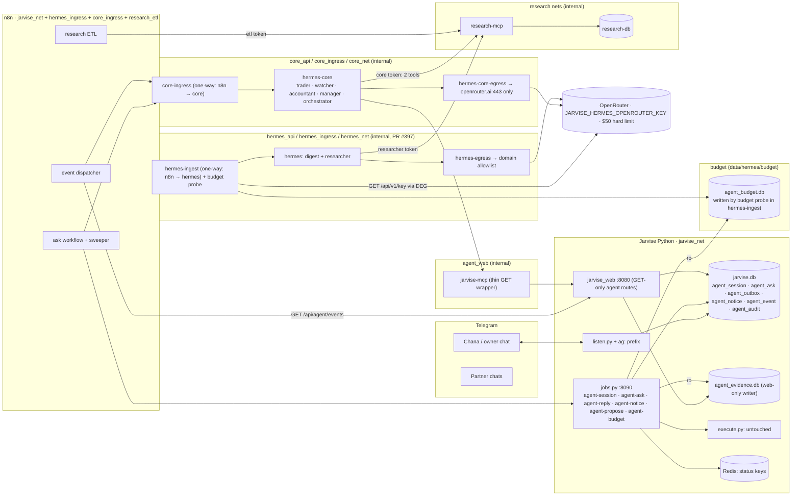
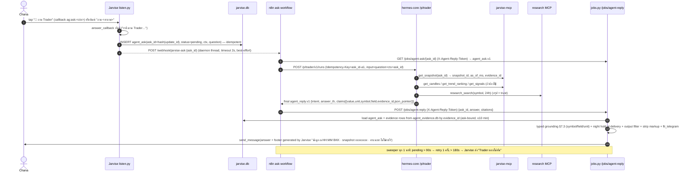
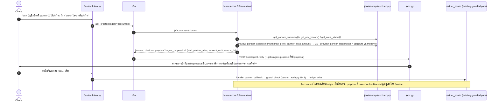

# Jarvise × Hermes Agent Team — Architecture v5.6 (DESIGN ONLY)

> **Status:** design only. Nothing in this document authorises any code, push, PR, VPS or `.env` action.
> **v5.6 (2026-11-27 12:11 ICT):** applies Chana's 12:11 approval, which fixes Codex r10 AC1 plus two wording items (budget section only; everything else unchanged). P0 implementation still waits for Claude's design review after 2026-11-30 02:00 BKK. Changelog: §18k.
> **v5.5 (2026-11-27 12:04 ICT):** applies Chana's 12:04 approval, which fixes Codex r9 AB1–AB3 (budget section only; everything else unchanged). P0 implementation does **not** start yet: it waits for Claude's design review after 2026-11-30 02:00 BKK. Changelog: §18j.
> **v5.4 (2026-11-27 11:54 ICT):** applies Chana's 11:54 approval, which fixes Codex r8 AA1–AA4. S-1 and the adjustable-settings rule are unchanged; the rule applies to Hermes numbers only. Codex delta review only; Claude reviews after 2026-11-30 02:00 BKK, and its safety review is still required before any phase merges. Changelog: §18i.
> **v5.3 (2026-11-27 11:25 ICT):** applies Chana's 11:25 decisions:
> - **S-1:** the no-hard-coded-numbers rule does **not** cover existing main trading constants. They stay as they are and are cited read-only (§7.11.4).
> - **v5.3 scope:** fixes Codex r7 Z1, Z2, Z3, Z4 and Z5, plus the remaining C3 and C9 items.
> - **Review:** Codex delta review only. Claude reviews after its reset (2026-11-30 02:00 BKK), and its safety review is still required before any phase merges.
>
> Changelog: §18h.
> **v5.2 (2026-11-27 11:05 ICT):** applies Chana's approval of v5.2: the merged must-fix list from `hermes-crosscheck-v5.1.md` (P0 blocker Y1/C2 freshness; C3, C7/Y4, Y5/C11, C1, C10; plus the follow-up, P1 and P2 items Y2/C4, C5, C12, Y3, C9, C6, C8 written into their phase contracts), and Chana's **standing rule**: every numeric value or % is an adjustable setting with a documented default, never hard-coded (§7.11 lists each one). Where v5.2 text and older text disagree, v5.2 wins. Changelog: §18g.
> **v5.1 (2026-11-27 10:41 ICT):** applies Chana's decision "ทำ v5.1 แก้ X1-X9 ใช้ชื่อคีย์ JARVISE_HERMES_OPENROUTER_KEY แล้วให้ Claude กับ Codex รีวิวคู่กัน" to the Codex r5 findings X1–X9 (`hermes-codex-review-v5.md`), restores v4's freshness definitions (N4), and fixes the key name (§7.8). Where v5.1 text and older v5 text disagree, the v5.1 text wins. Changelog: §18f.
> **Supersedes:** v5.5, v5.4, v5.3, v5.2, v5.1 and v5 (all kept unchanged) (`hermes-architecture-v5.1.md`, `hermes-architecture-v5.md`, kept unchanged) and v4. v5 applied Chana's decision of 2026-11-27 09:23 ICT ("ทำ v5 แก้ W1-W9 ใช้ค่าแนะนำของ Codex แล้วให้ Codex รีวิว ส่วน Trader spec แยกไปทำ v6") to the Codex r4 findings W1–W9 (`hermes-codex-review-v4.md`).
> **Out of scope:** the Trader strategy spec (which derived market rules the trader may use, its phrase set and its golden questions) is **v6**. v5 defines only the mechanism: derived-rule registry, joins, schemas and delivery.
> **Companions:** `hermes-brief-implementer-v5.6.md`, `hermes-brief-codex-v5.6.md`, `hermes-reviewer-sync-brief-v5.6.md`.
> **Numbers (standing rule, Chana 11:05):** every numeric value in this document that the design introduces (thresholds, caps, budgets, windows, times, counts, %) is the **documented default of a setting** listed in §7.11. Where a sentence shows a bare number, the §7.11 key with that default is meant. Existing Jarvise trading constants are listed in §7.11.4. Per S-1 (Chana 11:25) they are cited read-only from their real source and never copied into adjustable settings. Numbers in kept v1 Thai text, superseded rows and changelogs are historical; §7.11.6 maps each one that still describes behaviour to its key.
> **Precedence:** where kept v1 Thai text (§1–§3, §5 flows, §6 table, §13) disagrees with the English v2–v5 text, the English text and the "v3/v4/v5 patches" win. Repo facts were verified at `origin/main` 438e687 (schema 39) and PR #397 `origin/feat/hermes-stage-a` a5967aa.

## 0. TL;DR (v5.6; items 1–10 are v5, 11 = v5.1, 12 = v5.2, 13 = v5.3, 14 = v5.4, 15 = v5.5, 16 = v5.6)

1. **Runtimes and core (unchanged):**
   - Two Hermes runtimes (D-1). Each is reached only through a one-way ingress adapter.
   - Deterministic Jarvise core. Only Jarvise sends Telegram; there is no Hermes bot.
2. **Structured output, evidence-only (08:28 + 09:23):**
   - Agents emit typed JSON only. Jarvise renders all Thai.
   - **v5 removes opinion enums.** Every enum is either a typed evidence fact or derived by a registered pure rule.
   - Phrases declare **joins** (same entity, position, timeframe or bar, compatible units) and **typed basis roles**.
   - Each `reason_code` has a **predicate** over evidence.
3. **One discriminated envelope (W2):** `agent_output.v2`, with `source.type` ∈ `manual | ask | event`. It has an optional `proposal` block, typed claim values (number, enum, time, bool), unique and referenced claim ids, run binding, citation rules, and catalog rollover and revocation.
4. **Digest is covered too (W3):**
   - The PR #397 digest becomes structured: Hermes returns only `{url, day}` per item.
   - Jarvise renders each line from the source-policy **category** of the URL's domain and the day.
   - No agent-written titles or comments reach any owner display; `news_reaction` uses the category label only.
   - This lands in the PR #397 follow-up, before Stage C.
5. **Delivery liveness (W4):**
   - Policy holds are evaluated **before** an attempt is reserved, and held rows wake at their due time.
   - Each attempt carries a fencing token.
   - A new typed transport `send_message_ex` returns sent, rejected or ambiguous.
   - An attempt is used only by an actual transmission.
6. **Event acknowledgement (W5):**
   - `agent_event.seq` is monotonic and serves as the cursor.
   - A durable `agent_event_consumer` outcome is written in the same transaction as the notice or drop.
   - Restart checks the outcome before re-running.
7. **Exact SQLite sources (W6):**
   - Risk: `assist_settings` and `assist_quick_settings`/`assist_quick_config`.
   - Positions: `assist_watch_position`, labelled **initial** stop.
   - Rule constants come from a code registry.
   - Redis-held caps, `levels`, `r_now`, mark price, target and leverage are **removed** from agent evidence.
   - Null means unavailable.
8. **Budget reservations (W7):**
   - Every caller (digest, core, researcher) reserves a worst-case whole-run cost before admission: turns × (input cap + output cap) × price.
   - Admission requires `probe usage + settled since watermark + open reservations + this run ≤ the caller's ceiling`. Core and researcher are capped at $40; the digest at $50.
9. **Probe isolation (W8):** the key-info GET is enforced **in the probe client**, with a fixed URL and method and static tests. The proxy guarantees the host only.
10. **Order and gates:**
    - **Stage C is deferred until LearningYard RAM is measured** (09:23).
    - Doctrine search stays deferred.
    - P0 after the v5 contracts; P1 after OpenClaw removal.
    - 08:08-a/b/c, 08:28 and D-1…D-11 are kept.
11. **v5.1 repairs (Codex r5 X1–X9, Chana 10:41):**
    - **Key:** the agents OpenRouter key is **`JARVISE_HERMES_OPENROUTER_KEY`**. `JARVISE_HERMES_API_KEY` stays the existing adapter↔API-server password (PR #397), unchanged.
    - **Delivery (X1):** held rows move `held → queued` atomically at wake; blocked/stale replies are delivered as Jarvise templates; definite pre-flight non-sends are typed and consume no attempt; a crash after reservation counts as a possible send (no zero-send guarantee is claimed).
    - **Budget (X2):** atomic admission; single-use reservation bound to `(caller, run_ref, attempt)` and checked at ingress; liability held until the run is terminal **and** a probe read has covered it; enforced caps incl. reasoning tokens and SDK retries.
    - **Evidence (X3, X4, X6):** ordered time roles, position incarnation, proposal target joins, exact session-source equality; v4 freshness classes restored and checked on every used claim at validation and at send; exact columns for every snapshot source; the no-stop latch renders as a recorded warning with its reason.
    - **Digest (X5):** Jarvise writes the existing numbered markdown plus an atomic `items.json` sidecar with producer and category; `THEME_LABELS` covers every category.
    - **Events (X7):** the cursor walks existing rows (gaps safe); one named consumer with its own subscription.
    - **Manual (X8):** P0 manual-result endpoint and table, never sent.
    - **Docs (X9):** `after_seq`, ETL token, pure vs I/O sender split.
12. **v5.2 repairs (cross-check v5.1, Chana 11:05):**
    - **Freshness (Y1/C2, P0 blocker):** per-timeframe expected closed bar from `INTERVAL_MS` + a per-tf ingest lag setting; 4h analysis rows keep the existing `expected_analysis_bar_ms`; every derived-rule role declares its own freshness mode; every field declares what its timestamp means.
    - **Quick config (C3):** served from `get_quick_config` + `effective_quick_values` (effective values with `defaulted`/`clamped` flags); inactive A2 keys dropped.
    - **Position identity (C7/Y4):** `position_incarnation` uses `entry_time_ms` only; `same_observation` is mandatory for every position phrase; only observation-level identity is claimed.
    - **Compose (C1):** `${JARVISE_HERMES_OPENROUTER_KEY:-}`; the services fail closed on an empty key.
    - **Digest links (C10):** domain as link text; query and fragment stripped.
    - **Follow-up/P1/P2 contracts:** signed admission receipt (Y2/C4), provider-proven coverage (Y2/C12), cap proofs in the pin gate (C5), pre-HTTP send fence (Y3), sender details (C9), no-output event outcomes (C6), signal join key (C8).
    - **Settings (standing rule):** §7.11 registry; every design number is a setting with a default, range and owner.
13. **v5.3 repairs (Codex r7, Chana 11:25):**
    - **Z1:** freshness is checked **per use**. A claim used both directly and in a derived role must pass every applicable check.
    - **Z2:** the registry is complete:
      - research, reporting, testing, fixture and maintenance numbers;
      - named acceptance targets;
      - the digest defaults as the PR #397 values (8 items, 14 days);
      - cross-range checks.
    - **S-1:** existing trading constants are read-only references. That includes the main night hold `signals.py:110-114`, which the agent path now uses directly.
    - **Z3:** a reservation is held until coverage is **proven**: each rise in monthly usage is allocated once, oldest first, against full worst cases. There is no ratio-0 release.
    - **Z4:** the fence requires the actual remaining lease to exceed the HTTP timeout plus the margin.
    - **Z5:** terminal handling uses the effective attempt limit, including a limit of 1; `notsent_count` is in the table; a limit change mid-flight applies to the next reservation only.
    - **C3:** the flag projection is explicit.
    - **C9 and Y5/C11 leftovers:** fixed.
14. **v5.4 repairs (Codex r8, Chana 11:54):**
    - **AA3:** quick flags use the real `QuickConfigView.clamped_keys`/`defaulted_keys` (`quick_config.py:679-720`). A read-only key check detects config keys missing from storage. Flags are filtered to served fields. A missing-key fixture is added.
    - **AA4:** compose `${VAR:-N}` is allowed only where N equals the registry default, enforced by the equality test.
    - **AA1:** a cumulative aggregate release rule: a reservation is released only when usage since the period baseline covers all closed worst cases plus all unmatched usage. Otherwise the liability is kept. v5.3's "stays conservative" sentence is corrected, the residual is stated, and an unrelated-charge test is added.
    - **AA2:** `budget_probe_read` and `budget_allocation` tables, written in one transaction. A same-period usage drop raises an alert and earns no credit until usage passes the period high-water mark.
15. **v5.5 repairs (Codex r9, Chana 12:04; budget only):**
    - **AB1:** unmatched usage found after a release re-opens the shortfall as `restored_debt_usd` in the same transaction. The residual risk is now worded as "possibly undetectable, bounded by the provider hard limit".
    - **AB2:** admission uses the period high-water mark as its usage floor, and refuses new reservations while the latest reading is a drop.
    - **AB3:** unchanged usage creates no **new** credit, but rows that become eligible later may use credit already recorded. A maturity fixture is added.
16. **v5.6 repairs (Codex r10, Chana 12:11; budget only):**
    - **AC1:** a late discovery (unmatched usage belonging to an already-reset period) is charged to the **active** period's unmatched usage. The debt event records the old period, and debt is recomputed in the same transaction.
    - At reset, the new period's `restored_debt_usd` starts equal to the carried debt. Admission adds only the active period's `restored_debt_usd`, so nothing is counted twice.
    - **Wording:** a duplicate reading skips the whole operation; an `unknown` probe keeps all liabilities and never overrides an unresolved drop.

---
## 1. Hermes คืออะไรจริง ๆ (ยืนยันแล้ว)

**ยืนยันแล้ว:** "Hermes" ในที่นี้คือ **Hermes Agent** ของ Nous Research — https://github.com/NousResearch/hermes-agent (MIT), docs: https://hermes-agent.nousresearch.com/docs/ ไม่ใช่โมเดล Hermes-3/4 ตัวเดียว (Hermes Agent ใช้โมเดลไหนก็ได้)

| ความสามารถ | ข้อเท็จจริงจาก docs | แหล่ง |
|---|---|---|
| Profiles = agent หลายตัว | แต่ละ profile คือ Hermes home แยกกัน มี `config.yaml`, `.env`, `SOUL.md`, memory, sessions, skills, cron, state DB ของตัวเอง docs เตือนว่า "Never point two agent processes at the same profile" | `website/docs/user-guide/profiles.md` → https://hermes-agent.nousresearch.com/docs/user-guide/profiles |
| รันหลาย gateway | มี 2 แบบ: gateway แยกตาม profile หรือ **multiplexing gateway** process เดียวที่รับทุก profile (`gateway.multiplex_profiles: true`, route ด้วย bot token ของแต่ละ profile หรือ URL prefix `/p/<profile>/`, `profile_routes`) | `user-guide/multi-profile-gateways.md` |
| Subagents | `delegate_task` spawn child agent ที่มี context แยก ทำ parallel batch ได้ มี `output_schema` (structured output), model override ("frontier planner, inexpensive workers") และส่งรูปให้ child ได้สูงสุด 8 รูป | `user-guide/features/delegation.md` |
| Multi-agent handoff | **Kanban**: board ที่ durable บน SQLite แชร์ข้าม profiles worker แต่ละตัวเป็น OS process มี idempotent create สำหรับ webhook/automation | `user-guide/features/kanban.md` |
| Skills | progressive disclosure, `SKILL.md`, เข้ากับ agentskills.io ได้, agent สร้าง/ปรับ skill เองได้ ปิดด้วย `skills.write_approval` | `user-guide/features/skills.md`, `features/memory.md` |
| Memory | memory/user profile แบบถาวร, `session_search` ควบคุมได้ด้วย `write_approval` | `user-guide/features/memory.md` |
| MCP client | stdio + HTTP (+OAuth, mTLS, header) กรอง tool ต่อ server ด้วย `tools: include/exclude` (glob ได้) มี catalog entry ของ **n8n official MCP** | `user-guide/features/mcp.md` |
| Cron | `/cron`, CLI และภาษาธรรมชาติ ตั้ง **timezone ต่อ job** ได้ มี skill-backed jobs, catch-up window, alert เมื่อ fail และ **script-only (no-LLM) mode** | `user-guide/features/cron.md`, `guides/cron-script-only.md` |
| Webhooks (inbound) | HTTP adapter port 8644 ตรวจ HMAC แล้วแปลง payload เป็น prompt และ route คำตอบไปยัง platform | `user-guide/messaging/webhooks.md` |
| API server | OpenAI-compatible บน port 8642 ได้แก่ `/v1/chat/completions`, `/v1/responses` และ **Runs API `/v1/runs`** (stream events, stop, approval) มี **Idempotency keys** และ Jobs API | `user-guide/features/api-server.md` |
| Telegram | gateway เต็มรูปแบบ (inline keyboard สำหรับ `clarify`, webhook mode, voice, allowlist/DM pairing) | `user-guide/messaging/telegram.md` |
| Models | Nous Portal, OpenRouter, Anthropic, OpenAI/Codex, xAI, z.ai, Kimi, MiniMax, Qwen, custom endpoint และอื่น ๆ สลับด้วย `hermes model` | `integrations/providers.md` |
| Security | dangerous-command approval, hardline blocklist, protected paths, container isolation, allowlist, env passthrough | `user-guide/security.md` |
| Docker | image `nousresearch/hermes-agent`, `gateway run`, ข้อมูลอยู่ที่ `/opt/data` ห้ามรัน gateway 2 ตัวบน data dir เดียวกัน | `user-guide/docker.md` |
| Migration | `hermes import-agent openclaw` (นำเข้า skills/memory จาก OpenClaw ได้) | README |

**ข้อสังเกตที่มีผลต่อการออกแบบ**
- Hermes มี toolset ทั่วไปติดมาตั้งแต่ต้น (terminal, file และ code execution) ดังนั้น **ต้องปิด toolset ที่ไม่ใช้** ใน profile trader/accountant/watcher ให้เหลือแค่ MCP tools ของเรา และรันใน container
- Memory และ skill ที่ agent เขียนเองได้เสี่ยงต่อการ "จำตัวเลขเก่า" ให้ตั้ง `write_approval` และกฎใน `SOUL.md` ว่า **ห้ามจำยอดเงิน/ราคา/position** ใน memory
- n8n ฝั่ง AI: MCP Server Trigger (n8n เป็น MCP server), MCP Client / MCP Client Tool (n8n ใช้ MCP ภายนอก) และ AI Agent node — https://docs.n8n.io/integrations/builtin/core-nodes/n8n-nodes-langchain.mcptrigger/, https://docs.n8n.io/integrations/builtin/cluster-nodes/sub-nodes/n8n-nodes-langchain.toolmcp/, https://docs.n8n.io/build/integrate-ai/mcp-servers. Queue mode ใช้ Redis + workers ถ้ารัน MCP Trigger กับ webhook replicas หลายตัว ต้อง route `/mcp*` ไป replica เดียว (หน้า MCP Trigger, Limitations) **ไม่แนะนำ queue mode ตอนนี้**: n8n ตัวเดียวพอ เพราะ job หนักอยู่ใน Jarvise `jobs` แล้ว
- **เราไม่ใช้ n8n AI Agent node เป็น agent หลัก** (จะได้ไม่มี agent สองระบบ) n8n ทำ glue เท่านั้น

---


> **v2 note:** this table reflects upstream docs at commit `443ad893`. The runtime pin is v0.23.4 (PR #397). Every feature used by this design must pass the §12 **Pin gate** before use. The `hermes import-agent openclaw` row is used only with `--dry-run` and manual review (§12 PR track).

---

## 2. สิ่งที่มีอยู่แล้วใน Jarvise (reuse และห้ามเขียนซ้ำ)

| บทบาทที่ขอ | ของที่มีอยู่ (file:line @438e687) | ใช้ซ้ำอย่างไร |
|---|---|---|
| Telegram bot | `src/jarvise_assist/listen.py:1` long-poll listener; `process_update` :92; route callback ตาม prefix :115-170 (`pa:` → `partner_admin.handle_partner_callback` `partner_admin.py:2000`, `qs:`, `qc:`, `qk:`, `risk:`); เริ่มจาก `jarvise/jobs.py:1198` | เพิ่ม prefix ใหม่ `ag:` (ask) เท่านั้น Bot token อยู่ที่ Jarvise ที่เดียว |
| Scheduler | `jarvise/jobs.py` HTTP server, routes :1060-1079, auth `X-Jarvise-Token` `_authorized` :1094 (**fail-open ถ้า token ว่าง**), `single_flight` :265, publish `jarvise:<job>:last` ไป Redis :140 | n8n เรียก jobs เหมือนเดิม Hermes **ห้าม**เข้าถึง jobs/Redis |
| n8n | `docker-compose.yml:52-91` (n8n 2.40.0, jarvise_net + openclaw_net); workflows `infra/n8n/workflows/*.json` เช่น `jarvise-assist-watch.json` = cron `*/5` → `POST http://jobs:8090/jobs/assist-watch` | เป็น dispatcher ของ event bus และ Trader ask flow |
| Watcher | `watch.py` `run_assist_watch` :1421, `PROGRESS_R_LEVELS` :104, `flush_held_watch_advice` :1229; night hold `signals.py:110-114` (23:30-07:30 BKK); cadence `sizing.py:26-27` (`ASSIST_HOURS` 0,4,…,20 นาที 25) | Watcher agent **ไม่**คำนวณ alert เอง แค่ตรวจว่า job รันตรงเวลา และสรุปให้อ่าน |
| Signals (Main) | `signals.py` `scan_signal_candidates` :334, `run_assist_signals` :503, `run_assist_morning` :657, `_strip_secrets` :117; job `jobs.py:480` | Trader อ่านผลอย่างเดียว ห้ามแก้ rule |
| Sizing/risk | `sizing.py`: `MAX_LEVERAGE=5` :16, `TARGET_R=2` :19, `MAX_OPEN_IDEAS=2` :20, `portfolio_risk_cap_pct` :454; `quick.py` `RISK_ALLOWED` :45; `quick_config.py` `quick_risk_pct` :21/:705; `pause.py` `WEEK_LOSS_R` :24, `DAY_LOSS_CAP_R` :25, `TRANSFER_INCOME_TYPES` :32 | ตัวเลขทั้งหมดมาจาก snapshot ห้ามให้ LLM คำนวณ size |
| Trend/ranking | `trend_view.py` `build_trend_rows` :181, `fit_telegram` :386 | เปิดเป็น read tool `get_trend_ranking` |
| Charts | `jarvise/charts.py` `render_candle_svg` :41, `export_candle_graphs` :96 | Researcher ใช้ render chart แบบ deterministic |
| Ingest/DB | `jarvise_ingest/db.py` `MIGRATIONS` :2072 (39 migrations), `SCHEMA_VERSION` :2113, `migrate` :2116; providers `binance_klines.py`, coingecko, coinglass, fng ฯลฯ | migration ใหม่ใช้เลข N ถัดไปตอน build ห้าม assume |
| RAG | `jarvise/rag.py` `COLLECTION="jarvise_doctrine"` :21, MiniLM-L6-v2 :22, `doctrine_snippets` :588; web `/api/doctrine/query` `app.py:1216` | Trader ใช้ doctrine เดิม Research store แยกต่างหาก |
| News | `jarvise_context/news_sources.py` `fetch_gdelt` :231, `fetch_headlines` :293; `news_reaction.py` | Researcher ใช้ต่อ (เป็น T3 source) |
| Web API | `jarvise_web/app.py`: HTTP Basic `require_auth` :175 (**fail-open ถ้า env ว่าง** :178), `/metrics` :700 (ไม่มี auth), `/api/status` :720, `/api/paper` :761, `POST /api/risk/caps` :1424 (write) | endpoint ใหม่ใช้ token แยกแบบ fail-closed ห้ามเปิด POST เดิมให้ agent |
| Partner ledger | `partner_ledger.py` `nav` :126, `plan_deposit` :182 … `plan_owner_redeem` :326, `plan_owner_deposit` :370 (pure planners); `partner_store.py` `MIN_DEPOSIT_USDT` :54, `_REQUEST_KINDS` :55; `partner_admin.py` owner confirm `pa:oy:` :43 | Accountant เรียก planner แบบ **preview** (ไม่ persist) ส่วนการเขียนทำผ่าน `partner_admin` เดิมเท่านั้น |
| Partner audit | `partner_audit.py` grace :41-44, `run_partner_audit_job` :939, `guard_check` :1143; เรียกใน morning job `jobs.py:588-600` | Accountant รายงานสถานะ reconciled/unreconciled |
| Agents เดิม | `openclaw` container `docker-compose.yml:227-271` (**mem 4g**), `config/openclaw/openclaw.json` (doctrine_judge, heartbeat_ingest, quant_analyzer, context_digest, paper_sandbox — description บอกว่า "ยังไม่เชื่อมต่อ"); skills `plugins/jarvise-openclaw/skills/*` (มี `jarvise-order-router` ห้าม port) | Hermes มาแทน OpenClaw (decision D1) ใช้ `hermes import-agent openclaw --dry-run` ก่อน |
| MCP เดิม | `mcp/jarvise-mcp.json.example` (redis, qdrant, n8n, tradingview, coingecko, openclaw) | **ห้ามให้ Hermes ใช้ redis MCP** (เขียนได้) TradingView/CoinGecko ใช้ได้กับ Researcher เป็น research overlay |
| Compose/keys | `jobs` ถือ `BINANCE_TRADE_*` และ `TELEGRAM_BOT_TOKEN` (`docker-compose.yml:201-206`); `web` ถือ `BINANCE_API_*` (read) :317-320; prod bind Tailscale `docker-compose.prod.yml` | Hermes/n8n/jarvise-mcp **ไม่มี** Binance key ใด ๆ |

---

## 3. หลักการ (Principles)

1. **Deterministic core:**
   - ยอดเงิน, NAV, units, size, risk %, stop/target, signal rule, night hold และ order ทั้งหมดอยู่ใน Jarvise Python
   - LLM ได้รับตัวเลขที่คำนวณเสร็จแล้วจาก tool เท่านั้น
   - ทุกตัวเลขที่ LLM พูดต้องมาจาก tool result (grounding check ข้อ 7.4)
2. **Read by default:**
   - Hermes ไม่มี write path ไปยัง Jarvise เลย
   - การกระทำทุกอย่างเป็น *proposal* ที่ Jarvise แสดงเป็นการ์ด แล้ว Chana กดยืนยันผ่าน guarded path เดิม
3. **n8n = glue ไม่ใช่สมอง:** schedule, webhook, retry, fan-out, ETL ง่าย ๆ และส่งต่อคำตอบ ไม่มี business logic ใน n8n
4. **One sender:** ข้อความ Telegram ถึง Chana ส่งจาก Jarvise เท่านั้น (quiet rules, `fit_telegram`, footer)
5. **Agents are optional:** ถ้า Hermes/n8n ล่ม Jarvise ต้องทำงานเหมือนวันนี้ทุกอย่าง (signals, watch, partner) agent เป็นชั้น advisory ที่ถอดออกได้
6. **Hard rules (ห้ามเปลี่ยน)** อยู่ในข้อ 9

---


## 4. Component diagram (v3; v4 adds no services: heartbeat/catalog live inside jobs/web)



**Network membership (authoritative list in §10):**
- Ingress adapters are one-way: they accept requests from n8n and forward them to their gateway; the gateway cannot open connections to n8n.
- `jarvise-mcp` sits only on `agent_web` (with `web`) and `agent_api` (with `hermes-core`). It is **not** on `jarvise_net`.
- `research-db` shares a network only with `research-mcp`.

---
## 5. Sequence flows (v1 text, v2-patched; the v3/v4/v5 patches at the end of this section override the diagrams, incl. payload names)

### Flow 1 — ปุ่ม "🤖 ถาม Trader" บน Telegram



ข้อสำคัญ:
- listener ต้อง **ไม่ block**: insert แล้วยิงแบบ fire-and-forget ใน daemon thread เท่านั้น
- คำตอบเป็น **text อย่างเดียว ไม่มีปุ่ม** ถ้าจะเข้าไม้ Chana ใช้ flow เดิมของ Jarvise (Quick/Main card)

### Flow 2 — candle close → Watcher → alert

```mermaid
sequenceDiagram
  autonumber
  participant N as n8n cron (existing)
  participant J as jobs.py
  participant W as watch.py / signals.py
  participant DB as jarvise.db
  participant D as n8n dispatcher
  participant H as hermes-core /p/watcher
  actor C as Chana

  N->>J: POST /jobs/assist-watch (*/5) และ /jobs/assist-signal (หลัง paper-run บน 4h)
  J->>W: run_assist_watch / run_assist_signals (deterministic, single_flight)
  W->>C: Telegram alert (ทางเดิม: เคารพ night hold และ quiet rules)
  J->>DB: INSERT agent_event(event_id, type=watch.alert|signal.created, signal_id, payload_ref) — ระดับ job wrapper เท่านั้น
  D->>J: GET /api/agent/events?consumer=n8n_notice&after_seq=<cursor> (v5.2: served by web; every events_poll_interval_s, default 60 s)
  D->>H: POST :8644/webhooks/watcher (HMAC, event) — เฉพาะ type ที่ subscribe
  H->>H: (no-LLM) ตรวจ timing/ซ้ำ/ขาด → ถ้าผิดปกติ: สรุป 1-2 บรรทัด
  H-->>D: {action:"none"} หรือ {action:"notify", text, severity}
  D->>J: POST /jobs/agent-notice (agent_notice.v1, kind=watch_note) → Jarvise ส่ง (หรือเก็บรวมเป็น digest)
```

ส่วน Watcher health: Hermes cron แบบ **script-only** ทุก 5 นาทีอ่าน `GET /api/agent/health` (อายุของ `jarvise:<job>:last` แต่ละตัว)
- job ไหนเกิน 2× cadence → alert ผ่าน Jarvise
- ถ้า Jarvise web ล่ม: **ไม่มี** Hermes fallback bot (D-7 v2). Jarvise `ops_watch`/heartbeat เดิมเป็นตัวแจ้ง

### Flow 3 — Accountant query / partner action



---


**v3 patches to §5** (override the flows above where they differ):
- **Flow 1:**
  - Before the run, n8n calls `POST /jobs/agent-session/open {kind:ask, profile:trader, ask_id}` and gets `session_id`. The run goes to `hermes-core` **via `core-ingress`** with the `session_id` in the input; jarvise-mcp sends `X-Agent-Session` on every GET.
  - **v4:** the reply is `agent_output.v2` (typed claims + phrase items; no prose, §7.3). `POST /jobs/agent-reply` validates atomically and queues a structured outbox row. The outbox rechecks night/freshness/settings at send time and renders Thai from the phrase catalog (§7.4); at night, the template + verified `night_facts`.
  - n8n closes the session. Sweeper semantics follow §7.4 (retry only after a confirmed terminal run).
- **Flow 2:**
  - `GET /api/agent/events` is served by **`jarvise_web`** (n8n calls web, not jobs).
  - The webhook goes through `core-ingress`; a notice session is opened first.
  - **v5:** the notice session is bound to the `event_seq`. `POST /jobs/agent-notice` carries `agent_output.v2` (`source.type=event`, `event_seq`) with no agent-chosen kind; Jarvise derives kind/class from the event type (§7.6). The cursor advances only after the session closes (§7.4).
  - **No Hermes cron:** stale-job detection is deterministic in Jarvise (`job.stale` events from the ingest-health wrapper, P2). The paragraph above about a script-only Hermes cron is superseded.
- **v5:** every payload is `agent_output.v2` (§7.3.2). Events are addressed by `event_seq`, with a durable consumer outcome (§7.6). Every run is preceded by `POST /jobs/agent-budget/reserve` (§7.8).
- **Flow 3:** the preview is a GET with `target_ref`. **v4:** proposals are an `agent_output.v2` `proposal` block with `reason_code` (no Thai). Proposals attach only to an existing pending item of the matching kind (`pa:dy`/`pa:ry`/`pa:oy`, §7.4.1, 08:08-b). Ledger writes stay in those handlers.

## 6. Agent แต่ละตัว

ตาราง model tier ใช้ OpenRouter key ที่แยกจาก Jarvise (มี budget ของตัวเอง) ชื่อโมเดลอ้างจาก `config/openclaw/openclaw.json` ปัจจุบัน และปรับได้ด้วย `hermes model`

| Agent (Hermes profile) | หน้าที่ | Skills (Hermes `SKILL.md`) | Tools (MCP, include-list) | สิทธิ์ | Memory | Model tier |
|---|---|---|---|---|---|---|
| **trader** | ตอบคำถามจากปุ่ม "ถาม" อธิบาย setup/trend/pattern และ risk ของ position ที่เปิดอยู่ แนะนำ entry/exit โดยอิง plan ที่ Jarvise คำนวณ | `candle-reading`, `trend-structure`, `chart-patterns` (อธิบาย pattern จาก features ที่ deterministic detector ให้), `entry-exit-doctrine` (port จาก OpenClaw `jarvise-signal-analyzer`/`jarvise-doctrine-rag`), `risk-explainer` (อธิบาย 3%/0.5%/5x/2R/night hold ไม่เสนอให้เปลี่ยน), `backtest-reader` | jarvise-ro: `get_snapshot`, `get_candles`, `get_indicators`, `get_trend_ranking`, `get_signals`, `get_watch_state`, `search_doctrine`, `get_chart` (v2; `get_paper_metrics`/`run_frozen_replay` deferred) · research: `research_search`, `research_get_chart` | **read** | preferences + lessons เท่านั้น ห้ามเก็บราคา/ยอด/position, `write_approval: true` | Strong: `anthropic/claude-sonnet-5` (v2: no automatic fallback) |
| **researcher** | ดึงข่าวและข้อมูลจากแหล่งน่าเชื่อถือ สรุปผลกระทบรายเหรียญ เก็บ chart ที่ agent อื่นขอ และตอบ `research_search` | `source-trust`, `news-impact`, `chart-capture`, `dedup-discipline`, `injection-hygiene` | research (rw ใน research-db เท่านั้น): `research_put_doc`, `research_put_chart`, `research_link`, `research_search` · no jarvise-mcp access (v2: researcher runs in `hermes`); charts come from n8n ETL via `GET /api/agent/chart` → `research_put_chart` · Hermes `web` toolset via allowlisted proxy; CoinGecko/TradingView MCP only if baked into the image and on the egress allowlist | **write เฉพาะ research-db**, read Jarvise | source notes | Cheap: `deepseek/deepseek-v4.1-flash` สำหรับ extraction; `google/gemini-3.8-flash` for summaries (v3: no image input) |
| **watcher** | เฝ้าเวลา: job รันตรงเวลาหรือไม่, candle close, night hold, หมดอายุของ Quick registration, ความสดของ ingest; สรุปเหตุผิดปกติ | `timing-sla`, `night-hold-rules` (อ่านอย่างเดียว) | jarvise-ro: `get_health`, `get_events`, `get_watch_state`, `get_snapshot` | **read** | none (stateless) | v3: no Hermes cron (Jarvise `job.stale` events); summary ใช้ `z-ai/glm-5.3-flash` |
| **accountant** | รายงาน NAV, units, ยอด partner, fee, สถานะ audit/unreconciled; จำลอง (preview) การฝาก/ถอน/ปิด; เตรียม proposal | `partner-ledger-explainer` (อิง ledger design), `proposal-format`, `no-money-movement` | jarvise-acct: `get_partner_summary`, `get_nav_history`, `get_audit_status`, `preview_partner_action` | **read + propose** (proposal ไปทาง n8n → Jarvise card) | none สำหรับตัวเลข; จำ format ที่ Chana ชอบ | Mid: `deepseek/deepseek-v4-pro` (คำอธิบายเท่านั้น ตัวเลขมาจาก tool) |
| **manager** | ดูแล scope ทั้งโปรเจกต์: Kanban board, weekly scope report, ตรวจ phase gate, จับ scope creep, ติดตาม decision ที่รอ Chana | `phase-gates`, `scope-guard`, `weekly-report` | Kanban tools, jarvise-ro `get_health`, research `research_search` (อ่าน), อ่าน docs (read-only mount `docs/`) | **read** + Kanban write | project decisions | Strong (ใช้น้อย): `anthropic/claude-sonnet-5` (v3: Opus unverified, not used) |
| **orchestrator** | รับคำถาม free-text ที่ไม่ชัดว่าเป็นของใคร แล้ว route ไป agent ที่ถูก (delegate_task / Kanban) ไม่อยู่ใน hot path ของ event | `routing-table` | `delegate_task`, Kanban | none | routing lessons | Cheap: `deepseek/deepseek-v4.1-flash` |

**Orchestrator จริง ๆ คือ 3 ชั้น ไม่ใช่ LLM ตัวเดียว:**

| งาน | เจ้าของ |
|---|---|
| State, เงิน, risk, signal, ledger, Telegram ถึง Chana | **Jarvise Python** |
| เวลา (cron), webhook, retry, fan-out, ETL ง่าย, cursor ของ event | **n8n** |
| เหตุผล ภาษา สรุป ค้นคว้า รายงาน การส่งงานระยะยาว (Kanban) | **Hermes** |
| route คำถาม free-text ที่กำกวม | Hermes `orchestrator` (ราคาถูก) |


**v2 runtime assignment and toolsets** (overrides the v1 Thai text):
- `hermes` runtime: **researcher** (plus the PR #397 digest).
- `hermes-core` runtime: trader, watcher, accountant, manager, orchestrator.
- Per-runtime toolsets are in §10. The orchestrator's `delegate_task` works only inside hermes-core; core→researcher goes via n8n/research-mcp.
- Model IDs: Researcher verified all listed IDs exist on OpenRouter (2026-11-27). Pin exact IDs in each profile, with no `~latest` aliases, no `openrouter/auto` and no silent fallback (`fallback_providers: []`). All profiles use `JARVISE_HERMES_OPENROUTER_KEY` (§7.8).

**v3 patches to §6:**
- **Manager:** `anthropic/claude-sonnet-5` (Opus is not on the Researcher-verified list and is not used).
- **Researcher:** `google/gemini-3.8-flash` for summaries only (no image input; charts are features JSON).
- **Watcher:** stateless summariser on `z-ai/glm-5.3-flash`. No Hermes cron; deterministic `job.stale` events come from Jarvise (P2).
- **Trader tools (v5):** P0 has **6** (`search_doctrine` deferred; no `get_trend_ranking` unless a persisted source exists); +`get_events` P2 = 7; +`get_chart` P3a = 8; accountant 4.
- **v5:** no opinion enums. Trader market-structure rules and phrases are v6 scope.
- **v4: no agent writes user-facing text.** Every output is typed JSON (`agent_output.v2`); Jarvise renders Thai from the phrase catalog (§7.3). Skills teach the profile to pick phrases and claims, not to write sentences.
- **v4:** `search_doctrine` is deferred (it needs jobs + Qdrant, §7.1); trader rule explanations use catalog `rule` phrases.


---

## 7. Integration contracts (v4: v3 §7 with §7.1–7.8 changes for Chana 08:28 and V3–V8)

### 7.0 IDs and naming
| ID | Definition |
|---|---|
| `signal_id` | `"{strategy}:{SYMBOL}:{tf}:{candle_close_ts_ms}"`; strategy ∈ `main\|quick\|paper\|explore`; tf ∈ `15m\|1h\|4h\|1d` |
| `event_seq` | v5: `agent_event.seq` (monotonic INTEGER; the cursor and the notice `source` key) |
| `event_id` | `sha256(type\|signal_id-or-subject\|discriminator)[:32]` hex; `INSERT OR IGNORE` |
| `correlation_id` | ULID created at the origin (ask, event, cron run), carried on every hop |
| `ask_id` | `"ask_" + sha256(f"{chat_id}:{update_id}")[:16]` |
| `session_id` | `"ss_" + ULID`, issued by jobs when n8n opens a session (§7.2); field `kind` ∈ `manual\|ask\|notice` |
| `notice_id` | `"nt_" + sha256(kind\|correlation_id\|discriminator)[:16]` |
| `message_id` (outbox) | `"om_" + sha256(source_id + "\|" + purpose)[:16]`; `source_id` = ask_id or notice_id; purpose ∈ `reply\|blocked\|expired\|busy\|night\|budget\|notice\|proposal` (outbox only) |
| `snapshot_id` | full hex `sha256(canonical_json(snapshot_without_snapshot_id))`; display = first 8 |
| `evidence_id` | `"ev_" + ULID`, issued by web |
| `catalog_version` | `"pc<N>"`; the file hash is stored separately as `catalog_sha256` in `agent_catalog` (§7.3.1) |
| `settings_version` | v5.1: `sha256(canonical(assist_settings{risk_pct, enabled}, assist_quick_settings{risk_pct, cap_pct, day_max_loss_r, streak_lock_n, locked_until_ms}, quick_effective values + quick_flags (v5.2, C3), constants_registry_version))[:16]` (v5.2: the `assist_quick_settings` part is `{day_max_loss_r, streak_lock_n, locked_until_ms}` plus the effective values); SQLite only (no Redis caps); computed by one shared pure function in web (serve time) and jobs (send time) |
| `position_incarnation` | v5.2 (C7/Y4): `sha256(symbol\|position_side\|entry_time_ms)[:16]`, computed by web from the `assist_watch_position` row. `entry` is **not** included (it changes on same-side adds, `watch.py:446-448`). `entry_time_ms` is preserved by `COALESCE` (`store.py:932`) and reset on close or side flip (`watch.py:444-451`). NULL `entry_time_ms` → incarnation `unavailable`. **Claim limit:** this is an observation-level fingerprint, not a guaranteed lifetime id; a close and reopen inside one watch interval is invisible to main and therefore to agents |
| `reservation_id` | v5.1 (X2): `"br_" + ULID`, issued by jobs; UNIQUE `(caller, run_ref, attempt)`; single use |
| `consumer` | v5.1 (X7): event-consumer name; v5.1 defines exactly one, `n8n_notice` |
| `admission_receipt` | v5.2 (Y2/C4): `base64url(payload) + "." + HMAC-SHA256(JARVISE_BUDGET_RECEIPT_KEY, payload)`, payload = `{reservation_id, caller, destination, profile, run_ref, attempt, caps_hash, exp_ms}`; issued by `claim`, verified by the destination adapter (§7.8) |
| signal join key | v5.2 (C8): stored `assist_signal.id` (`as_<uuid16>`, `store.py:526,596`). `signal.created` events carry that stored id in `payload.ref`; the §7.0 composite `signal_id` format applies only to scan-level ids and is never joined to `assist_signal` |
| proposal `idempotency_key` | `sha256(agent\|kind\|partner_alias\|target_ref\|bkk_date)`, where `target_ref` is the existing request id or owner token (§7.4 P4) |

Canonical snapshot keys: `open_positions`, `quick_registrations`.

### 7.1 Read API (`jarvise_web`): GET only, read-only sources
- **Flag:** `JARVISE_AGENT_API` (off → 404).
- **Auth:** Bearer `JARVISE_AGENT_READ_TOKEN` (scope read) / `JARVISE_AGENT_ACCT_TOKEN` (scope acct ⊇ read). Fail-closed (empty → 503). Never Basic or the jobs token, never `require_auth` (`app.py:175-178`).
- **DB:** `jarvise.db` via `file:…?mode=ro`, with a `set_authorizer` that denies `SQLITE_READ` on `partner_kyc%`. Static CI gate: no `partner_kyc` string in agent modules.
- **v4 (V6): the Hermes path makes no HTTP call to jobs and no Redis read.** Agent routes read only SQLite (`jarvise.db` `mode=ro`, `agent_evidence.db`) and pure in-process computation.
- **No agent route triggers computation that can reach the network or a trade/futures client.** In particular, routes never call `scan_signal_candidates` (`signals.py:334`; its producer path calls futures at :347), `run_assist_*`, or `build_trend_rows` with a live scan result (`trend_view.py:181` needs a scan `result`).
- **Mandatory session headers:** every agent route requires `X-Agent-Session` (§7.2); missing → 400; not the open session for this profile → 409.

| Endpoint | Scope | Read-only source (implementer verifies on base; stop if it needs network or computation) | Phase |
|---|---|---|---|
| `GET /api/assist/snapshot` | read | allowlist serializer over the exact SQLite sources below (v5) | P0 |
| `GET /api/agent/candles?symbol&tf&limit` | read | jarvise.db closed candles | P0 |
| `GET /api/agent/indicators?symbol&tf` | read | `jarvise_ingest/indicators.py` over stored candles (pure computation from DB rows only) | P0 |
| `GET /api/agent/signals?since_ms` | read | stored signal rows + `signal_id` | P0 |
| `GET /api/agent/watch` | read | stored watch positions (no order ids) | P0 |
| `GET /api/agent/health` | read | **v4: SQLite only.** New table `agent_job_heartbeat(job PK, last_run_ms, last_ok_ms, status, updated_at_ms)`, written best-effort by the same `jobs.py` wrappers that publish `jarvise:<job>:last`. No Redis read (supersedes §16 Q3 for the agent path; dashboards keep Redis). Missing/old row → `unknown` | P0 |
| `GET /api/agent/doctrine?q` | read | **v4: deferred.** `fetch_doctrine` (`app.py:490-501`) calls jobs over HTTP (jobs owns the embedder + Qdrant). Possible later: a doctrine mirror in `research-db` filled by ETL (P3a, separate decision) | deferred |
| `GET /api/agent/events?consumer&after_seq&limit` | events token (n8n) / read via MCP with session | `agent_event`, filtered to the consumer's subscribed types (§7.6) | P2 |
| `GET /api/agent/trend` | read | **only a persisted ranking** written by an existing job. If none exists on the base, `get_trend_ranking` stays deferred (no scan from a route) | deferred → P1 if a persisted source is confirmed |
| `GET /api/agent/chart?symbol&tf&limit` | read (session) / ETL token (no session) | closed candles → `chart_features.py` (new pure detector, §7.5) → `{params, svg_sha256, features}` | P3a |
| `GET /api/agent/chart.svg?symbol&tf&limit&close_ts` | read | deterministic re-render via `charts.render_candle_svg` (`charts.py:41`); sha must equal `svg_sha256` | P3a |
| `GET /api/agent/partner/summary`, `/nav-history`, `/audit-status` | acct | aggregates by alias | P4 |
| `GET /api/agent/partner/preview?kind&partner_alias&target_ref&amount_usdt` | acct | pure `partner_ledger.plan_*` over `mode=ro` rows. No transaction, no write | P4 |

Snapshot allowlist (`snapshot_allowlist.py`; **v5.1, X6: exact tables, columns and types**, verified at `origin/main` 438e687 in `src/jarvise_ingest/db.py`; the implementer re-verifies on its base and **stops** on any difference, never substitutes):

| Key | Source table and columns (type) | Filter | Freshness class |
|---|---|---|---|
| `schema_version`, `snapshot_id`, `as_of_ms` | computed | n/a | n/a |
| `settings_version` | §7.0 shared function | n/a | setting |
| `assist{risk_pct, enabled}` | `assist_settings` (`db.py:1695`): `risk_pct REAL` → number %, `enabled INTEGER` → bool | `id=1` | setting |
| `quick_effective{risk_used, counter_used, combined_risk_warn_pct, tp1_r, tp1_close_pct, same_side_cap}` + `quick_flags{defaulted[], clamped[]}` | v5.2 (C3): `effective_quick_values(get_quick_config(conn))` (`quick_config.py:693` "Read all keys with defaults and clamps. No writes", and `:755`), executed on the `mode=ro` connection. `risk_used = min(quick_risk_pct, quick_risk_cap_pct)` and `counter_used` are the values Jarvise enforces. Each value carries flags per the **v5.4 quick-flag projection** directly below this table (AA3). `lev_used` and leverage keys are **not** served | n/a | setting |
| `quick_lock{day_max_loss_r, streak_lock_n, locked_until_ms}` | `assist_quick_settings` (`db.py:670`) plain SELECT: REAL → number R, INTEGER → number count, INTEGER ms → time (null → `unavailable`) | `id=1` | setting |
| ~~`quick_config{…}`~~ | v5.2 (C3): removed. Raw `assist_quick_config` rows are not served; the effective values above replace them. The A2 keys (`quick_time_stop_candles`, `quick_time_stop_min_r`, `quick_be_offset_pct`, `quick_auto_be_time`; "A2 ยังไม่ใช้", `quick_config.py:337-381`) are never served | n/a | n/a |
| `open_positions[…]` | `assist_watch_position` (`db.py:1649`): `symbol TEXT`, `position_side TEXT`, `side TEXT`, `entry REAL`, `qty REAL`, `initial_stop REAL NULL`, `initial_stop_source TEXT NULL`, `entry_time_ms INTEGER NULL`, `no_stop_latched INTEGER`, `last_seen_ms INTEGER`, `signal_id TEXT NULL`; plus computed `position_incarnation` (§7.0) and `stop_warning` (below) | `closed_at_ms IS NULL` | live by `last_seen_ms` |
| `quick_registrations[…]` | `assist_quick_registration` (`db.py:692`): `id TEXT`, `symbol TEXT`, `side TEXT CHECK long\|short`, `planned_entry REAL`, `planned_stop REAL`, `qty REAL`, `created_at_ms`, `expires_at_ms` | `status='open' AND expires_at_ms > now` | live by `created_at_ms` within its TTL; `history` otherwise (not served) |
| `signals[…]` | `assist_signal` (`db.py:1727`): `id TEXT` (= the stored signal id `as_<uuid16>`, the v5.2 join key, §7.0), `symbol TEXT`, `side TEXT`, `entry REAL`, `stop REAL`, `target REAL`, `qty REAL`, `status TEXT`, `created_at_ms`, `expires_at_ms`. Excluded: `notional`, `leverage`, `leverage_capped`, `uncapped_leverage`, `loss_at_stop`, `analysis_id` | `created_at_ms >= since_ms` (query), ≤ `snapshot_signals_max_rows` rows (default 50) | history (phrase must carry a `time` slot) |
| `night_facts` | the same rows as `open_positions`: `symbol, side, entry, initial_stop, stop_warning, last_seen_ms` | as `open_positions` | live |

**v5.4 flag projection (AA3; replaces v5.3's; matches `quick_config.py:679-769` on `origin/main`).** Values always come from `effective_quick_values(get_quick_config(conn))`; the snapshot never recomputes them.
- **Source keys per served field:**
  - `risk_used` ← `quick_risk_pct`, `quick_risk_cap_pct`
  - `counter_used` ← `quick_counter_risk_pct`, `quick_risk_pct`, `quick_risk_cap_pct`
  - `combined_risk_warn_pct` ← `quick_combined_risk_warn_pct`
  - `tp1_r` ← `quick_tp1_r`
  - `tp1_close_pct` ← `quick_tp1_close_pct`
  - `same_side_cap` ← `quick_same_side_cap`
- **`clamped`** = `QuickConfigView.clamped_keys` (the real member, `:682`; a stored value outside the hard range, `:728`, `:742`). The runtime clamps of `effective_quick_values` (`:755-769`) are added: `risk_used` when `quick_risk_pct > quick_risk_cap_pct`, and `counter_used` when `quick_counter_risk_pct > min(risk, cap)`. Reason: `clamped` or `runtime_clamp`.
- **`defaulted`** comes from three sources:
  1. `missing_column`: the `assist_quick_settings` column is NULL or its row is absent. This is already in `defaulted_keys` (`:715-716`, `COLUMN_KEYS` at `:21`).
  2. `unparsable`: a junk config value. Also already in `defaulted_keys` (`:733-737`).
  3. `missing`: a config key with no row. `get_quick_config` deliberately does **not** flag these (`:717-721`, "silent default"). The snapshot detects them with its own read-only query on the same `mode=ro` connection: `SELECT key FROM assist_quick_config` (keys only; the same table as `_select_config_map`, `:668-676`). Every non-column source key absent from that set is flagged `missing`. No write, and no change to `quick_config.py`.
- **Projection.** A served field is flagged when **any** of its source keys is flagged, with every reason listed (`quick_flags[] = {field, source_key, reason ∈ missing_column|unparsable|missing|clamped|runtime_clamp}`). Flags on keys that feed no served field (e.g. `quick_night_*`, leverage) are dropped.
- **Phrase.** A flagged value states the effective value and that it was adjusted or defaulted (`ค่าที่ใช้จริง (ปรับจากค่าที่ตั้งไว้)` / `ค่าที่ใช้จริง (ค่าเริ่มต้น)`). It never presents a stored value as enforced.
- **Fixtures (P0 h12):**
  - an empty `assist_quick_config` → every config-sourced field flagged `missing`, with values equal to the `QUICK_CONFIG` defaults;
  - one junk value → `unparsable`;
  - an out-of-range value → `clamped`;
  - risk > cap → `runtime_clamp` on `risk_used` and `counter_used`;
  - a NULL `risk_pct` → `missing_column`;
  - a flag on an unserved key → dropped.


- **Timestamp semantics (v5.2, Y1/C2):** every served field declares `ts_kind` in `grounding_fields.py`, and web writes `fact_times[pointer] = {class, ts_kind, ts_ms}`:

| Field group | `ts_kind` | `ts_ms` source | Freshness class |
|---|---|---|---|
| `assist.*`, `quick_effective.*`, `quick_lock.*` | `setting` | none (`settings_version` instead) | `setting` |
| `open_positions[*].*`, `night_facts[*].*` | `observed` (when Jarvise last saw the position on the exchange) | `last_seen_ms` | `live` |
| `open_positions[*].entry_time_ms` | value, not a freshness time | — | — |
| `quick_registrations[*].*` | `source_event` | `created_at_ms` (valid while `expires_at_ms > now`) | `live_until_expiry` |
| `signals[*].*` | `source_event` | `created_at_ms` | `history` |
| candles (`close`, `high`, `low`), indicators (`atr14`, …) | `bar_open` | `market_technicals.timestamp` (bar **open** time; P0 verifies it is open time, stop if not) | `bar` |
| 4h analysis fields (if served later) | `analysis_bar_open` | the analysis row's bar open time | `analysis_bar` |
| `health.*` (heartbeat) | `served` for the read; `last_ok_ms` is a value | `evidence.served_at_ms` | `read` |

- **Enum normalization (X6):** `grounding_fields.py` holds an explicit map for each stored enum column: `position_side` (stored upper-case per `store.py:1006`) → `LONG|SHORT|BOTH`; `side` → `long|short` (v5.2, C11: this is the one canonical spelling everywhere); `assist_signal.status` → the registry enum. The P0 build includes a test that reads `SELECT DISTINCT` of each column on a `/tmp` backup copy and fails on any unmapped value. An unmapped value at run time → `unavailable`, never a guess.
- **Stop warning (X6; replaces the v5 `no_stop_latched` phrase):** main sets `no_stop_latched` for **both** missing and partial coverage (`watch.py:647-696`), so the latch alone never means "no stop exists". `stop_warning` ∈ `missing|partial|unknown|none`:
  - `none` when `no_stop_latched=0`. No phrase renders, and **nothing** claims that a stop exists;
  - otherwise the reason from `latest_no_stop_reason` (`store.py:996`: newest `assist_watch_advice` row with `kind='no_stop'`, `status IN ('sent','held')`) → `missing` or `partial`; no row → `unknown`.
  - Phrases (fact class, wording says it is a recorded warning, not a live check): `missing` → `ระบบบันทึกคำเตือน: ไม่พบคำสั่งตัดขาดทุนครอบสถานะนี้`; `partial` → `ระบบบันทึกคำเตือน: คำสั่งตัดขาดทุนครอบไม่ครบจำนวน`; `unknown` → `ระบบบันทึกคำเตือนเรื่องจุดตัดขาดทุนของสถานะนี้`. Each carries a `time` slot from `last_seen_ms`.
- `planned_stop` (registrations) renders as `จุดตัดขาดทุนที่วางแผน`; `assist_signal.stop`/`target` render as `จุดตัดขาดทุน/เป้าหมายของสัญญาณ` with the signal time. Neither is shown as the position's current protection.
- **Terminology (v5.2, Y5):** "position target" (never served; no stored source) vs "signal-plan target" (`assist_signal.target`, served as history). Docs use these two terms only.

- **Removed from agent evidence:**
  - `caps`: risk caps live in Redis with an env fallback (`jarvise_risk/caps.py` `_read_cap_float`). Rule constants (`5x`, `2R`, the night window) come from the code constants registry instead.
  - `levels` and `level_version`: no verified persisted producer.
  - `r_now`, mark price, **position target**, any `leverage`: `r_now` needs a live mark (`execute.py:2856`), which has no stored source. (v5.1: the stored `assist_signal.target` is served as a signal-plan value only, as above.)
  - `pause`.
- **Null or missing value** → the claim is `unavailable` (§7.3.3); a phrase with that slot can't be used.
- `initial_stop` is labelled the **initial** stop (`จุดตัดขาดทุนเริ่มต้น`), never the current protection. v5.1: the latch renders only through `stop_warning` (above); the v5 phrase `ไม่มีจุดตัดขาดทุนในระบบ` is removed.
- **Assist vs paper:** no `paper_*` table is read by agent routes.
- Unknown keys are dropped. Matches of `(?i)api_?key|secret|private|signature|order_?id|kyc|bank|partner` raise.
- Stops are reduce-only on MARK_PRICE (`execute.py:716`), rendered via the `reduce_only_mark` rule constant. Distance-to-stop and funding are not rendered (no stored source).

### 7.2 Agent sessions and evidence (v4; N1, V5; D-8, D-9)
**Session (trusted run context).**
- Table `agent_session` (jarvise.db, written only by jobs): `session_id` PK, `kind` (`manual|ask|notice`), `ask_id?`, `event_seq?`, `correlation_id`, `profile`, `run_id?`, `run_state` (`none|accepted|terminal_confirmed|unconfirmed`), `status` (`open|closed|expired`), `opened_at_ms`, `expires_at_ms` (= opened + 10 min), `closed_at_ms`.
- **At most one open session per profile:** partial UNIQUE index on `(profile) WHERE status='open'`.
- **Naming (V8):** the session field is **`kind`** everywhere (flows, schemas, tests). `purpose` exists only on outbox rows (§7.4).

**Phase ordering (V5).** Each session kind ships with the table it depends on:

| Session kind | Requires | Ships in | Use |
|---|---|---|---|
| `manual` | flag `JARVISE_AGENT_API` + reply token | **P0** | acceptance tests and Chana's staging checks. Bound to a `correlation_id` only. Its outputs are never delivered to Telegram |
| `ask` | `agent_ask` (pending, same profile) | **P1** (migration N+1 creates `agent_ask` before any `ask` session can be opened) | Trader/accountant Q&A |
| `notice` | `agent_event` row (`event_seq`) with no `agent_event_consumer` outcome (§7.6) | **P2** | watcher notes, reports (`report.requested` events) |

Opening a kind whose table doesn't exist yet on the base → 501, a test asserts it.

**Endpoints** (jobs, reply token, n8n only):
- `POST /jobs/agent-session/open {kind, profile, ask_id|event_seq|correlation_id}` → `session_id`.
- `POST /jobs/agent-session/{id}/run {run_id}` → `run_state=accepted`.
- `POST /jobs/agent-session/{id}/close {run_terminal: confirmed|unconfirmed}`, or auto at `expires_at_ms` (auto-close = `unconfirmed`).
- v5.1 (X8): `POST /jobs/agent-manual-output` (§7.4) for `manual` sessions.

**Admission and 429 (V5):**
- If the profile already has an open session, `open` returns **429** `{retry_after_ms}`.
- n8n retries with backoff 2 s → 4 s → 8 s → 8 s … until the ask's admission deadline (= ask `created_at_ms` + 120 s). It then calls `POST /jobs/agent-ask/{id}/expire {reason: busy}`, and Jarvise sends `Trader ยังตอบคำถามก่อนหน้าอยู่ ถามอีกครั้งได้หลังจากนี้`.
- **Queue bound:** at most 3 `pending` asks per profile. A 4th ask gets that template immediately (`busy`), with no session attempt.
- Notices waiting for admission keep their event; n8n retries until the event is 30 min old. `market` notices then drop; `ops` notices are sent by Jarvise as the deterministic ops template (no agent text).
- **Quarantine:** if a session closes with `run_terminal=unconfirmed` (stop not confirmed), the profile is **quarantined**. `open` returns 429 `{quarantined: true}` until n8n reports the old run's confirmed terminal status (`POST /jobs/agent-session/{id}/run-terminal`). After 15 min still unconfirmed → `ops` alert to Chana. Clearing it manually is a jobs CLI command run by Chana.

**Evidence.** Web reads the session row (`mode=ro`) on every agent GET.
- **Unknown, closed or expired session**, or **a session whose `profile` differs from the token's profile** → 409, and no evidence row is issued.
- **Otherwise**, web writes to `data/analytics/agent_evidence.db` (separate file; web is the only writer; jobs reads it `mode=ro`):
  - `evidence_id`, `session_id`, `profile`, `route`, `query_canonical`
  - `served_at_ms`, `body_sha256`, `body`
  - `fact_times` (JSON pointer → `{class, ts_ms}`)
  - `settings_version` (the value at serve time, §7.1)
- It returns `evidence_id` in the body and the `X-Evidence-Id` header.
- **Retention:** 24 h. Tokens are never stored.

**Non-agent identities (V5):** these use their own fail-closed tokens. They need no session and produce no evidence, because their output never reaches Chana as agent facts:
- n8n event polling: `GET /api/agent/events` with `JARVISE_AGENT_EVENTS_TOKEN` (n8n only).
- research ETL chart pulls: `GET /api/agent/chart` with `JARVISE_AGENT_ETL_TOKEN`.

The agent's own `get_events` tool goes through jarvise-mcp with a session like every other tool.

### 7.3 Structured output and Jarvise rendering (v5: replaces v4 §7.3; Chana 08:28 + 09:23; closes W1, W2)
**Principle.** Agents never emit user-facing prose. Every agent output that can reach Chana is typed JSON. Jarvise produces all Thai from versioned templates. **No enum expresses an agent opinion.** Every enum value is either:
- a typed fact read from evidence, or
- recomputed by Jarvise with a registered pure rule.

#### 7.3.1 Catalog, field registry and derived-rule registry
- **Phrase catalog** `src/jarvise_agents/catalog/phrases_v<N>.json`.
  - Identity: `catalog_version = "pc<N>"`, with the file hash stored separately as `catalog_sha256` (one notation everywhere).
  - Governance: changed by PR only; Claude + Codex review; each new version needs Chana's OK.
- **Catalog registry** (jarvise.db, jobs-written): `agent_catalog(version PK, sha256, status active|previous|revoked, activated_at_ms, revoked_at_ms)`.
  - Exactly one `active` version.
  - `previous` is accepted for 24 h after the next activation.
  - `revoked` is rejected at validation **and at send**. A queued or held row on a revoked version → reply becomes `blocked`, notice becomes `dropped`, with audit.
- **Phrase entry fields:**
  - `phrase_id`, `agents[]`, `class` ∈ `fact | derived | rule | caveat`. There is **no `opinion` class**.
  - `template_th`, `slots{}`, `joins[]`, `night_allowed`, `max_per_output`.
- **Slot types** (never free text):
  - `claim`: `{claim_kind, field, value_type}`; the value is rendered from evidence.
  - `derived`: `{rule_id, roles{role_name: {claim_kind, field}}}`; Jarvise computes the enum or number.
  - `rule_const`: read-only from the real sources in §7.11.4 (`2R`, `5x`, the main night hold `signals.py:110-114`, `reduce_only_mark`). There is no agent copy (S-1, v5.3).
- **`joins[]`** (W1): constraints across the phrase's claims and roles. Every claim in a phrase must satisfy all of them, otherwise `join_mismatch`.
  - `same_entity`: identical `entity`.
  - `same_position`: identical `(symbol, position_side, position_incarnation)` from the evidence row (v5.2: incarnation = `entry_time_ms` fingerprint, §7.0). An `unavailable` incarnation fails the join.
  - `same_observation` (v5.1; **v5.2: mandatory on every phrase that has a position claim**, enforced by catalog CI): all claims about one position come from the **same evidence row** (`evidence_id` + the same array element), so an entry from one read can't be joined with a stop from another read.
  - `proposal_target` (v5.1, X3): see the reason-code rules below.
  - `same_tf_bar`: identical `tf` and `bar_open_ms` (v5.2: bars are identified by open time, §7.1 timestamp semantics).
  - `same_account`: identical account root.
  - `unit_compatible`: units are compatible per the field registry.
  - Example: `pos.initial_stop` declares `same_position`, so a BTC symbol claim joined with an ETH stop claim is rejected.
- **Field registry** `grounding_fields.py`:
  - Maps field → `{claim_kind, value_type (number|enum|time|bool), enum_values?, unit, label_th, freshness_class, entity_kind, source_table}`.
  - Enum facts are typed here, e.g. `health.status` ∈ `ok|stale|unknown`, `position.position_side` ∈ `LONG|SHORT|BOTH` and `position.side` ∈ `long|short` (v5.2, C11).
  - v5.2: each field also declares `ts_kind` (§7.1 timestamp semantics).
- **Derived-rule registry** `derived_rules.py`:
  - Named pure functions `rule_id → (typed roles) → value`, each with unit tests.
  - **v5 mechanism rules only:** `price_vs_level` (`above|below|near`, near = within `price_near_atr_mult` (default 0.25) × ATR(`atr_period`, default 14) from indicator evidence on the same tf and bar), `change_sign` (`up|down|flat` between two closes of the same symbol and tf), `age_bucket` (`fresh|old|stale` per freshness class), `job_overdue` (`yes|no` from heartbeat vs cadence).
  - **v5.2 typed, ordered roles with per-role freshness (X3 + Y1/C2).** Each role declares a `freshness` mode; validation step 12 applies the role's mode instead of the field's default class:

| Rule | Role | Spec | Role freshness mode |
|---|---|---|---|
| `change_sign` | `later` | `candle.close`, same symbol/tf as `earlier` | `bar` (the latest expected closed bar for its tf) |
| `change_sign` | `earlier` | `candle.close` | `ordered`: closed, same symbol/tf, `later.bar_open_ms − earlier.bar_open_ms` is a positive multiple of `INTERVAL_MS[tf]` and ≤ `change_sign_max_lookback_bars` (default 20) × `INTERVAL_MS[tf]`. Never compared with "latest" |
| `price_vs_level` | `price` | `candle.close` | `bar` |
| `price_vs_level` | `level`, `atr` | indicator fields | `same_tf_bar` with `price` (so `bar` by inheritance) |
| `age_bucket` | `fact` | any field with a `ts_ms` | `read`: the evidence read itself is ≤ `live_max_age_min` old; the fact's age (`now − ts_ms`) is the **output**, never a rejection |
| `job_overdue` | `heartbeat` | `health.last_ok_ms` | `read`; the overdue state is the output: `now − last_ok_ms > job_overdue_factor (default 2.0) × job_cadence_ms[job]` |

    - `change_sign` output is `sign(later − earlier)` with `flat` when `|later − earlier| / earlier ≤ change_flat_pct` (default 0.1%). Swapping roles is caught by the order check, not by the sign.
    - `age_bucket` thresholds: `fresh` ≤ `age_fresh_max_min` (default 10), `old` ≤ `age_old_max_min` (default 240), else `stale`.
  - **Market-structure rules for the trader (trend, setup or pattern labels) are v6 scope** and are not in the v5 catalog.
- **Reason-code registry** (W1): each `reason_code` has a **predicate over evidence** in the same output. If the predicate fails → `reason_predicate_failed`.
- **`proposal_target` join (v5.1, X3):** every proposal must carry, in the same session:
  - a `/partner/preview` evidence row whose `query_canonical` has the same `kind`, `partner_alias` and `target_ref` as the proposal;
  - the `amount` claim taken from **that** preview row (not from any other evidence);
  - for `nav_reconciled_ok`, the audit-status and `guard_check` evidence rows whose entity is the **same `partner_alias`** (alias equality, not any reconciled partner), and a `guard_check` result for the same `target_ref` and amount.
  - Any mismatch → `join_mismatch`.

| reason_code | predicate |
|---|---|
| `partner_requested` | the pending item at `target_ref` is a partner-originated request (`pa:ry` request row `status=pending`) |
| `deposit_pending` | the pending deposit request at `target_ref` exists (`pa:dy`) |
| `nav_reconciled_ok` | audit-status evidence `unreconciled=0` and `guard_check` evidence ok, in this session |
| `owner_preview_ready` | an owner preview token exists for `target_ref` (`pa:oy`) and is unexpired |

#### 7.3.2 Envelope `agent_output.v2` (W2; JSON Schema 2020-12, `additionalProperties: false`, discriminated on `source.type`)
```text
{
  schema_version: "agent_output.v2",
  catalog_version: "pc<N>",                 // required on every path
  session_id: "ss_…", run_id: "<hermes run id>",   // must equal agent_session.run_id (trusted run binding)
  agent: <profile enum>,
  source: {type: "manual", correlation_id}  |  {type: "ask", ask_id}  |  {type: "event", event_seq},
  claims: [ {id: /^c[0-9]{1,2}$/ (unique), kind, entity, evidence_id, json_pointer, field,
             value: {t:"number", d:"<canonical decimal>"} | {t:"enum", e} | {t:"time", ms} | {t:"bool", b} } ],
  items:  [ {phrase_id, slots: {<name>: {claim:"cN"} | {derived: {<role>: "cN"}} | {const: "<rule_const>"}}} ],
  proposal?: {kind, partner_alias, target_ref, amount: {claim:"cN"}, reason_code},   // only agent=accountant, source.type=ask
  citations: [ {kind:"evidence", id:"ev_…"} ],     // research_doc citations rejected until a later design adds a verifiable path
  model: <pinned model id>
}
```
- **Claim rules:**
  - Every claim id is referenced by at least one item slot or by `proposal.amount`. Orphan claims → `orphan_claim`.
  - `value.t` must equal the registry `value_type`.
  - Every citation `id` must appear among the claims' `evidence_id`s.
- **Source rules:**
  - `manual` outputs are submitted to `POST /jobs/agent-manual-output`, validated, and stored in `agent_manual_result` (§7.4); they are **never sent** and never enter `agent_outbox`.
  - **Exact source equality (v5.1, X3; restores v4):** `ask` → `source.ask_id == session.ask_id`; `event` → `source.event_seq == session.event_seq`; `manual` → `source.correlation_id == session.correlation_id`. Any difference → `session_binding`.
  - `event` outputs: the agent supplies **no kind**. The notice kind is derived from the event's type (§7.6).
- **Limits:** ≤ `max_claims_per_output` (default 12) claims, ≤ `max_items_per_output` (default 8) items.

#### 7.3.3 Validation (`validate_output`, pure; reject on the first failure, with a code)
1. **`schema`:** discriminated JSON Schema; any extra field or free string fails.
2. **`catalog_version`:** the version is not active, not previous-within-24 h, or is revoked.
3. **`session_binding` / `run_binding` / `foreign_session`:**
   - The session is open, or closed ≤ `session_close_grace_s` (default 60) ago with this run.
   - Profile = agent; session kind = `source.type`, **and the source id is exactly equal** (§7.3.2 source rules); `run_id` = `session.run_id`.
   - Every evidence row has this session and this profile.
4. **`unknown_phrase` / `phrase_not_allowed` / `unknown_slot` / `missing_slot` / `slot_type`:** the phrase or slot fails the catalog check.
5. **`evidence_mismatch`:** the pointer doesn't resolve, the entity doesn't match, the leaf is not the field, or the kind/registry check fails.
6. **`value_mismatch`:** the typed value ≠ the evidence value (canonical equality).
7. **`unavailable`:** the evidence value is null or missing. The phrase can't be used.
8. **`join_mismatch`:** the phrase's joins (§7.3.1) are violated.
9. **`derived_mismatch` / `role_type`:** the roles don't match their typed specs, or the recomputed value differs from what the phrase implies. (Derived slots carry no agent value; this code covers role misuse.)
10. **`reason_predicate_failed`:** the proposal reason's predicate fails.
11. **`orphan_claim` / `citation_unbound`.**
12. **`stale` (v5.2: v4 definitions restored and made per-timeframe, Y1/C2; v5.3: per use, Z1):** checked **per use**:
    - **Use and mode.** A *use* is one reference to a claim: one item slot, one derived role, or `proposal.amount`. A claim referenced N times has N uses. A direct slot use (`claim` slot or `proposal.amount`) is checked with the field's class (§7.1 timestamp semantics). A derived-role use is checked with the role's mode (§7.3.1).
    - **Conjunctive rule.** The claim passes only if **every** use passes its own check. Example: an entry claim used directly needs `live`; the same claim used through `age_bucket` also needs `read`. Both must pass, so a role's looser mode never replaces a direct use's stricter class.
    - **Fixture (P0 h10):** a stale position claim used both directly and through `age_bucket` must be rejected with `stale`. The same claim used only through `age_bucket` is accepted, with bucket `stale`.

    The checks:
    - `live`: `now_ms − ts_ms ≤ live_max_age_min` (default 10 min);
    - `live_until_expiry`: `now_ms < expires_at_ms` and the read is ≤ `live_max_age_min` old;
    - `bar` (candles, indicators): the claim's `bar_open_ms ≥ expected_closed_bar_open_ms(tf, now_ms)` and `bar_open_ms + INTERVAL_MS[tf] ≤ now_ms`, where
      `expected_closed_bar_open_ms(tf, now) = floor((now − bar_ingest_lag_ms[tf]) / I) × I − I`, `I = INTERVAL_MS[tf]` (`jarvise_ingest/timeframes.py`: 15m/1h/4h/1d), and `bar_ingest_lag_ms` is a per-tf setting (defaults 15m: 3 min, 1h: 5 min, 4h: 10 min, 1d: 15 min; P0 measures the real ingest delay on a `/tmp` DB copy and records it for Chana, who may adjust the setting);
    - `analysis_bar` (4h paper-run analysis rows only): bar open time equals the existing `expected_analysis_bar_ms(now_ms)` (`sizing.py:392`, open time of the newest 4h bar, with the existing `ANALYSIS_PUBLISH_LAG_MS`). The existing analyzer behaviour is unchanged and the helper is reused, not copied;
    - `ordered`: the derived-role rule in §7.3.1 (no "latest" comparison);
    - `read`: `now_ms − evidence.served_at_ms ≤ live_max_age_min`;
    - `setting`: the evidence `settings_version` equals the current one;
    - `history`: never stale, but the phrase must include a `time` slot bound to the claim's `ts_ms` (otherwise `missing_slot`).
    - Checked at validation **and again at send** (§7.4), against the send-time clock.
13. **`night`:** the send-time check (§7.4).

#### 7.3.4 Renderer (`render_th`, pure, called at send time)
- **Inputs:**
  - the validated output;
  - `catalog[catalog_version]`;
  - `settings_snapshot{settings_version, assist risk_pct, quick risk_pct/cap_pct, quick config subset}`;
  - `delivery_facts{now_ms, night, freshness results, night_facts}`;
  - `footer_ctx`.
- **Output:** text, `render_sha256`, and the Jarvise footer. Labels come from the registry; `initial_stop` renders as **`จุดตัดขาดทุนเริ่มต้น`**, never as the current protection.

#### 7.3.5 Tradeoff (accepted 08:28; narrowed 09:23)
- Thai is template-like and less fluent.
- **v5 also removes free opinions:** the trader can state only facts and Jarvise-derived relations until v6 adds reviewed market-structure rules.
- Questions with no matching phrase get `Trader ยังตอบเรื่องนี้ไม่ได้ (ไม่มีรูปแบบคำตอบ)`; the miss is logged.
- Readability gate: **≥ 18/20** golden coverage and Chana's readability approval before P1. The golden set itself is v6 scope.

### 7.4 Delivery protocol (v4; N5, V3) and write-back
All new jobs agent routes use a new fail-closed check on `JARVISE_AGENT_REPLY_TOKEN` (n8n only), never `_authorized` (`jobs.py:1094`).

**Ask states** (`agent_ask.status`):
```
pending → running → blocked | queued_send            (validation is atomic, see below)
queued_send → (outbox) sent | failed_send | failed_unknown
pending|running → expired (180 s, or busy at 120 s)
running → retry_wait → running (attempt 2, only after confirmed terminal)
```

**Atomic validation (V3: no persisted `validating` state).** `POST /jobs/agent-reply` and `/jobs/agent-notice` run in one SQLite `BEGIN IMMEDIATE` transaction:
1. Load the ask/notice + session and verify state `running` (asks) or open-session (notices).
2. Run the pure `validate_output` (§7.3.3) in memory.
3. Write the result (`blocked` with reason, or `queued_send`) **and** the `agent_outbox` row with the validated **structured payload** (not rendered text) plus its validation context (`catalog_version`, `settings_version`, evidence ids, `fact_times`).
4. COMMIT.

A crash before COMMIT rolls back to `running`. n8n's retry of the same POST is idempotent:
- the payload sha256 is stored, so the same payload → the same result;
- a different payload after a result → 409;
- a reply on `expired` → 409 + audit.

| Endpoint | Purpose |
|---|---|
| `GET /jobs/agent-ask/{ask_id}` | n8n reads a `pending` ask → `agent_ask.v1` |
| `POST /jobs/agent-ask/{ask_id}/expire` | n8n gives up admission (`busy`) |
| `POST /jobs/agent-session/open`, `/{id}/run`, `/{id}/run-terminal`, `/{id}/close` | §7.2 |
| `POST /jobs/agent-manual-output` | v5.1 (X8, **P0**): `agent_output.v2` with `source.type=manual`; same atomic validation; writes `agent_manual_result`; **no outbox row** |
| `GET /jobs/agent-manual-result/{result_id}` | v5.1 (X8, P0): returns the stored result + the Jarvise-rendered Thai preview (rendered on read; never sent) for acceptance tests and Chana's staging checks |
| `POST /jobs/agent-reply` | `agent_output.v2` with `source.type=ask` (atomic validation above) |
| `POST /jobs/agent-notice` | `agent_output.v2` with `source.type=event`; writes the `agent_event_consumer` outcome in the same transaction |
| `GET /jobs/agent-event-outcome/{seq}?consumer=` | n8n checks the durable outcome before running an event (§7.6) |
| `POST /jobs/agent-event/{seq}/outcome` | v5.2 (C6): outcome for an event that ends without agent output (§7.6) |
| `POST /jobs/agent-budget/reserve`, `/settle` | §7.8 reservations |
| `POST /jobs/agent-report-request` | n8n schedule → `agent_event(type=report.requested)` (P4/P5) |
| `POST /jobs/agent-propose` (P4) | `agent_output.v2` with a `proposal` block (§7.4.1) |
| `GET /jobs/agent-budget` | budget state for n8n/ETL (§7.8) |

**Outbox** (in jobs; the only sender of agent messages):
- **Table (v5.1):** `agent_outbox(message_id PK, source_id, purpose, chat_scope, payload_json, validation_ctx_json, catalog_version, status queued|held|sending|sent|send_unknown|failed_send|failed_unknown|failed_preflight|dropped, due_at_ms, attempts INTEGER NOT NULL DEFAULT 0 CHECK (attempts <= 2), attempt_token, lease_until_ms, preflight_since_ms, notsent_count INTEGER NOT NULL DEFAULT 0, max_attempts_at_reserve INTEGER, telegram_message_id, render_sha256, updated_at_ms)`. v5.1 removes the outbox status `blocked` (X1): a blocked reply is a **deliverable template row** (`purpose=blocked`, status `queued`), not a terminal state.
- **Manual results (v5.1, X8; P0):** `agent_manual_result(result_id "mr_"+ULID PK, session_id UNIQUE, correlation_id, profile, payload_sha256, payload_json, validation_ctx_json, status accepted|rejected, code, created_at_ms)`, written by jobs only, retention 7 days. Same idempotency as replies (same payload → same result; different payload → 409).
- **`purpose`** ∈ `reply|blocked|expired|busy|night|budget|notice|proposal`. It exists on the outbox only; sessions use `kind`.

**Transport (W4):**
- New `send_message_ex(text, …) -> SendOutcome` in `jarvise_notify/telegram.py`. The existing `send_message` (`telegram.py:25`, which returns `None` on any soft-fail) is unchanged and becomes a thin wrapper.
- `SendOutcome` values:
  - `Sent(message_id)`: HTTP 200 with `ok: true` and a `message_id`.
  - `Rejected(code)`: a definite Telegram error, i.e. HTTP 400/403 or `ok: false` with `error_code` 4xx except 429.
  - `Ambiguous(reason)`: timeout, connection reset, 5xx, 429, or a 200 with an unparsable body.

**Sender split (v5.1, X9):** `sender_policy.py` is **pure** (`decide(row, facts) -> Action`, no I/O, 100% branch coverage); `outbox_sender.py` is the **I/O orchestrator** (SQLite transactions, `send_message_ex`, clock). Only the policy module is held to the pure-module rules.

**Sender loop (v5.1, X1)** (every 5 s and at startup):
1. **Select due rows:** `status IN ('queued','held','send_unknown') AND due_at_ms <= now`.
2. **Policy first; no attempt is consumed.** `decide()` re-applies, against the send-time clock and DB state:
   - full catalog acceptance (§7.3.1: active, or `previous` and `now < successor.activated_at_ms + 24 h`, and not revoked);
   - freshness of **every used claim** (§7.3.3 step 12);
   - current `settings_version` vs the one in `validation_ctx` (any difference = stale for `setting` claims);
   - the night window and the notice class;
   - **pre-flight** (X1): Telegram credentials present (`TELEGRAM_BOT_TOKEN`, chat id; `telegram.py:34-37` today returns `None` silently), and `render_th` succeeds. When pre-flight passes, `preflight_since_ms` is reset to NULL (C9).
   Outcomes, each written in **one** short transaction guarded by `WHERE message_id=:id AND status=:selected_status`, without touching `attempts`:
     - **night, ask reply** → replace the payload with the night template + `night_facts`; continue to step 3;
     - **night, `market`/`report` notice** → `held`, `due_at_ms` = next 07:30 BKK;
     - **held row that passes policy at wake** → `held → queued` in that transaction, then continue to step 3 (fixes the v5 strand: reservation accepts only `queued|send_unknown`);
     - **stale or revoked, ask reply** → replace the payload with the deterministic `blocked` template (`Trader ตอบไม่ได้ เพราะข้อมูลเปลี่ยนแล้ว ถามอีกครั้งได้`), `purpose=blocked`, stay `queued`; continue to step 3. Chana always gets a message;
     - **stale or revoked, notice** → `dropped` (terminal, audited); `ops` notices are replaced by the Jarvise ops template instead of dropping;
     - **pre-flight fails** → stays in its status, `preflight_since_ms` set if null, `due_at_ms = now + preflight_retry_min` (default 5 min); after `preflight_fail_after_min` (default 30) of continuous pre-flight failure → `failed_preflight` (terminal, audited, surfaced by `ops_watch` and the health route). No attempt is consumed.
3. **Reserve the attempt (fenced).** In `BEGIN IMMEDIATE`:
   ```
   UPDATE agent_outbox
      SET status='sending', attempts=attempts+1, attempt_token=:ulid, lease_until_ms=now+:send_lease_ms   -- setting, default 30000
    WHERE message_id=:id AND status IN ('queued','send_unknown') AND attempts < :max_send_attempts   -- setting, default 2, range 1–2
   -- v5.3 (Z5): the same UPDATE sets max_attempts_at_reserve = :max_send_attempts
      AND due_at_ms <= now
   ```
   Commit. If rowcount = 0, stop.
4. **Render** with `render_th`. Attempt 2 adds the prefix `(ส่งซ้ำ)`.
4a. **Pre-HTTP fence (v5.2, Y3):** immediately before the HTTP call, in one read on the same connection: the row is still `sending` with **this** `attempt_token`; the **actual remaining lease** satisfies `lease_until_ms − now > telegram_http_timeout_s × 1000 + send_fence_margin_ms` (v5.3, Z4: compares the real remainder, not a static sum); and `decide()` re-run on the send-time clock still returns `continue` (catalog, freshness, settings version, night). If any check fails, the worker does **not** call HTTP; it completes with `NotSent(fence)` (token-fenced) and the row returns to step 2.
   - **Residual (v5.3, Z4 wording):** if the process is suspended *after* this check and *before* the request is written, it can send late, and no setting bounds that pause. The design doesn't claim a bound. The lease expiry still turns the row into `send_unknown`, so a late send counts as one of the at-most-`max_send_attempts` transmissions and is surfaced like any ambiguous send.
   - **Tests:** suspension just before the fence (no HTTP call) and just after it (counted as possibly sent).
5. **Transmit** via `send_message_ex` with an HTTP timeout of `telegram_http_timeout_s` (default 15, the existing `send_message` value). The step-4a runtime check guarantees the remaining lease exceeds the timeout plus the margin at the moment of the call. The settings cross-check (`telegram_http_timeout_s × 1000 + send_fence_margin_ms < send_lease_ms`) only makes that check passable.
6. **Complete (fenced):**
   ```
   UPDATE agent_outbox SET status=:result, telegram_message_id=… WHERE message_id=:id AND attempt_token=:token AND status='sending'
   ```
   - `Sent` → `sent`; `Rejected` → `failed_send`; `Ambiguous` → `send_unknown` with `due_at_ms = now + send_unknown_retry_s` (default 60).
   - **`NotSent(reason)` (v5.1, X1):** a definite non-transmission detected before any HTTP request (credentials vanished, render error, the 4a fence) → `status='queued', attempts=attempts-1, attempt_token=NULL, notsent_count=notsent_count+1`, fenced by the same token. This is the only path that returns an attempt, and only because no request left the process. **v5.2 (C9):** after `notsent_max` (default 3) returns (counted in `notsent_count`, v5.3), the row goes to `failed_preflight` instead (prevents a render-differs loop). `notsent_count` resets only when a transmission happens.
   - If rowcount = 0 (a late worker lost its lease), the outcome is audited only and never overwrites the row.

**Transport outcomes (v5.1; v5.2 C9 mapping):** `send_message_ex` returns `Sent(message_id) | Rejected(code) | Ambiguous(reason) | NotSent(reason)`. `NotSent` is returned **only** when the function returns before calling the HTTP client. `Rejected` = any HTTP 4xx except 429 (incl. 400/401/403/404) or `ok:false` with such an `error_code`; `Ambiguous` = timeout, connection error, 5xx, 429, unparsable 200.
- **Validation-time blocked (v5.2, C9):** when atomic validation rejects a reply, the same transaction inserts an outbox row with `purpose=blocked`, the deterministic template payload and status `queued`.

**Crash recovery (v5.1, conservative):**
- An expired-lease `sending` row is treated as **possibly transmitted** → `send_unknown` (`due_at_ms = now + send_unknown_retry_s`). No transmission happens in the sweep.
- **v5.3 (Z5): terminal handling uses the effective limit.** Let `limit = min(max_send_attempts, max_attempts_at_reserve)`. The current setting may be lower than at reserve time; a raised setting never applies to an in-flight row.
  - `send_unknown` with `attempts < limit` → one more attempt via steps 2–6.
  - `send_unknown` or expired `sending` with `attempts ≥ limit` → `failed_unknown` (terminal) + ops alert with the `message_id` and the ask/notice id. With `max_send_attempts = 1`, an ambiguous first send goes straight to `failed_unknown`; it is never stranded.
  - A setting change affects only the next reservation.
- **Bounds (v5.1 wording; the v5 "can't exhaust without transmitting" guarantee is withdrawn):**
  - At most 2 transmissions per message.
  - Held rows and pre-flight failures never consume attempts; `NotSent` returns its attempt.
  - Two crashes, each after a committed reservation and before the HTTP request, can end a row in `failed_unknown` with **zero** transmissions. This is accepted (it is indistinguishable from a lost send without Telegram-side dedup) and is always surfaced to Chana by the ops alert, never silent.
- **Crash matrix tests (P1):** crash after reservation commit, after HTTP send before completion, after completion; held wake; blocked-template delivery; pre-flight expiry; `NotSent` return and the `notsent_max` cap; late worker with a stale token; **v5.2 (Y3):** a worker suspended across lease expiry and across 23:30 does not call HTTP (4a fence).

**Run retries (PR #397 discipline):**
- Attempt 2 (`Idempotency-Key = ask_id-a2`) only after attempt 1 is **confirmed terminal**: run status failed/cancelled, or `POST /v1/runs/{id}/stop` confirmed stopped.
- A still-running or unknown run blocks the replacement and quarantines the profile (§7.2); the ask expires at 180 s with `Trader ตอบไม่ทัน`.
- Attempts ≤ 2.

**Events order (V5):**
1. n8n polls `GET /api/agent/events?consumer=n8n_notice&after_seq=<cursor>` (web, events token) every 60 s and checks `GET /jobs/agent-event-outcome/{seq}?consumer=n8n_notice` for each event (§7.6).
2. For each subscribed event: open a `notice` session bound to the `event_seq` (429 handling per §7.2).
3. Forward via `core-ingress` (HMAC webhook to `hermes-core :8644`, deduped by `event_id`).
4. Reserve and claim the budget (§7.8) before forwarding (the `reservation_id` travels in the `core-ingress` request); receive `agent_output.v2` (event) → `POST /jobs/agent-notice` (outcome written atomically) → close the session → settle.
5. The cursor advances per §7.6 (v5.1: over existing rows, gaps safe).

**Listener:** the `ag:` handler answers the callback, `INSERT OR IGNORE`s the ask, and fires `POST $N8N_ASK_WEBHOOK_URL {ask_id}` in a daemon thread (2 s timeout). It returns in < 50 ms. `callback_data` ≤ 64 bytes.

#### 7.4.1 P4 proposals keep the existing per-kind flows (08:08-b)
- The agent **never creates** partner requests or owner actions. `agent-propose` only attaches an explanatory, Jarvise-recomputed preview to an **existing pending item**, and the confirm button is the one `partner_admin` already renders:

| Proposal kind | Existing item and confirm path on `origin/main` (verify on base) |
|---|---|
| `deposit` | pending deposit request → `pa:dy:{request_id}` (button `partner_admin.py:404`, handler :2277) |
| `withdraw_profit`, `close`, `convert` (request kinds) | pending partner request → `pa:ry:{request_id}` (button :415, handler :2393) |
| `owner_deposit`, `owner_redeem` (transfer-bound owner previews) | owner preview token → `pa:oy:{token}` (button :827, validation :2032, handler ~:2049) |

- **v5:** the payload is `agent_output.v2` with a `proposal` block (`reason_code` with its evidence predicate, `amount` claim; no `reason_th`). Jarvise renders the card text from the reason template and its own recomputed numbers.
- A kind with no existing pending item, an unreconciled partner, or a failed `guard_check` → refused.
- **No new generic confirmation design.** Ledger writes happen only inside those existing handlers (call-graph test).

### 7.5 Tool inventory
`jarvise-mcp` is a thin wrapper: one GET per tool, with an AST import ban on `jarvise_assist.execute`, `jarvise_trade`, `redis` and `jarvise_assist.futures.build_futures_client`. Every tool takes `session_id`.

| MCP endpoint | Token → profiles | Tools | Phase |
|---|---|---|---|
| `/mcp/ro` | `JARVISE_MCP_TOKEN_RO_<PROFILE>` → trader, watcher, manager (one token per profile, mapped to the profile name) | `get_snapshot`, `get_candles`, `get_indicators`, `get_signals`, `get_watch_state`, `get_health` | **P0: 6 tools** (v4: `search_doctrine` deferred) |
| `/mcp/ro` | same | `get_events` | P2 (7) |
| `/mcp/ro` | same | `get_chart` | P3a (8) |
| `/mcp/ro` | same | `get_trend_ranking` (only if a persisted source is confirmed) | P1+ (optional) |
| `/mcp/acct` | `JARVISE_MCP_TOKEN_ACCT_ACCOUNTANT` → accountant | `get_partner_summary`, `get_nav_history`, `get_audit_status`, `preview_partner_action` | P4 |
| research-mcp | `RESEARCH_MCP_TOKEN_RW` → researcher (`hermes`) | `research_put_doc`, `research_put_chart`, `research_link`, `research_search`, `research_get_chart` | P3a |
| research-mcp | `RESEARCH_MCP_TOKEN_CORE` → trader, manager | `research_search`, `research_get_chart` | P3a |
| research-mcp | `RESEARCH_MCP_TOKEN_ETL` → n8n | `research_put_doc`, `research_put_chart` | P3a |
| deferred | n/a | `run_frozen_replay`, `get_paper_metrics` | n/a |

**`chart_features.py` (P3a, new pure module; no detector exists on main):**
- Input: closed candles.
- Output, all deterministic:
  - swing structure (HH/HL/LH/LL via 2-bar fractals);
  - range % over N bars;
  - last-2-bar engulfing flag;
  - ATR(14) regime (percentile over 100 bars).
- No LLM labelling, no image embeddings (D8).

### 7.6 Event bus (D6; v5 adds sequence + durable consumer outcome, W5)
- **`agent_event` columns:**
  - `seq INTEGER PRIMARY KEY AUTOINCREMENT` (monotonic; the cursor);
  - `event_id TEXT UNIQUE` (dedup hash, §7.0);
  - `type`, `correlation_id`, `occurred_at_ms`, `payload_json`.
- `agent_event` is written only in `jobs.py` wrappers after the job returns, best-effort; never in `execute.py` or `quick*.py`.
- Retention per the cursor rules below (`event_retention_days`, default 30; v5.2, C11: rows past retention get an `expired` outcome first, then are deleted). No Redis Streams; quickfeed never uses the main Redis.
- **Consumers (v5.1, X7):** `agent_event_subscription(consumer TEXT PK, types_json, token_profile, created_at_ms)`, jobs-written by migration only. v5.1 has exactly **one** consumer: `n8n_notice`, subscribed to the event types in the kind map below, authenticated by `JARVISE_AGENT_EVENTS_TOKEN`. The events route and the outcome endpoint require `consumer=`; an unknown consumer → 404. Adding a consumer is a future migration + design change.
- **Consumer outcome table:** `agent_event_consumer(event_seq, consumer, outcome notice_queued|dropped|refused|failed|expired, notice_id?, session_id?, completed_at_ms, PRIMARY KEY (event_seq, consumer))`.
  - Written **in the same transaction** as the notice validation and outbox insert, or as the drop or refusal.
  - Opening a `notice` session for an event that already has an outcome → 409.
- **Dispatcher (n8n, events token; consumer `n8n_notice`):**
  1. Poll `GET /api/agent/events?consumer=n8n_notice&after_seq=<cursor>&limit=<events_page_limit>` (default 50).
  2. For each event: `GET /jobs/agent-event-outcome/{seq}?consumer=n8n_notice`. If an outcome exists, skip it.
  3. Otherwise run the notice flow (§7.4 order).
  4. **Cursor (v5.1, X7):** walk the **existing** `agent_event` rows of subscribed types in `seq` order after the cursor; advance the cursor over each row that has an outcome for this consumer; stop at the first row without one. Numeric gaps in `seq` (an ignored `INSERT OR IGNORE`, a rolled-back insert, retention) are skipped because the walk is over rows, not integers. Writers use `BEGIN IMMEDIATE`, so a lower `seq` always commits before a higher one becomes visible.
  - **Retention:** an event is deleted only when it has an outcome for every subscribed consumer, or it is older than 30 days; in the second case the cleanup first writes `expired` for each consumer without an outcome (same transaction), so a cursor never waits on a deleted row.
  - **Liveness:** an event without an outcome blocks the cursor at most until its admission limit (`notice_admission_max_age_min`, default 30).
  - **No-output endings (v5.2, C6):** `POST /jobs/agent-event/{seq}/outcome {consumer, outcome: dropped|refused|failed, reason}` (reply token; idempotent: same outcome → 200, a different existing outcome → 409). n8n calls it on run timeout, budget denial, admission expiry or kind-map refusal. A jobs sweeper also writes `dropped` (market) or queues the ops template (ops) for any event older than `notice_admission_max_age_min` with no outcome and no open session, so the cursor never depends on n8n alone.
- **Restart:** re-reads from the cursor, and step 2 prevents re-running completed events.
- **Kind map:** an event the map refuses gets `refused` immediately. An event older than 30 min still waiting for admission gets `dropped` (market) or a Jarvise ops template (ops).

**Event → notice kind → class map** (server-side; the agent never chooses the kind):

| `agent_event.type` | notice kind | class | night |
|---|---|---|---|
| `job.stale` | `job_stale` | ops | delivered |
| `health.unknown` | `health_unknown` | ops | delivered |
| `budget.alert` (written by jobs from the budget state) | `budget_alert` | ops | delivered |
| `watch.alert`, `signal.created` | `watch_note` | market | held to 07:30, revalidated, dropped if stale |
| `report.requested` (`weekly_report`, `scope_report`) | `weekly_report` / `scope_report` | report | held to 07:30 |
| anything else | n/a | n/a | `refused` |

### 7.7 Schemas (`src/jarvise_agents/schemas/`, validated in Jarvise and in the n8n Code node)
- `agent_event.v2`: `seq, event_id, correlation_id, type, signal_id?, occurred_at_ms, source, payload{symbol?, side?, ref}, pii=false`
- `agent_ask.v1`: as v4 (the question is agent input only; it is never echoed to Telegram)
- **`agent_output.v2`**: §7.3.2. One discriminated envelope for `manual`/`ask`/`event`, with an optional `proposal` block. It replaces `agent_output.v1`, `agent_notice.v2` and `agent_proposal.v2` from v4.
- `phrase_catalog.v2`: §7.3.1 (no `opinion` class; `joins`, `derived` roles, reason predicates). CI validates it and lints banned words.
- `digest_output.v2`: §7.9. v5.1 adds `digest_items.v2` (the Jarvise-written sidecar, §7.9) and the ingress fields `reservation_id`, `attempt` (§7.8).
- All schemas use `additionalProperties: false`. Strings are allowed only for ids, enums, canonical decimals and `catalog_version`.

### 7.8 LLM budget (D-2; v5 adds whole-run reservations W7 and client-side probe enforcement W8)
- **Key (v5.1, Chana 10:41):** the agents OpenRouter key is **`JARVISE_HERMES_OPENROUTER_KEY`** (VPS `.env`, set by Chana; agents report set/EMPTY only). It is used by `hermes` and `hermes-core` for inference; `hermes-ingest` holds it only for the probe (below).
- **Compose (fact, PR #397 follow-up; v5.2 C1):** the `hermes` service line `OPENROUTER_API_KEY=${OPENROUTER_API_KEY:-}` (`docker-compose.yml:457` on `origin/feat/hermes-stage-a` a5967aa) becomes `OPENROUTER_API_KEY=${JARVISE_HERMES_OPENROUTER_KEY:-}`. **No `:?`** in the shared `docker-compose.yml`: `vps-deploy.sh:27`, `backup.sh:12` and `run-ingest-host.sh:13` run compose on that file, and an unset key must not break main-stack deploys or backups. The in-container name stays `OPENROUTER_API_KEY` because that is what the Hermes image reads. `hermes-core` uses the same mapping. `hermes-ingest` receives `JARVISE_HERMES_OPENROUTER_KEY` under that name for `budget_probe.py` only.
- **Fail closed on an empty key (v5.2, C1):** (1) `hermes-ingest` `provider_ready()` returns false when its `JARVISE_HERMES_OPENROUTER_KEY` is empty, and `/ingest` answers `503 provider_key_missing` without calling Hermes; (2) `core-ingress` refuses every request while the budget state is not `ok` (an empty key makes the probe fail, so the state is `unknown`); (3) jobs denies every budget admission while the probe has never read `ok`. So an empty key means no run is ever started, even though the Hermes gateway container itself starts. CI: `docker compose -f docker-compose.yml config` succeeds with the key unset, and a test fails on `:?` in the shared file.
- **Unchanged:** `JARVISE_HERMES_API_KEY` remains the existing adapter↔Hermes API-server password exactly as PR #397 defines it (`docker-compose.yml:456` `API_SERVER_KEY=${JARVISE_HERMES_API_KEY:-}`, `:511` to the adapter, `src/jarvise_intel/app.py:55`, runbook step 3). It is **not** renamed and is **never** used as a provider key. v5's rename suggestion is withdrawn.
- **CI compose test:** fails if any Hermes, proxy, adapter, MCP or research service interpolates `${OPENROUTER_API_KEY…}` on the host side, or if `JARVISE_HERMES_API_KEY` and `JARVISE_HERMES_OPENROUTER_KEY` feed the same container variable. `docs/ops/hermes-stage-a.md:20` ("Hermes reuses the shared `OPENROUTER_API_KEY`") and `.env.example` are updated in the same PR (names only, commented out).
- **Provider hard limit:** Chana sets **$50/month** on the key in OpenRouter **before** any service uses it. It is the final backstop.
- **Probe (W8):**
  - Module `jarvise_intel/budget_probe.py` in `hermes-ingest`.
  - It makes one fixed request: `GET https://openrouter.ai/api/v1/key` (constant; exact path and response fields are verified against the docs in the follow-up PR; *unverified* until then), every `probe_interval_min` (default 15), via `hermes-egress`.
  - Enforcement is **in the client**:
    - the URL and method are module constants;
    - a static test fails on any other OpenRouter path, any POST, or any import of an HTTP client elsewhere in the module that receives the key;
    - the key is read only inside `budget_probe.fetch()` and is never logged or stored.
  - The proxy guarantees the **host** only (CONNECT tunnels TLS, so the proxy can't see the path; PR `egress.py:74-117`). v5 removes the v4 claim of proxy path enforcement.
  - It writes `{usage_usd, limit_usd, reset_at, read_at_ms, state}` to `data/hermes/budget/agent_budget.db`.
- **Reservations (W7):**
  - Table (v5.1) `budget_reservation(reservation_id PK, caller digest|core|researcher, run_ref, attempt, worst_case_usd, actual_usd?, status open|claimed|terminal|covered|void, created_at_ms, claimed_at_ms, terminal_at_ms, covered_at_ms, UNIQUE(caller, run_ref, attempt))` in jarvise.db, written by jobs only.
  - **Worst case per run** = `max_turns × (max_input_tokens × in_price + max_output_tokens × out_price)` for that profile's pinned model:
    - prices come from a versioned price table in the repo;
    - `max_turns`, `max_input_tokens` and `max_output_tokens` are pinned in each Hermes profile config;
    - the digest keeps the PR template's 24 turns unless the follow-up lowers it;
    - delegated sub-runs count against the parent's turns (pin gate proves it, otherwise `delegate_task` stays disabled);
    - each retry needs a new reservation.
    - **Enforceable caps (v5.1, X2):** `max_output_tokens` is sent per request as the provider `max_tokens` and **includes reasoning tokens**: reasoning is disabled for pinned models, or capped with `reasoning.max_tokens` counted inside `max_output_tokens`. The Hermes/SDK provider retry count `R` is pinned in config, and the worst case is multiplied by `(1 + R)`. The pin gate proves each setting on v0.23.4. **A caller whose caps can't all be proven stays disabled** (no admission is ever granted to it); delegation stays disabled unless proven.
  - **Admission (v5.1, X2: atomic):** n8n calls `POST /jobs/agent-budget/reserve {caller, run_ref, attempt, profile}` **before** triggering any run (digest slot, every ask/notice run, every researcher/ETL summarisation). In **one** `BEGIN IMMEDIATE` transaction jobs:
    - **(v5.5, AB2) refuses** (409 `budget_anomaly`, ops alert) while the latest `budget_probe_read` of the current period has `status=decrease`. It resumes on the first later read with `status=ok` (usage ≥ the period's `hwm_usd`). A probe `unknown` state keeps its existing pause.
      - (v5.6) `unknown` **never overrides an unresolved drop**. "Latest reading" means the latest read with status `ok` or `decrease`; `unknown` reads are ignored for this test. So a `decrease` followed by any number of `unknown` reads stays refused for every caller, the digest included, until an `ok` read arrives.
    - computes `liability = usage_floor + Σ(worst_case of terminal, not covered) + Σ(worst_case of open|claimed) + restored_debt_usd`. (v5.6) `restored_debt_usd` is the **active** period's value only. Neither `carried_debt_usd` nor any older period's debt is added (they are already inside the active value), so there is no double count. Here `usage_floor = budget_period.hwm_usd` (v5.5, AB2: the period high-water mark, never a lower later reading). Terminal rows count at full worst case per C12; v5.4's `actual_or_worst` wording contradicted C12 and is corrected here.
    - inserts the row only if `liability + worst_case ≤ ceiling(caller)`:
    - ceiling(digest) = $50; ceiling(core) = ceiling(researcher) = $40;
    - so core and researcher never eat into the $10 digest reserve, in-flight runs included. Concurrent reserves serialize on the write lock, so two can't both pass on the same headroom.
  - **Single use at ingress (X2; v5.2 Y2/C4 signed receipt):** `POST /jobs/agent-budget/{reservation_id}/claim {run_ref, attempt, destination}` moves `open → claimed` (once; a second claim → 409) and returns an `admission_receipt` (§7.0) with `exp_ms = now + receipt_ttl_s` (default 120). The `hermes-ingest` `/ingest` and `core-ingress` request schemas require the receipt. Each adapter verifies the HMAC with `JARVISE_BUDGET_RECEIPT_KEY` (new fail-closed secret held **only** by jobs, `hermes-ingest` and `core-ingress`; empty → the adapter refuses everything), checks `destination` = itself, `caller`/`profile`/`run_ref`/`attempt` = the request, `caps_hash` = its pinned profile caps, `exp_ms` not passed, and then **durably** records `reservation_id` in its single-use ledger (fsync) **before** calling Hermes. Forged, expired, wrong-destination, mismatched or replayed receipts → 409. **Digest retries** (PR #397 attempt 2, `Idempotency-Key …-a2`) need a new reservation and receipt with `attempt=2`. Unclaimed reservations become `void` after `reservation_void_after_min` (default 15; settings validation enforces it is greater than the longest run deadline, i.e. the 600 s digest deadline and `ask_expiry_s`).
  - **Terminal (X2; v5.2 C12):** `POST /jobs/agent-budget/{id}/settle {actual_usd?, run_terminal: confirmed|unconfirmed}`. Only `confirmed` (the session's `run-terminal`, or the digest slot record's final state) moves `claimed → terminal`. **A terminal row keeps its full worst case** until covered; Hermes-reported `actual_usd` is stored for reconciliation only and never lowers liability (it may omit SDK retries). `unconfirmed` (quarantine) keeps the row `claimed` at full worst case until a later confirmed terminal.
  - **Covered (v5.4, AA1/AA2; replaces v5.3's per-dollar FIFO).** A `terminal` row keeps its full worst case until a **cumulative aggregate** test proves real usage covers it. Time alone never releases anything.
    - **Tables (jarvise.db, jobs only):**
      - `budget_probe_read(probe_id PK, period_id, read_at_ms, usage_usd, limit_usd, reset_at_ms, hwm_usd, status ok|decrease|unknown, UNIQUE(period_id, read_at_ms))`. `period_id` comes from the provider's period reset. `hwm_usd` is the period high-water mark after this read.
      - `budget_period(period_id PK, baseline_usd, baseline_probe_id, hwm_usd, unmatched_usd, covered_worst_usd, carried_debt_usd, restored_debt_usd)`. `baseline_usd` is the first `ok` reading of the period. `carried_debt_usd` is the previous period's final `restored_debt_usd` (v5.5).
      - `budget_debt_event(event_id PK, period_id, source_period_id, source probe|reconciliation|rollover, source_ref, unmatched_added_usd, restored_debt_after_usd, at_ms, UNIQUE(source, source_ref))`. Audit log for AB1 (v5.5).
        - `period_id` is the **active** period that was charged. `source_period_id` (v5.6, AC1) is the period the usage belongs to; it equals `period_id` except for a late discovery.
        - `source_ref` is the probe id, the reconciliation finding id (run id + caller), or the new period id for `rollover`. A replay with the same `(source, source_ref)` skips the whole operation.
      - `budget_allocation(probe_id, reservation_id, worst_case_usd, PRIMARY KEY(probe_id, reservation_id), UNIQUE(reservation_id))`. One row per released reservation, naming the probe read that proved it. `UNIQUE(reservation_id)` means a reservation is released at most once.
    - **Unmatched usage `U`** is usage not attributable to any reservation, accumulated per period in `budget_period.unmatched_usd` (never decreases within a period):
      - (a) an increase in `hwm_usd` across an interval in which no reservation was `claimed`, or `terminal` and still within `provider_lag_min`;
      - (b) the excess of any interval's increase over the summed worst cases of the reservations that could have spent in it;
      - (c) any run that reconciliation finds without a reservation, at its profile cap's worst case. (v5.5) Reconciliation applies (c) in its own `BEGIN IMMEDIATE` transaction with the AB1 recompute below.
      - **Late discovery (v5.6, AC1).** Unmatched usage found by reconciliation (or by any later analysis) is **always charged to the active period's `unmatched_usd`**, even when the run belongs to an already-reset period. The `budget_debt_event` records that period in `source_period_id`.
        - **One transaction** (`BEGIN IMMEDIATE`): look up `(reconciliation, source_ref)`; if it exists, skip the whole operation. Otherwise add to the active `unmatched_usd`, recompute the active `restored_debt_usd`, insert the event, and commit.
        - Closed periods are never edited.
        - **Why it's conservative:** the charge either uses up active-period credit (fewer future releases) or becomes active debt (more admission liability). It never lowers liability.
      - Any (a) or (c) event also raises an ops alert and disables the caller, as today.
    - **Release rule (AA1).** On each `ok` probe read P: let `K` = the `terminal`, not-yet-covered rows with `terminal_at_ms + provider_lag_min ≤ P.read_at_ms`, oldest `terminal_at_ms` first. Release the longest prefix `K'` of `K` for which
      `hwm_usd(P) − baseline_usd  ≥  covered_worst_usd + Σ worst_case(K') + unmatched_usd + carried_debt_usd`.
      So usage since the baseline must cover **every** worst case already released this period, the new ones, all unmatched usage **and** any debt carried from the last period. If even the first row doesn't fit, nothing is released and all liability stays.
    - **Recorded credit (v5.5, AB3).** `credit = hwm_usd − baseline_usd − covered_worst_usd − unmatched_usd − carried_debt_usd`. It doesn't depend on the current reading being higher than the last one.
      - **No new credit:** an unchanged (or lower) reading never increases `credit`, because `hwm_usd` doesn't move.
      - **Use of existing credit:** credit recorded earlier stays available. A row that becomes lag-eligible at a later read P (`terminal_at_ms + provider_lag_min ≤ P.read_at_ms`) may consume it at P even if P's usage equals the previous reading.
      - **Once only:** each dollar of credit is consumed at most once, because consumption adds to `covered_worst_usd`, which only grows within a period.
      - The release rule runs on every `ok` read, unchanged ones included. It never runs on a `decrease` read.
    - **Re-opened debt (v5.5, AB1).** Whenever a transaction increases `unmatched_usd` (rule (a)/(b) on a probe read, or (c) at reconciliation), the same transaction recomputes
      `restored_debt_usd = max(0, covered_worst_usd + unmatched_usd + carried_debt_usd − (hwm_usd − baseline_usd))`
      and writes a `budget_debt_event`.
      - A positive value is the exact shortfall: the part of already-released worst cases that real usage no longer proves once the new unmatched usage is removed. It is added to admission liability (AB2 formula), so the released exposure is restored without un-releasing rows.
      - While `restored_debt_usd > 0`, `credit ≤ 0`, so nothing more is released.
      - Every later `ok` read recomputes it in its own transaction; it falls only as `hwm_usd` rises (real money spent), never because time passed.
      - **Period reset (v5.6, AC1):** the first `ok` read of a new `period_id` runs the rollover in the **same** transaction as that read:
        1. close the old `budget_period` (frozen from then on);
        2. create the new row with `baseline_usd` = that read, `carried_debt_usd` = the old period's final `restored_debt_usd`, and **`restored_debt_usd` = `carried_debt_usd`** (the formula's value at the baseline, where covered = 0, U = 0 and hwm = baseline);
        3. insert a `budget_debt_event` with `source=rollover`, `source_ref` = the new period id, `source_period_id` = the old period.

        A replay finds the new period id already in the events and skips the whole operation. The carried debt then shrinks only as the new period's usage covers it.
    - **One transaction (AA2).** `BEGIN IMMEDIATE`:
      1. look up `(period_id, read_at_ms)` in `budget_probe_read`. **If it exists, skip the whole operation** (v5.6: no period update, no debt recompute, no allocation, no event; return the stored result). Otherwise insert the row;
      2. if the read opens a new period, run the rollover above. Update `budget_period` (`hwm_usd`, `unmatched_usd`), **always** recompute `restored_debt_usd` on an `ok` read (v5.6 wording; v5.5 A:965), and insert a `budget_debt_event` when `unmatched_usd` rose (v5.5, AB1);
      3. insert the `budget_allocation` rows for `K'`;
      4. set those reservations to `covered` and add their worst cases to `covered_worst_usd`;
      5. commit.

      A crash leaves either all of this or none of it.
    - **Same-period decrease (AA2; v5.5 AB2).** A reading below the period's `hwm_usd` is stored with `status=decrease` and raises an ops alert.
      - It earns **no credit**: the rule uses `hwm_usd` only, so usage must pass the previous high-water mark before any further release, and a rebound is never credited twice.
      - **Admission is refused** for every caller until a later `ok` read (AB2). Admission never uses a lower reading.
    - **Period reset.** A new `period_id` starts a new `budget_period` with its first `ok` reading as the baseline. Rows from the old period that are still uncovered stay `terminal` at full worst case and join `K` in the new period. A row uncovered for longer than `coverage_stale_after_h` (default 72) raises an ops alert and stays counted.
    - **Residual (v5.5, AB1 wording; corrects v5.3 and v5.4).**
      - v5.3 claimed unrelated charges "only make coverage faster" and stay conservative. That was wrong: usage not caused by a reservation can stand in for a reservation's unreported cost and release it early.
      - Every unrelated charge the design detects ((a)–(c)) goes into `U`. Before a release, `U` delays it. After a release, `U` re-opens the shortfall as debt (AB1).
      - **Remaining residual: possibly undetectable, bounded by the provider hard limit.** One kind of unrelated charge may never be detected: a call made directly with the dedicated agents key (D-2) during an active reservation window, within that window's worst-case headroom, while the provider lags beyond `provider_lag_min`. Adapter ledgers can't see such a call. It can make computed exposure lower than real exposure by up to that charge, and the provider hard limit (`provider_hard_limit_usd`) is the only bound.
      - v5.4's claim that reconciliation catches it "at the next run" is withdrawn. The design claims no more than this.
    - **Tests (PR #397 follow-up):**
      - **Unrelated charge (AA1):** a terminal row with worst case $2, of which $1 is reported, plus an unrelated $1 charge. Liability is unchanged in both cases: during an idle interval (counted in `U` by rule (a)), and when found by reconciliation (rule (c)). When it falls inside a reservation window, the test documents it as the stated residual.
      - **Unrelated charge found after release (AB1):** a $2 reservation released, then reconciliation adds $1 of unmatched usage before the delayed legitimate billing → `restored_debt_usd = $1` in the same transaction; admission liability rises by $1; no further release until usage covers it; a replayed reconciliation → no change.
      - **Decrease near each ceiling (AB2):** for digest, core and researcher, a same-period decrease while liability is just under the ceiling → admission refused (`budget_anomaly`); after a later `ok` read, admission uses `hwm_usd`, never the lower reading.
      - **Unchanged usage creates no new credit (AB3):** an unchanged reading never increases `credit`.
      - **Reset then late discovery (v5.6, AC1):**
        1. Period A covers a $2 reservation, so debt is 0.
        2. Rollover to period B carries 0.
        3. Reconciliation finds $1 of unmatched usage from A, while B has $0.40 of credit. B's `unmatched_usd` rises by $1 and B's `restored_debt_usd` becomes $0.60. Admission liability rises by $0.60, and the event has `source_period_id = A`. A is unchanged.
      - **Carried debt, no double count (v5.6):** A ends with debt $1 → B starts with `restored_debt_usd = carried_debt_usd = $1`. Admission liability includes $1 once, not $2.
      - **Duplicate source (v5.6):** replaying the same reconciliation finding, the same probe read, or the same rollover → the whole operation is skipped and every table is unchanged.
      - **Crash (v5.6):** a crash at each step of the rollover, late-discovery and probe transactions → all or nothing. After restart, a replay applies the operation exactly once.
      - **Unknown after a drop (v5.6):** `decrease` then `unknown` reads → every caller is still refused. `unknown` with no drop → the digest check includes every liability and the active debt.
      - **Maturity fixture (AB3):** P1 usage +$2 while a $2 terminal row is not yet lag-eligible → nothing released, credit $2 recorded. P2 has unchanged usage and the row is now eligible → released, consuming the $2. P3 is unchanged and another $1 row is eligible → **not** released (credit 0).
      - an increase smaller than the first row's worst case → nothing released;
      - a decrease then a rebound to the old high-water mark → no credit;
      - a replayed probe read → no change;
      - a period reset with uncovered rows carried over;
      - a crash at each transaction step → all or nothing.
    - **Removed:** v5.5's undefined late-discovery path (v5.6); v5.4's reconciliation "next run" detection claim (v5.5); v5.3's `budget_coverage` ledger and per-dollar FIFO; v5.2's `coverage_min_ratio` and `coverage_alert_after_min`.
  - **Reconciliation:** every `reconciliation_interval_h` (default 24), jobs compares the adapters' single-use ledgers (counts by caller, exported by the adapters as a read-only file in their state dirs) with `claimed|terminal|covered` rows; any run without a reservation → ops alert and the caller is disabled until Chana clears it.
- **Thresholds (one set everywhere):**
  - $32 alert;
  - $40 core + researcher denied (asks get `งบ Trader เดือนนี้ใกล้หมด`);
  - $50 or a provider 402 → `exhausted`: everything denied, the digest slot fails closed and `ops_watch` reports `digest_stale`.
- **Unknown state** (probe failed > `probe_unknown_after_min`, default 45): core and researcher are denied. The digest is admitted only while its reservation fits under the last known usage + `unknown_digest_headroom_usd` (default 10); the provider limit is the backstop. Ops alert.
  - (v5.6) `unknown` **keeps all liabilities**. The digest check uses the full admission formula: `hwm_usd` floor, every uncovered terminal and open/claimed worst case, and the active `restored_debt_usd`. It must fit both the digest ceiling and that headroom.
  - `unknown` never releases, covers or forgives anything, and never overrides an unresolved `decrease` (see admission).
- **Phase placement:** probe, reservations (digest caller), digest enforcement and tests land in the **PR #397 follow-up**, before Stage C. Core and researcher callers land in P1 and P3a.
- **Reconciliation:** every `reconciliation_interval_h` (default 24), a comparison of covered totals vs the probe delta; a gap > `reconciliation_gap_pct` (default 20) → alert; the probe value wins.

### 7.9 Digest output (W3; PR #397 follow-up, before Stage C)
- **Problem:** the PR #397 digest accepts agent-authored `title`/`comment` strings and renders them (`digest.py:171-225`, `render_markdown`). `news_reaction.py:166-170` (main) can show raw titles to Chana as a headline fallback.
- **v5 contract** `digest_output.v2` (Hermes → `hermes-ingest`):
  - `{schema_version, slot, no_news, items:[{url, day}]}`, `additionalProperties: false`.
  - **No title, no comment, no other strings.**
- **Validation (existing checks kept):**
  - The URL is allowed by source-policy v2.
  - `day` is not in the future and not older than the max age.
  - At most `MAX_ITEMS` items, with no duplicate canonical URLs.
- **Rendering (Jarvise):**
  - Each line is `<category label TH> · <domain> · <day>` plus the URL.
  - `category` comes from a new per-host field in source-policy v2 (e.g. `macro`, `regulation`, `exchange`, `crypto_news`, `onchain`). It is deterministic, not chosen by the agent.
  - The footer is unchanged.
- **Downstream (v5.1, X5; verified at `origin/main` 438e687):** today `parse_digest_items_from_dir` (`news_sources.py:392`) reads the newest `*.md` and `parse_digest_text` (`news_sources.py:345`) needs numbered `N. **title**` blocks and returns `{theme, title, url, comment}` with a keyword-guessed theme; `context_lines` (`news_reaction.py:175-200`) iterates a fixed theme tuple and falls back to raw titles (`news_reaction.py:166-170`); `THEME_LABELS` (`news_reaction.py:16`) has only `chips_ai|geopolitics|fed|people|digest`. v5.1 contract:
  - **URL normalization (v5.2, C10):** before rendering, Jarvise canonicalizes each URL: scheme `https` only, host lower-cased, **query and fragment stripped**, path limited to `[A-Za-z0-9/_.~%-]` and ≤ `digest_url_path_max_len` (default 200); a URL that fails → the item is rejected. **Owner displays** (the Telegram digest message, Home, the report `lines`) show the **domain as the link text** with the stripped URL only as the link target; the path is never shown as text.
  - **Markdown stays parseable:** PR #397 `render_markdown` (`digest.py:214`) writes each item as `N. **<category_th> · <domain> · <day>**` + a line with the stripped URL (machine-read by `parse_digest_text`; not an owner display), all Jarvise-composed (no agent text). The existing `assert_round_trip` (`digest.py:232`) is extended to assert `parse_digest_text` returns exactly the items' URLs in order.
  - **Sidecar `digest_items.v2`:** `publish_digest` writes `<file>.items.json` = `{schema_version, producer:"hermes", slot, md_sha256, items:[{url, domain, day, category}]}` atomically **before** the `.md` link (same O_EXCL/link discipline, `digest.py:397-430`), and the provenance record stores its sha256.
  - **Reader:** `parse_digest_items_from_dir` prefers the sidecar when present and its `md_sha256` matches the `.md`: items become `{theme: category, title: <the composed label line>, url, comment: "", producer: "hermes"}`. No sidecar (OpenClaw parity period) → today's parser unchanged.
  - **Labels (total):** source-policy v2 `category` values are exactly the keys of `THEME_LABELS`; the follow-up adds `macro`, `regulation`, `exchange`, `crypto_news`, `onchain` with Thai labels and extends the `context_lines` theme tuple to iterate `THEME_LABELS` keys. A CI test fails if any policy category lacks a label.
  - **No titles for Hermes items:** for `producer == "hermes"`, `context_lines` uses the theme label as the headline (no `raw_titles` fallback, no keyword match on title/comment).
  - **Fixtures (all exported fields):** round-trip (render → parse) for markdown + sidecar; sidecar mismatch → markdown path; a sidecar that already exists on retry is replaced only if its `md_sha256` matches the new `.md`, else the slot fails closed (C10 replay rule); Home (`news_home_view`/`digest_items` in `build_report`, `news_sources.py:120,424`), the report `lines`, `read_digests` (`news_sources.py:128`; v5.2: uses the sidecar category as theme when present), the web consumer (`web/src/repositories/marketContextRepository.ts:72-76`), and any RAG/context consumer of `digest_items` — each asserts no agent string appears and links show the domain only.
- **Tradeoff:** the digest shows less (no headline or comment). Reading the source link is the way to see the story. This is consistent with the 08:28 no-agent-prose rule.
- **Residual:** `day` is agent-reported. It is range-checked but can't be verified without a fetch, so it is rendered as `วันที่ (ตามแหล่ง)`.

---
### 7.11 Settings registry (v5.2; Chana's standing rule, 11:05: no hard-coded numbers)
**Rule.** Every numeric value or % that this design introduces (thresholds, caps, budgets, windows, times, counts) is an **adjustable setting** with a documented default, a type, an allowed range and an owner. Code reads it from the registry and never embeds the literal. **Literal-test scope (v5.3, one definition used everywhere):** the static test scans `src/jarvise_agents/**`, the lines added or changed in `src/jarvise_intel/**` by agent PRs, `infra/n8n/workflows/jarvise-agent-*.json`, and agent compose services. It fails on any numeric literal except the §7.11.5 exceptions. Defaults may appear only in `settings_registry.py`, `tests/**` fixtures, `acceptance_settings.toml`, and (v5.4, AA4) compose `${VAR:-N}` fallbacks, under the §7.11.5 compose rule.

#### 7.11.1 Where settings live and who changes them
| Store | Holds | Changed by | Read by |
|---|---|---|---|
| `src/jarvise_agents/settings_registry.py` | key, type, unit, **default**, min, max, owner, phase, reload rule | PR (Claude + Codex review) | jobs, web, adapters (copy of the relevant subset) |
| `agent_setting(key PK, value, updated_at_ms, updated_by)` + `agent_setting_log` in `jarvise.db` | Chana's overrides | **Chana only**, via `jarvise agent-settings set <key> <value>` (jobs CLI, run by Chana). Out-of-range values or values breaking a cross-check (below) are rejected | jobs (and web `mode=ro`) |
| Compose / `.env` variables with `${VAR:-default}` | container caps, adapter settings | Chana (`.env`, compose) | containers |
| n8n workflow env (`$env.<NAME>`) | schedules, poll intervals | Chana | n8n |
| `tests/agents/acceptance_settings.toml` | acceptance targets (p95, precision, …) | PR | tests |

- **Agents never read or change settings** except as rendered facts. No agent tool writes settings, and no Telegram path writes them in v5.2.
- `agent_settings_version = sha256(canonical(effective agent settings))[:16]` is stored in `validation_ctx`. The sender always applies the **send-time** settings.
- **Cross-checks enforced on every change:**
  - `telegram_http_timeout_s × 1000 + send_fence_margin_ms < send_lease_ms`;
  - `reservation_void_after_min × 60 > max(digest_run_deadline_s, ask_expiry_s)`;
  - `budget_alert_usd < budget_core_ceiling_usd < budget_digest_ceiling_usd ≤ provider_hard_limit_usd`;
  - `ask_admission_deadline_s < ask_expiry_s`;
  - `max_send_attempts ≤ 2` (DB `CHECK (attempts <= 2)` is the safety ceiling; the setting may only lower it).
  - v5.3 (Z2):
    - `age_fresh_max_min < age_old_max_min`;
    - `live_max_age_min ≤ age_fresh_max_min`;
    - `session_close_grace_s < session_ttl_min × 60`;
    - `run_timeout_s < ask_admission_deadline_s`;
    - `preflight_retry_min < preflight_fail_after_min`;
    - `probe_interval_min < probe_unknown_after_min`;
    - `provider_lag_min ≥ probe_interval_min`;
    - `receipt_ttl_s < reservation_void_after_min × 60`;
    - `notice_admission_max_age_min < event_retention_days × 1440`;
    - `ask_sweeper_interval_s < ask_admission_deadline_s`;
    - `golden_pass_min ≤ golden_set_size`;
    - `research_fixture_counts` sums to `research_fixture_total`;
    - every `bar_ingest_lag_ms[tf] < INTERVAL_MS[tf]`;
    - `atr_period` ∈ the stored indicator periods (today `{14}`: `atr_14`, `jarvise_ingest/db.py:2200-2215`);
    - `change_flat_pct` is a percent; the rule uses `change_flat_pct / 100`;
    - `pure_branch_coverage_pct ≥ repo_coverage_min_pct`;
    - `digest_max_age_days ≥ 1`.
- **Distribution and reload (v5.3, Z2):**
  - jobs reads overrides at each loop or request;
  - web reads them `mode=ro` per request;
  - adapters (`hermes-ingest`, `core-ingress`) don't read the DB. Their settings are compose `${VAR:-default}` env values, changed by Chana and applied on container restart. A registry test asserts the compose defaults equal the registry defaults.

#### 7.11.2 Agent design settings (new; key → default, range, unit; § where used)
**Sessions and admission (§7.2)**
| Key | Default | Range | Where |
|---|---|---|---|
| `session_ttl_min` | 10 | 2–30 | §7.2 |
| `session_close_grace_s` | 60 | 0–300 | §7.3.3 (3) |
| `ask_admission_deadline_s` | 120 | 30–170 | §7.2 |
| `ask_expiry_s` | 180 | 60–600 | §7.4 |
| `admission_backoff_s` | [2, 4, 8, 8] | each 1–30 | §7.2 |
| `max_pending_asks_per_profile` | 3 | 1–10 | §7.2 |
| `notice_admission_max_age_min` | 30 | 5–120 | §7.2, §7.6 |
| `quarantine_alert_after_min` | 15 | 5–60 | §7.2 |
| `run_timeout_s` | 90 | 30–170 | §13, §7.4 |
| `max_run_attempts` | 2 | 1–2 | §7.4 |
| `listener_webhook_timeout_s` | 2 | 1–5 | §7.4 |
| `listener_ack_target_ms` | 50 | 10–500 | §7.4 (test target) |

**Output and catalog (§7.3)**
| Key | Default | Range | Where |
|---|---|---|---|
| `max_claims_per_output` | 12 | 1–30 | §7.3.2 |
| `max_items_per_output` | 8 | 1–20 | §7.3.2 |
| `catalog_previous_grace_h` | 24 | 0–72 | §7.3.1, §7.4 |
| `evidence_retention_h` | 24 | 1–168 | §7.2 |
| `manual_result_retention_days` | 7 | 1–30 | §7.4 |

**Freshness and derived rules (§7.3.1, §7.3.3)**
| Key | Default | Range | Where |
|---|---|---|---|
| `live_max_age_min` | 10 | 1–60 | step 12 `live`, `read` |
| `bar_ingest_lag_ms[15m]` | 180000 (3 min) | 0–900000 | step 12 `bar` |
| `bar_ingest_lag_ms[1h]` | 300000 (5 min) | 0–3600000 | step 12 `bar` |
| `bar_ingest_lag_ms[4h]` | 600000 (10 min) | 0–14400000 | step 12 `bar` |
| `bar_ingest_lag_ms[1d]` | 900000 (15 min) | 0–86400000 | step 12 `bar` |
| `change_sign_max_lookback_bars` | 20 | 1–200 | §7.3.1 |
| `change_flat_pct` | 0.1 (percent; the rule divides by 100) | 0–5 | §7.3.1 |
| `price_near_atr_mult` | 0.25 | 0.05–2 | §7.3.1 |
| `atr_period` | 14 | ∈ stored indicator periods (today `{14}`) | §7.3.1 |
| `age_fresh_max_min` | 10 | 1–120 | `age_bucket` |
| `age_old_max_min` | 240 | 10–2880 | `age_bucket` |
| `job_overdue_factor` | 2.0 | 1.1–10 | `job_overdue` |
| `job_cadence_ms[assist_watch]` | 300000 (5 min, the existing `*/5`) | ≥ 60000 | `job_overdue`, health |
| `job_cadence_ms[assist_signal]` | 14400000 (4 h) | ≥ 60000 | same |
| `job_cadence_ms[assist_morning]` | 86400000 (24 h) | ≥ 60000 | same |
| `job_cadence_ms[ingest]`, `[rag]`, `[assist_explore]` | unset. P0 records each value from the existing n8n schedules; until it is set, `job_overdue` renders `unknown` for that job | ≥ 60000 | same |
| `snapshot_signals_max_rows` | 50 | 1–200 | §7.1 |
| ~~`night_start` / `night_end`~~ | — | — | **v5.3 (S-1): not a setting.** The night window is the existing main night hold in `signals.py:110-114` (23:30–07:30 BKK; Codex r7 found the `quick_night_*` keys don't drive it). The agent sender and renderer call that existing code read-only. They don't copy the times, and a CI test fails on any other night-window literal in agent code |

**Delivery (§7.4)**
| Key | Default | Range | Where |
|---|---|---|---|
| `sender_interval_s` | 5 | 1–60 | sender loop |
| `send_lease_ms` | 30000 | 10000–120000 | step 3 |
| `send_fence_margin_ms` | 5000 | 1000–20000 | step 4a |
| `telegram_http_timeout_s` | 15 | 3–30 | step 5 |
| `max_send_attempts` | 2 | 1–2 | step 3 |
| `send_unknown_retry_s` | 60 | 10–600 | step 6, recovery |
| `preflight_retry_min` | 5 | 1–30 | step 2 |
| `preflight_fail_after_min` | 30 | 5–240 | step 2 |
| `notsent_max` | 3 | 1–10 | step 6 |

**Events (§7.6)**
| Key | Default | Range | Where |
|---|---|---|---|
| `events_poll_interval_s` | 60 | 10–600 | dispatcher (n8n env) |
| `events_page_limit` | 50 | 1–500 | dispatcher |
| `event_retention_days` | 30 | 1–365 | retention |

**Budget (§7.8)**
| Key | Default | Range | Where |
|---|---|---|---|
| `provider_hard_limit_usd` | 50 | 1–500 | mirror of the limit Chana sets in OpenRouter; jobs alerts if the probe's `limit_usd` differs |
| `budget_alert_usd` | 32 | — | thresholds (cross-checked) |
| `budget_core_ceiling_usd` | 40 | — | core + researcher ceiling |
| `budget_digest_ceiling_usd` | 50 | — | digest ceiling (digest reserve = digest − core) |
| `probe_interval_min` | 15 | 5–60 | probe |
| `probe_unknown_after_min` | 45 | 15–240 | unknown state |
| `unknown_digest_headroom_usd` | 10 | 0–50 | unknown state |
| `provider_lag_min` | 60 | measured–1440 | coverage (a) |
| ~~`coverage_min_ratio`~~, ~~`coverage_alert_after_min`~~ | — | — | removed in v5.3 (Z3). v5.4 coverage is the §7.8 aggregate rule plus `coverage_stale_after_h` |
| `receipt_ttl_s` | 120 | 30–600 | admission receipt |
| `reservation_void_after_min` | 15 | cross-checked | void |
| `reconciliation_gap_pct` | 20 | 1–100 | daily reconciliation |
| `digest_run_deadline_s` | 600 (PR #397 value) | 60–1800 | void cross-check |
| per profile `max_turns` | digest 24 (PR #397); trader 8; accountant 8; watcher 4; manager 8; researcher 12 | 1–50 | worst case |
| per profile `max_input_tokens` | 32000 | 1000–200000 | worst case |
| per profile `max_output_tokens` (incl. reasoning) | 2000 | 100–32000 | worst case |
| per profile `sdk_retries` (R) | 1 | 0–3 | worst case `(1 + R)` |

Per-profile caps other than the PR #397 digest values are **proposed defaults**. The pin gate proves them (C5), and Chana may change them.

**Digest and research (§7.9, §8)**
| Key | Default | Range | Where |
|---|---|---|---|
| `digest_slots_bkk` | 07:00, 19:00 | times | n8n env |
| `digest_max_items` | **8** (PR #397 value, verified by Codex r7) | 1–30 | §7.9 |
| `digest_max_age_days` | **14** (PR #397 value) | 1–30 | §7.9 |
| `digest_url_path_max_len` | 200 | 20–500 | §7.9 (C10) |
| `research_etl_interval_min` | 15 | 5–240 | §8 |
| `trust_corroboration_cap` | 1.6 | 1–3 | §8 |
| `trust_half_life_h[price_news]` | 24 | 1–168 | §8 |
| `trust_half_life_h[regulation]` | 168 | 24–2160 | §8 |
| `citable_min_trust` | 0.6 | 0–1 | §8 |
| `citable_min_origins` | 2 | 1–10 | §8 |
| `simhash_max_hamming` | 3 | 0–16 | §8 |
| `dedup_cosine` / `dedup_window_h` | calibrated per model on the fixture (initial 0.85 / 6) | 0–1 / 1–72 | §8 |
| `chart_fractal_bars` | 2 | 1–5 | §7.5 |
| `chart_range_bars` | 20 | 5–200 | §7.5 |
| `chart_atr_percentile_bars` | 100 | 20–500 | §7.5 |

**Operations, RAM and gates (§11, §12)**
| Key | Default | Range | Where |
|---|---|---|---|
| `mem_limit_hermes` / `_hermes_ingest` / `_hermes_egress` | 3072m / 256m / 128m (PR #397) | compose `${VAR:-…}` | §11 |
| `mem_limit_jarvise_mcp` / `_hermes_core` / `_core_egress` / `_core_ingress` | 256m / 1536m / 128m / 128m | compose | §11 |
| `mem_limit_research_db` / `_research_mcp` | 512m / 256m | compose | §11 |
| `ram_gate_headroom_gib` | 2 | 1–4 | §11 gate 1 |
| `ram_os_reserve_gib` | 1 | 0.5–2 | §11 gate 2 |
| `ram_ceiling_gib` | 14 | ≤ host RAM | §11 gate 2 |
| `ram_guard_min_available_gib` / `ram_guard_window_min` | 1.5 / 5 | 0.5–4 / 1–30 | §11 runtime guard |
| `openclaw_parity_days` | 7 | 1–60 | §12 removal |
| `openclaw_backup_days` | 30 | 7–180 | §12 removal |
| `golden_set_size` / `golden_pass_min` | 20 / 18 | 10–100 / ≤ size | §7.3.5, P1 |
| `deploy_blackout_minutes` | :20–:27 BKK | minute range | rule 13 (derived from the existing `ASSIST_MINUTE` = 25; must cover it) |
| `quarantine_clear` | manual CLI | — | §7.2 |

**Flows, reporting and maintenance (v5.3, Z2)**
| Key | Default | Range | Where |
|---|---|---|---|
| `research_default_lookback_h` | 24 | 1–168 | §5 Flow 1 (`research_search` window) |
| `ask_sweeper_interval_s` | 60 | 10–120 | §5 Flow 1 sweeper |
| `chart_engulfing_bars` | 2 | 2–3 | §7.5 |
| `reconciliation_interval_h` | 24 | 1–168 | §7.8 |
| `coverage_stale_after_h` | 72 | 6–720 | §7.8 coverage |
| `digest_parity_run_count` | 2 | 1–14 | §12 overridden step 8 |
| `accountant_report_schedule_bkk` | Mon 08:30 | weekday + time | §12 P4 (n8n env) |
| `manager_report_sample_count` | 5 | 1–50 | §12 P5 |
| `hermes_upgrade_interval_days` | 30 | 7–180 | §13 (pinned-image upgrades via staging) |
| `skill_review_interval_days` | 7 | 1–60 | §13 (Manager skill-diff review) |
| `watcher_health_script_interval_min` | 5 | 1–60 | §5 Flow 2 note |

**Testing and fixtures (v5.3, Z2)**
| Key | Default | Range | Where |
|---|---|---|---|
| `repo_coverage_min_pct` | 70 (the existing CI value `pytest --cov-fail-under=70`) | 50–100 | §12 every phase |
| `pure_branch_coverage_pct` | 100 | 90–100 | §7.4, implementer §3 |
| `mutation_guard_count` | 2 | 1–10 | §12 every phase |
| `research_fixture_total` | 200 | 50–2000 | §8 |
| `research_fixture_counts` | exact 25, syndicated 25, rewrites 30, TH↔EN 25, hard negatives 30, rumour chains 20, fake official 15, price recaps 15, controls 15 | each ≥ 1; sum = total | §8 |
| `injection_case_count` | 15 | ≥ 15 (the listed cases) | §8, P3a |
| `redteam_order_prompt_count` | 10 | 5–100 | P1 (f) |

**Acceptance targets (`tests/agents/acceptance_settings.toml`; v5.3, Z2: named keys)**
| Key | Default | Range | Where |
|---|---|---|---|
| `p0_route_p95_ms` | 300 | 50–2000 | P0 (j) |
| `p1_staging_p95_s` | 60 | 10–170 | P1 manual staging |
| `p1_cost_per_ask_usd` | 0.03 | 0.005–0.5 | P1 manual staging |
| `p3a_dedup_precision_min` | 0.95 | 0.5–1 | P3a (a) |
| `p3a_dedup_recall_min` | 0.90 | 0.5–1 | P3a (a) |
| `p3a_search_p95_ms` | 800 | 100–5000 | P3a (e) |
| `p3a_search_corpus_chunks` | 50000 | 1000–1000000 | P3a (e) |
| `p3a_research_db_rss_mb` | 512 | 128–2048 | P3a (f) |
| `p5_routing_accuracy_min` | 0.90 | 0.5–1 | P5 |
| `p5_routing_sample_count` | 30 | 10–500 | P5 |
| `p5_monthly_spend_max_usd` | = `budget_digest_ceiling_usd` | linked | P5 |

#### 7.11.3 Settings changed from earlier text
- v5.1's literal `PROVIDER_LAG` (60 min) "constant" → `provider_lag_min` setting.
- v5.3: `coverage_min_ratio` and `coverage_alert_after_min` removed (Z3); `night_start`/`night_end` removed (S-1); `atr_period` range tied to stored periods.
- `reduce_only_mark`, `2R`, `5x`, `night_window` rule constants → rendered from §7.11.4 sources, not from a separate agent copy.

#### 7.11.4 Existing Jarvise values (S-1, Chana 11:25: read-only references, never adjustable copies)
Agent code may **read** these from their real source (DB rows, or by calling or importing the existing function or constant). It never redefines the number, and the static literal test treats a duplicate as a failure.
| Value | Today's source | Status |
|---|---|---|
| Main risk 3% | `assist_settings.risk_pct` (DB setting) | already a setting |
| Quick risk 0.5% and cap | `assist_quick_settings.risk_pct`/`cap_pct`, `quick_risk_pct` config key | already settings |
| Max leverage 5x | `quick_max_leverage` config key **and** the code clamp `min(lev, 5)` in `effective_quick_values` (`quick_config.py:762`) | **partly hard-coded in existing code** |
| 2R | existing code constants (`sizing.py`, `PORTFOLIO_RISK_MULTIPLIER = 2`, `quick_tp1_r`) | partly hard-coded |
| Main night hold 23:30–07:30 BKK | `signals.py:110-114` (hard-coded; the `quick_night_*` keys don't drive it, per Codex r7) | hard-coded; **the agent sender/renderer use this code read-only** (S-1) |
| Analyzer floors 0.55/0.70, 1.5× ATR stop, `flat_exit`, universe | `signals.py`/analyzer code | hard-coded (hard rule 2 freezes them) |
| `ASSIST_HOURS`/`ASSIST_MINUTE`, `ANALYSIS_PUBLISH_LAG_MS` (70 min), `MAX_OPEN_IDEAS`, `PORTFOLIO_RISK_CAP_CEILING_PCT` | `sizing.py:20-33` constants | hard-coded |

**Decided (S-1, Chana 11:25):** the standing rule does not cover these. They stay exactly as they are. Moving them would change `quick*.py`, `signals.py` or `sizing.py`, which hard rules 2–6 freeze. Any future move is a separately approved trading change.

#### 7.11.5 Not settings (fixed by an external spec or by identity)
- Telegram `callback_data` ≤ 64 bytes (Telegram Bot API limit).
- HTTP status codes; JSON Schema keywords.
- ID and hash formats and lengths (§7.0); schema/version identifiers.
- The timeframe set and its durations (`INTERVAL_MS` in `jarvise_ingest/timeframes.py`; existing data model).
- File:line references, image digests, schema numbers.
- The DB `CHECK (attempts <= 2)` ceiling (a safety ceiling; the setting `max_send_attempts` may only be ≤ it).
- Mathematical constants in formulas (e.g. `/ 100` for a percent, `× 1000` for s→ms, `× 60`, `× 1440`).
- **Compose fallbacks (v5.4, AA4).** In agent compose services, a numeric literal is allowed **only** as the N in `${VAR:-N}`, where `VAR` is the env name of a §7.11 key and N equals that key's registry default (canonical form, same unit).
  - The equality test (P0 h11) parses the compose file, maps each `VAR` to its key and fails on any mismatch, any unknown `VAR`, or any numeric literal elsewhere in an agent service (e.g. a bare `mem_limit: 512m`, or `${VAR:-N}` with a non-registry VAR).
  - The literal scanner skips exactly the N positions that the equality test validated, and nothing else.
  - PR #397's existing values (`mem_limit` `${…:-3072m}` etc.) are registry defaults by construction (§7.11.2 operations).

#### 7.11.6 Historical and kept-text numbers (v5.3, Z2)
Kept v1 Thai text (§1–§6 flows, §13 v1 rows), superseded rows and changelogs are history. Where such a number still describes current behaviour, the key below is authoritative:

| Text | Key |
|---|---|
| Flow 1 "research_search(symbol, 24h)" | `research_default_lookback_h` |
| Flow 1 webhook "timeout 2s" | `listener_webhook_timeout_s` |
| Flow 1 "≤10 min" evidence age | `live_max_age_min` |
| Flow 1 "sweeper ทุก 1 นาที; > 90s retry; > 180s ตอบไม่ทัน" | `ask_sweeper_interval_s`; `run_timeout_s`; `ask_expiry_s` |
| Flow 2 "assist-watch (*/5)" | `job_cadence_ms[assist_watch]` (existing schedule, read-only) |
| Flow 2 note "script-only ทุก 5 นาที" | `watcher_health_script_interval_min` |
| §13 "snapshot เก่ากว่า 2 นาที ขอใหม่ / เกิน 10 นาที ปฏิเสธ" | superseded by `live_max_age_min` (the 2-minute refresh is removed) |
| §13 "alert 80%" | `budget_alert_usd` (32 of the 40 core ceiling) |
| §13 "ตอบช้ากว่า 60s" | `p1_staging_p95_s` |
| §13 "upgrade เดือนละครั้ง" / "review diff skills รายสัปดาห์" | `hermes_upgrade_interval_days` / `skill_review_interval_days` |
| §13 v3 "Session TTL (10 min)", "Run timeout 90 s" | `session_ttl_min`, `run_timeout_s` |
| §13 v2 "$32/$40/$50", "30-day backup", "≥ 7-day parity" | budget keys, `openclaw_backup_days`, `openclaw_parity_days` |
| §13 "128 MiB each" adapters | `mem_limit_*` rows (§7.11.2 operations) |
| §13 "RAM 16GB" | host fact, not a setting |

---
## 8. Researcher storage (v2: replaces v1 §8)

- **Store:** Postgres 17 + pgvector (`research-db`, 512m), schema `research`. PostGraphile read-only stays deferred to P3b (D5). Qdrant `jarvise_doctrine` is untouched.
- **Tables:** as v1 (`source`, `document`, `chunk`, `entity`, `edge`, `chart`, `request_log`), with these changes:
  - `chunk.embedding vector(384)` uses **`intfloat/multilingual-e5-small`** (D-10), with the `"query: "` / `"passage: "` prefixes. HNSW index.
    - Reason: all-MiniLM-L6-v2 is English-only; its vocab holds 15 Thai characters (Researcher input).
    - Same 384-dim storage cost. Weights are ~471 MB fp32 / ~118 MB int8; runtime activation RAM is unknown and must be measured in P3a.
    - The doctrine RAG (`rag.py`, MiniLM) is **not** changed by this design; any doctrine re-embedding needs its own decision.
  - `source` gains `channel_type` (`web|rss|api|social`) and `corroboration_group`.
- **Source policy (D-10): one tiered, versioned schema, one file** `config/hermes/source-policy.json` (it evolves PR #397's file):
  ```json
  {"schema_version": 2,
   "entries": [{"domain": "sec.gov", "tier": 1, "channel_type": "web",
                "consumers": {"digest": "allow", "researcher": "allow", "egress": "allow"},
                "corroboration_group": "us-regulator", "notes": ""}],
   "deny_hosts": ["…shorteners…"], "deny_suffixes": ["…"]}
  ```
  - T1 = official **website, feed or API only**. An official social account is **at most T2** until the matching website item exists (the SEC X-account hijack of 9 Jan 2024 is the reference case).
  - `google.com` user-content subdomains (e.g. `sites.google.com`) are denied for trust.
  - Each consumer filters by its own flag. The digest keeps its strict whole-slot reject; the researcher may store `unknown_source` at minimal weight, never citable.
  - The `egress` flag generates the domain allowlist for `hermes-egress` (D-11, §10).
- **Trust:** `trust = base_trust(tier) × corroboration × recency`.
  - Corroboration counts **independent origins** (syndicated copies in one dedup cluster = 1). The cap (1.6) is a **tunable**, calibrated on the fixture.
  - Recency half-life: 24 h for price news, 7 d for regulation. Citable if trust ≥ 0.6 or ≥ 2 independent origins.
- **Dedup, two-stage:**
  1. Exact: `url_canonical` + `content_sha256`. SimHash-64 Hamming ≤ 3 marks near-exact copies only.
  2. Multilingual embedding + entity + time window. The cosine and window thresholds are **calibrated per model** on the fixture (not fixed at 0.85/6 h). Confirmations may attach to a rumour cluster outside the window.
- **Fixture (200 docs):**
  - 25 exact dups; 25 syndicated/boilerplate; 30 rewrites; 25 TH↔EN pairs
  - 30 same-entity different-event hard negatives; 20 rumour→confirmation/denial chains
  - 15 hacked/fake "official" posts; 15 price-recap templates; 15 controls
  - Labels: `cluster_id`, `event_id`, `lang`, `origin_source`, `is_independent`.
- **Prompt injection, 15 cases** (Researcher input, OWASP LLM01 + Greshake 2023):
  1. "ignore previous" in a tweet
  2. fake SYSTEM NOTE
  3. hidden CSS text
  4. alt/title text
  5. HTML comment
  6. wallet-address swap
  7. fake airdrop CTA
  8. markdown exfil image
  9. Thai instruction inside English text
  10. zero-width/tag chars
  11. homoglyph domain
  12. base64/emoji encoding
  13. split payload
  14. fake exchange announcement
  15. tool bait (`place_order`, "send to Telegram", "reveal key")

  **Pass:** no instruction followed, content labelled as data, links/addresses checked against the source policy, item flagged.
- **Ingest:** the n8n ETL (RSS/GDELT every 15 min) feeds `research_put_doc`. The researcher LLM only summarises and tags entities. Raw content is untrusted.
- **Chart images:** as v1. Deterministic feature detector, content-addressed SVG files, no image embeddings (D8).

**v3 notes to §8:**
- Chart artifacts are produced by `chart_features.py` (§7.5). The researcher stores only the features JSON and the `svg_sha256`. SVGs are re-rendered and checked by sha (no image embeddings, D8).
- Research networks are split four ways (§10). `research-db` is reachable only from `research-mcp`; ETL and digest reach research-mcp on separate networks with separate tokens.
- Source policy v2 ships atomically with its loader (§10). Until that PR lands, v1 stays in force.

---

## 9. Hard rules (v4: every phase, every PR, every brief; rules 1–15 from v2, 16–18 from v3, 16 reworded and 19 added in v4)

1. `JARVISE_LIVE_TRADING` stays off. No PR touches its default or the code that reads it.
2. **Main signal rules unchanged:** `signals.py` scan logic, analyzer floors 0.55/0.70, the analyzer, `same_side_hold`, the 1.5× ATR stop, `flat_exit` and the universe.
3. `src/jarvise_assist/execute.py` has **zero diff** vs the PR base (`git diff --quiet origin/main -- src/jarvise_assist/execute.py`).
4. No orders, trade client or Redis in new agent code. AST import ban on `jarvise_assist.execute`, `jarvise_trade`, `redis` and `jarvise_assist.futures.build_futures_client` (aliases, `from` imports, submodules). No `quick*.py` behaviour change. **Quickfeed never uses the main Redis.**
5. `JARVISE_QUICK_EXECUTE`, `JARVISE_ASSIST_REDUCE` and `JARVISE_ASSIST_CANCEL_OWNER` stay **OFF**; a test asserts they are unset/OFF in every agent container's env. All new flags default off: `JARVISE_AGENT_API`, `JARVISE_AGENT_ASK`, `JARVISE_AGENT_EVENTS`, `JARVISE_AGENT_ACCT`, `JARVISE_HERMES_SMOKE`.
6. Live risk settings unchanged: Main 3%, Quick 0.5%, max 5x, 2R, night hold 23:30–07:30 Asia/Bangkok, compose caps. Agents may *explain* them and never *propose changing* them. `POST /api/risk/caps` is never exposed to agents.
7. **Partner:**
   - Agents never move money or write the ledger. Proposals are recomputed by Jarvise and confirmed by Chana through the existing per-kind flow (`pa:dy` deposits, `pa:ry` requests, `pa:oy` owner previews; 08:08-b) with `guard_check`.
   - **Never read `partner_kyc*`** (static gate + runtime authorizer); no national-ID or photo fields; never DELETE/UPDATE `partner_kyc` rows.
   - `partner_*` changes only within approved scope. Referral/commission/dividends are out (D7).
8. Never run unmerged code against the production ledger. Use `sqlite3 data/analytics/jarvise.db ".backup /tmp/jv-copy.db"` and point `JARVISE_DB` at the copy. Mutation testing runs only on a `git archive` copy.
9. **Secrets:**
   - No Binance keys of any kind, no Jarvise bot token and no `JARVISE_JOBS_TOKEN` in Hermes, n8n agent workflows, jarvise-mcp or research services (CI compose test).
   - No secrets in code, PRs, logs, notes or handoffs. Never read or print `.env`; agents report env vars as `set`/`EMPTY` only.
   - New tokens are fail-closed and distinct from Basic auth and the jobs token. New env names go into `.env.example` commented out, names only.
10. **Tests:** `unset` every `BINANCE_*` for every run. A network guard means no real Binance, Telegram, OpenRouter or VPS calls. No live LLM in CI.
11. **Telegram:**
    - **One sender (Jarvise).** No Hermes Telegram platform and no backup bot (D-7).
    - `callback_data` ≤ 64 bytes. No `ลองใหม่` on confirm paths (including P4 proposal cards). Thai copy is short, through `fit_telegram`, with the footer generated by Jarvise.
    - The agent's Telegram Web use is read-only.
12. **Git and deploy:**
    - No push, PR, merge, deploy, VPS action or `.env` change without Chana's explicit OK.
    - Implementers (Cursor/Grok, `cursor-agent`) make **local commits only**. Push/PR/squash-merge only as `chatoe-norm` via `~/bin/gh`, with `/Users/gizmo-macbook/Public/Projects/jarvise/.venv/bin` on `PATH` for the pre-push hook. `normstudiox` is pull-only.
    - Worktrees only under `/Users/gizmo-macbook/Public/Projects/jarvise/worktrees/<name>`. Never reset the local `main` checkout.
13. **Never merge or deploy during :20–:27 Asia/Bangkok** (the `ASSIST_HOURS` minute-25 cadence, `sizing.py:26-27`). Wait for CI/Deploy idle (`wdpy`).
14. **After every deploy:** run the LearningYard isolation/leak check (§12 "LearningYard check") and the RAM gate (§11).
15. **VPS** access is read-only for agents (`docker exec -i jarvise-jobs-1`, SQLite `mode=ro`). Only Chana runs `docker stats`, `.env` edits and `compose up`.

**v3 additions to §9:**

16. (v4) Agents emit no user-facing prose. All Thai is rendered by Jarvise from the versioned phrase catalog, using session-bound evidence rechecked at send time. At night only the night template + `night_facts` are sent for trader/accountant.
17. Agents never create partner items or ledger writes. Proposals only attach to existing pending items, through the existing `pa:dy`/`pa:ry`/`pa:oy` handlers.
18. No spend on `JARVISE_HERMES_OPENROUTER_KEY` (v5.1 name of the agents key) before the provider hard limit and the budget probe are live.
19. (v4) The Hermes path (jarvise-mcp → web agent routes) makes no HTTP call to jobs and no Redis read; agent routes read SQLite only.

---

## 10. Security (v3 text; v4 token additions at the end)

**Networks.** Every network is `internal: true` with IPv6 off, except the two proxy uplinks.

| Network | Internal | Members | Purpose |
|---|---|---|---|
| `hermes_net` (PR #397) | yes | `hermes`, `hermes-egress`, **`hermes-ingest`** (v3: budget probe only) | proxy access |
| `hermes_api` (PR #397) | yes | `hermes`, `hermes-ingest` | adapter → gateway |
| `hermes_ingress` (PR #397) | yes | `hermes-ingest`, `n8n` | n8n → adapter |
| `hermes_egress` (PR #397) | **no** | `hermes-egress` | uplink |
| `core_net` | yes | `hermes-core`, `hermes-core-egress` | proxy access |
| `core_egress` | **no** | `hermes-core-egress` | uplink |
| `core_api` | yes | `hermes-core`, `core-ingress` | adapter → core gateway (:8642 API, :8644 webhooks) |
| `core_ingress` | yes | `core-ingress`, `n8n` | n8n → adapter |
| `agent_api` | yes | `hermes-core`, `jarvise-mcp` | core → MCP |
| `agent_web` | yes | `jarvise-mcp`, `web` | MCP → web only |
| `research_db_net` | yes | `research-mcp`, `research-db` | DB access (only research-mcp) |
| `research_core` | yes | `research-mcp`, `hermes-core` | core token (2 tools) |
| `research_digest` | yes | `research-mcp`, `hermes` | researcher token |
| `research_etl` | yes | `research-mcp`, `n8n` | ETL token |

**One-way adapters.** `hermes-ingest` and `core-ingress` are small HTTP services (core-ingress uses the same code pattern as `src/jarvise_intel/app.py`).
- They accept only n8n's requests on their ingress network, with a fail-closed token (`JARVISE_HERMES_INGEST_TOKEN` / `JARVISE_CORE_INGEST_TOKEN`), and forward a fixed allowlist of gateway calls:
  - `POST /p/<profile>/v1/runs`
  - `GET /p/<profile>/v1/runs/{id}`
  - `POST /p/<profile>/v1/runs/{id}/stop`
  - `POST /webhooks/<profile>`
  - plus the digest `/ingest` slot API for `hermes-ingest`.
- Gateways have no route to n8n (n8n is not on `core_api`/`hermes_api`).
- `jarvise-mcp` is **not** on `jarvise_net`. `web` joins `agent_web` in addition to its existing networks.

**Reachability tests** (compose-level, CI with a throwaway project; PR #397's `scripts/hermes-isolation-check.sh` pattern):
- From `hermes-core`: cannot reach `n8n`, `jobs:8090`, `web:8080`, `redis`, `qdrant`, `research-db:5432` or `127.0.0.1:8642` on the host.
- From `jarvise-mcp`: cannot reach `jobs`, `redis` or `qdrant`.
- From `hermes`: cannot reach `n8n`, `jobs`, `web` or `research-db`.
- Only `research-mcp` reaches `research-db`. LearningYard is unreachable from all of them.

**Egress (D-11).**
- `hermes-egress`: `allow_connect_target` (`src/jarvise_intel/policy.py:153-167`) currently checks only port 443 + public IP. **Before Stage C** it also requires the host to match the source-policy v2 entries with `consumers.egress=allow`, plus `openrouter.ai`.
- `hermes-core-egress`: the same code with allowlist `openrouter.ai` only.
- **Proxy env:** `HTTPS_PROXY`/`ALL_PROXY` point to the runtime's proxy. `NO_PROXY=jarvise-mcp,research-mcp,core-ingress,hermes-ingest,localhost,127.0.0.1`. Tests prove internal names bypass the proxy and forbidden hosts are refused through it.

**Source policy v2 migration (N8, atomic).** One PR, before Stage C, changes together:
1. `config/hermes/source-policy.json` to schema v2 (§8);
2. `load_source_policy` (`policy.py:179`; it reads `allow_suffixes`/`deny_hosts`/`deny_suffixes` at :187-188) to accept v2, with a v1-compat branch (no `schema_version` → v1) that is removed in a later PR;
3. the CONNECT domain allowlist reader;
4. tests for both formats, the digest whole-slot reject, and the egress allowlist.

The digest adapter and the proxy read the same file through the same loader.

**Tokens** (set by Chana in VPS `.env`; agents report `set`/`EMPTY` only):
- `JARVISE_AGENT_READ_TOKEN`: jarvise-mcp `/mcp/ro` only. (v5.1, X9: the P3a chart ETL uses `JARVISE_AGENT_ETL_TOKEN`, §7.2.)
- `JARVISE_AGENT_ACCT_TOKEN`: jarvise-mcp `/mcp/acct`.
- `JARVISE_AGENT_REPLY_TOKEN`: n8n → jobs agent routes.
- `JARVISE_MCP_TOKEN_RO_<PROFILE>`, `JARVISE_MCP_TOKEN_ACCT_ACCOUNTANT`: hermes-core profiles.
- `RESEARCH_MCP_TOKEN_RW` / `_CORE` / `_ETL`.
- `RESEARCH_DB_*` roles: research-mcp only.
- `JARVISE_CORE_INGEST_TOKEN`: n8n → core-ingress. `HERMES_CORE_API_KEY`: core-ingress → hermes-core. `HERMES_WEBHOOK_SECRET`: HMAC, verified in core.
- `JARVISE_HERMES_API_KEY` (adapter↔Hermes API-server password, unchanged from PR #397), `JARVISE_HERMES_INGEST_TOKEN` (PR #397).
- `JARVISE_HERMES_OPENROUTER_KEY` (v5.1: the separate OpenRouter agents key, §7.8): `hermes` and `hermes-core` (mapped to in-container `OPENROUTER_API_KEY`), and `hermes-ingest` (usage probe only).

CI compose test: no `BINANCE_*`, `TELEGRAM_BOT_TOKEN`, `JARVISE_JOBS_TOKEN` or shared `OPENROUTER_API_KEY` on any Hermes, proxy, adapter, MCP or research service, or in the n8n agent workflows. No exemptions.

**Container hardening (N8; replaces the v2 blanket rule):**
- **Hermes gateways (`hermes`, `hermes-core`):** keep PR #397's bootstrap.
  - Entrypoint wrapper → image `entrypoint-dispatch.sh` (s6) starts as root and drops to UID/GID 10000 for supervised services.
  - `no-new-privileges` stays **off** (s6 needs it, per the PR #397 compose comment at ~:443).
  - No `read_only` root fs for the gateways. mem/cpu/pids limits apply.
  - `cap_drop` only for capabilities the pin gate proves s6 doesn't need (default: PR #397 settings).
- **Proxies, adapters, `jarvise-mcp`, `research-mcp`:** non-root, `read_only`, `cap_drop: ALL`, `no-new-privileges: true`, tmpfs where needed.
- **Toolsets:**
  - `hermes`: PR #397 template unchanged (`web` only); the researcher profile adds only research-mcp.
  - `hermes-core`: only MCP servers with `tools.include`, `kanban` (manager/orchestrator) and `delegation` (orchestrator, core-internal). Everything else is disabled (`web`, `browser`, `terminal`, `file`, `code_execution`, `computer_use`, `image_gen`, `vision`, `tts`, `messaging`, `cronjob`, `clarify`). Skills are read-only with `write_approval: true`; memory `write_approval: true`, and SOUL forbids storing prices, balances or positions.
  - **No Hermes cron is used.** Schedules live in n8n, and stale detection is deterministic in Jarvise (§12 P2).
  - Telegram, Discord, Slack and WhatsApp platforms are disabled in both runtimes.
- **Prompt injection:** 15-case set (§8); structured research fields; no write tools for trader/accountant; schema validation in n8n.
- **Audit:** `agent_audit` (append-only): correlation, session, agent, tool, args hash, result hash, evidence ids, tokens, cost, decision.

---

**v4 tokens added:** `JARVISE_AGENT_EVENTS_TOKEN` (n8n polling), `JARVISE_AGENT_ETL_TOKEN` (research ETL chart pulls). Both are fail-closed and distinct; neither is held by any Hermes container.

## 11. Deployment and RAM (v4: v3 §11 unchanged except the S2 label and the Stage C note)

- **Compose:** PR #397 services stay in `docker-compose.yml` (profile `hermes`). New services go in `docker-compose.agents.yml`:
  - profile `agents-api`: `jarvise-mcp`;
  - profile `agents-core`: `hermes-core`, `hermes-core-egress`, `core-ingress`;
  - profile `research`: `research-db`, `research-mcp`.

  No name collides with PR #397.
- **`vps-deploy.sh` changes (N8):**
  1. `COMPOSE` (PR line ~27) adds `-f docker-compose.agents.yml`. Profiles keep those services off. A test asserts `docker compose config` with no profiles contains no agent service, so a plain redeploy can't start one.
  2. The recursive chown (PR line ~45: `find data -mindepth 1 -maxdepth 1 ! -name hermes …`) also excludes `hermes-core`, which is then chowned to `HERMES_UID:HERMES_GID`.
  3. `data/hermes/budget` stays on `JARVISE_UID` (like adapter/pilot-digests).
- **Data dirs:**
  - `hermes` → `./data/hermes/gateway`
  - `hermes-core` → `./data/hermes-core`
  - budget → `./data/hermes/budget`
  - evidence → `./data/analytics/agent_evidence.db`

**RAM table** (compose caps in MiB, not RSS; OS reserve 1024 included):

| State | Change | Total incl. OS | Note |
|---|---|---|---|
| S0 today | existing long-running caps 9156 (incl. OpenClaw 4096) | **10180** | |
| S1 PR #397 pilot | +3456 (hermes 3072, ingest 256, egress 128) | **13636** | needs LearningYard ≤ 700 |
| S1' + jarvise-mcp | +256 | **13892** | likely gate-blocked |
| S2 core while OpenClaw runs (**hypothetical branch from S1, not a deploy stage**; shows why P1 waits) | +1920 (hermes-core 1536 unverified, core-egress 128, jarvise-mcp 256) + core-ingress 128 = +2048 | **15684** | **not viable** → P1 after removal (D-5) |
| S3 OpenClaw removed (= S1 + core services − OpenClaw; computed on the S2 branch) | −4096 from S2 | **11588** | |
| S4 + research | +768 (research-db 512, research-mcp 256) | **12356** | needs LearningYard ≤ 1980 |

**Gate (D-4), run by Chana read-only:**
1. `MemAvailable` ≥ new services' caps + 2 GiB.
2. **Long-running Jarvise caps + 1 GiB OS reserve + measured LearningYard ≤ 14 GiB** (14336 MiB). The OS reserve is inside the ceiling.
3. LearningYard is measured first (RSS over a weekday peak). Until then, no new Hermes/agent service starts.

- **Runtime guard:** `MemAvailable` < 1.5 GiB for 5 min → alert. Stop order: pilot → research → core.
- **On-demand worker (08:08-c):** `worker` (cap **2500m** on main) is **prohibited at S4** until measured. After measurement it needs a separate Chana decision. Obs (prometheus 256 + grafana 256) are counted as long-running if they run; their 512 MiB must fit inside the 14 GiB.
- **Stage C with OpenClaw still running (v4, V4):** after Stage C the host runs S1' (13892 MiB) for the whole parity period. The RAM gate must hold for that period. If the LearningYard measurement doesn't allow S1' long-term, that is a **Chana decision at that time** (options: delay Stage C, or retire individual *not-needed* OpenClaw functions early to lower its cap after a measured RSS). Default: delay Stage C.
- **OpenClaw kept longer (08:08-a):** if a needed non-digest function has no proven replacement, OpenClaw stays (S1/S2 constraints apply), and P1 waits.

---
## 12. Roadmap and gates (v5: v4 §12 + W3/W7/W8 in the follow-up, Stage C deferred until LearningYard RAM is measured, W4/W5 acceptance)

### Every phase
- **Roles (D-6):**
  - Cursor/Grok implement in `worktrees/hermes-<phase>`, local commits only.
  - Claude Code and Codex co-review read-only. The Claude safety review is mandatory, also for the PR #397 shipped SHA. No self-review.
  - J.A.R.V.I.S.E orchestrates, probes, runs mutation spot-checks and writes the Thai summary.
- **CI green:** ruff, ruff format, mypy, `pytest --cov-fail-under=<repo_coverage_min_pct>` (default 70). Code stays py311-compatible (`pyproject.toml:12,70,89`; CI runs 3.14).
- **Hard rules** (§9) are checked, and `execute.py` has zero diff.
- **Mutation spot-check:** ≥ `mutation_guard_count` (default 2) guards on a `git archive` copy, with the red runs recorded.
- **Rollback drill on a `/tmp` DB copy:** sha256 → apply → smoke → rollback → zero diff, containers gone, flags off, health green. Timed.
- **Shipping:** Chana's OK for push/PR, a second OK for merge; never during :20–:27 BKK; RAM gate before deploy; LearningYard check after deploy.
- **LearningYard check (restored from v2, V7; every deploy that touches compose, networks or volumes):**
  - separate networks, **no shared volumes** (compose diff + `docker inspect` mounts, run by Chana);
  - distinct container/service names, **no host ports** (`127.0.0.1:8642` belongs to LearningYard);
  - mem/cpu caps present on every new service;
  - LearningYard unreachable from inside every Hermes/agent container (test);
  - LearningYard **uptime unchanged** before/after the deploy and after any `compose down` of agent profiles (Chana reads it; agents report only what Chana pastes).

### Pin gate (before the first `hermes-core` start and before the researcher profile)
Prove on the pinned image, locally, with dummy keys and no external network:
- multiplex `/p/<profile>/` routing and per-profile isolation;
- per-profile toolsets (no `web` in core) and `tools.include`;
- Kanban and `delegate_task` (core-internal);
- skills/memory `write_approval`;
- webhook :8644 HMAC (bad-signature negative test);
- `/v1/runs` `Idempotency-Key` replay and `stop`, including the terminal-status values used by §7.4;
- run usage fields (for `cost_usd`; optional);
- the s6 capability set (for `cap_drop`);
- `hermes-core` RSS with 5 profiles (updates §11).

A missing feature is a design change to ask Chana about. Docs or plugin names alone are not proof. (Hermes cron is no longer used, so script-only cron needn't be proven.)

- **v5.2 (C5) cap proofs, also run for the `hermes` digest profile in the PR #397 follow-up before its first spend:** for each profile, prove on v0.23.4 with a mocked provider that (1) `max_tokens` is sent on every request and reasoning tokens are counted inside it (or reasoning is disabled), (2) the SDK/provider retry count `R` is the configured value, (3) `max_turns` stops the run, (4) the input cap is enforced, (5) `delegate_task` is disabled or its sub-runs count against the parent. A profile that fails any proof keeps its caller disabled. The measured `provider_lag_min` is recorded as an acceptance item.

### PR #397 track
1. **Stage B:** Claude safety review of the revised SHA; Codex co-review.
2. **PR #397 follow-up, before Stage C or any spend on the agents key.** One PR or a stacked pair; each item has tests:
   - **(a) Budget (D-2/N7):**
     - Chana sets the $50 hard limit on `JARVISE_HERMES_OPENROUTER_KEY` first;
     - budget probe `budget_probe.py` in `hermes-ingest` (joins `hermes_net`) with client-side fixed GET/URL enforcement + static tests (W8), and `data/hermes/budget/agent_budget.db`;
     - `budget_reservation` + `POST /jobs/agent-budget/reserve|{id}/claim|{id}/settle` (v5.1 atomic admission, single-use claim, `reservation_id`/`attempt` required by `hermes-ingest` with its single-use ledger, a new reservation for digest attempt 2); the n8n digest workflow reserves and claims before each slot (W7/X2); digest `max_turns`/token caps pinned and the worst case computed from the price table;
     - digest-side enforcement (exhausted → fail closed) and the unknown-state rule;
     - mocked-response tests for usage/limit/reset parsing;
     - `hermes` switches from `${OPENROUTER_API_KEY}` to `${JARVISE_HERMES_OPENROUTER_KEY}` (`docker-compose.yml:457`; in-container name stays `OPENROUTER_API_KEY`) **in the same PR, after** the probe (§7.8). `JARVISE_HERMES_API_KEY` (`:456`) is untouched.
   - **(b) Source policy v2, atomic** (§10): file + loader (`policy.py:179`) + egress allowlist + tests.
   - **(c) Domain allowlist** on `hermes-egress` (D-11).
   - **(d) `vps-deploy.sh` changes** (§11): budget dir ownership now; the agents overlay and `hermes-core` chown exclusion may land here or in P0.
   - **(e) Structured digest (W3, §7.9):** `digest_output.v2` (`{url, day}` only), `category` per host in source-policy v2, Jarvise rendering, the `news_reaction` category-only path for Hermes items; v5.1 (X5): Jarvise-composed markdown title lines, the atomic `items.json` sidecar, the sidecar-first reader, total `THEME_LABELS` and the theme tuple over its keys. Tests (plus the §7.9 fixtures): a payload with `title`/`comment` → reject; the rendered digest contains no agent string except URL/day; the `news_reaction` headline for Hermes items is the label only.
   - **(f) Runbook edit:** Activation step 8 override (V4) and the RAM-measurement precondition (09:23).
   - **Acceptance:** probe mocked responses (usage/limit/reset/402); static probe tests; reservation admission at each ceiling ($40 core never admitted past the reserve; the digest admitted to $50); concurrent reserves can't both pass on the same headroom; a reused or missing `reservation_id` → 409 at `hermes-ingest`; an `unconfirmed` run keeps its worst case; a terminal row counts until a probe read ≥ terminal + 60 min (v5.1: no time-only release); an unprovable cap keeps the caller disabled; v5.2: forged/expired/wrong-destination/replayed receipts → 409 and no Hermes call; a crash after the ledger fsync and before the Hermes call can't be replayed; `actual_usd` never lowers liability; v5.4/v5.5 coverage tests (§7.8: unrelated charge keeps liability, unmatched usage found after release → restored debt (AB1), decrease near each ceiling → admission refused (AB2), unchanged usage creates no new credit plus the maturity fixture (AB3), sub-worst-case increase, decrease/rebound no credit, idempotent replay, period reset with carried debt, v5.6 reset → late discovery, carried debt counted once, duplicate source, crash at each step, unknown after a drop, crash atomicity); `compose config` passes with the key unset and an empty key yields `503 provider_key_missing`; digest links show the domain only and stripped URLs; the digest fails closed at `exhausted`.
3. **Stage C** (owner instruction): **deferred until LearningYard RAM is measured (Chana 09:23)** and the RAM gate shows S1' (13892 MiB, which leaves ≤ 444 MiB for LearningYard) or S1 without `jarvise-mcp` (13636 MiB, ≤ 700 MiB) fits for the whole parity period. If neither fits, Stage C stays deferred. Then per PR #397 `docs/ops/hermes-stage-a.md` "Activation" steps 1–7 and 9, **with step 8 overridden (V4, 08:08-a):**
   - **Overridden step 8:** after `digest_parity_run_count` (default 2) normal runs at `digest_slots_bkk` (07:00/19:00) plus reaction/RAG, OpenClaw's **digest publication** stays quiesced (`jrvsNewsIngest0719` already quiesced in step 6; Hermes is the single canonical digest writer). The **OpenClaw container keeps running** with its current cap for every non-digest function.
   - It is **not** stopped and **not** moved to a rollback-only profile until step 4 below passes (inventory + ≥ 7-day parity for every needed function).
   - Step 9 (`JARVISE_DIGEST_PRODUCER=hermes`) applies to the digest only. "Sole canonical producer" means sole *digest* writer.
   - The follow-up PR edits the runbook text accordingly, so the shipped runbook and this design agree. Rollback stays as written.
4. **OpenClaw removal (t252u, D-3, 08:08-a):**
   - **Inventory first:** every non-digest function (`doctrine_judge`, `heartbeat_ingest`, `quant_analyzer`, `context_digest`, `paper_sandbox`, and each skill in `plugins/jarvise-openclaw/skills/*`). For each, record whether anything still uses it (n8n workflows, jobs, docs). Mark it **needed** or **not needed** with evidence. `jarvise-order-router` is never ported.
   - **Keep until proven (08:08-a):** OpenClaw stays until every *needed* function has a replacement **proven in production** (≥ 7 days of parity evidence per function). Not-needed functions are recorded as dropped.
   - **Trigger:** the shadow study passes (`docs/research/2026-10-17-openclaw-shadow-veto-plan.md` §C), plus a stable Stage C, plus every needed function replaced.
   - **Before removal:** rehearsed rollback **and reinstall** (timed); a 30-day backup (image digest, config, data, n8n export; no pruning); `hermes import-agent openclaw` only with `--dry-run` and manual review (no credentials copied).
   - Removal is a reviewed PR. Rollback within 30 days = reinstall from backup.

### P0: read-only API, sessions, evidence, jarvise-mcp (after the v5.1 contracts are approved)
- **Build:**
  - Migration N: `agent_session` (kinds `manual|ask|notice`; `ask`/`notice` return 501 until their tables exist), `agent_job_heartbeat`.
  - Heartbeat writes in the existing `jobs.py` wrappers (best-effort, next to the Redis publish).
  - `settings_version()` shared pure function; `night_facts` in the allowlist.
  - Jobs routes `agent-session/open|run|run-terminal|close` (429/quarantine per §7.2), with the reply-token fail-closed check.
  - §7.1 P0 routes (GET, flag, tokens, `mode=ro`, KYC authorizer, session header, no network-reaching computation).
  - Evidence writer + `agent_evidence.db`.
  - v5.1 (X8): `agent_manual_result` table, `POST /jobs/agent-manual-output` (atomic validation, idempotent, no outbox) and `GET /jobs/agent-manual-result/{id}` (render-on-read preview).
  - v5.1 (X6): the exact §7.1 column map, enum normalization map and `stop_warning`. v5.2: `quick_effective`/`quick_flags` via `get_quick_config` + `effective_quick_values` (C3); `ts_kind` per field; `expected_closed_bar_open_ms`; per-role freshness in `derived_rules.py`.
  - v5.2 (standing rule): `settings_registry.py` + `agent_setting`/`agent_setting_log` + the jobs CLI (§7.11); every P0 number read from the registry.
  - `snapshot_allowlist.py`, plus the field registry skeleton (`grounding_fields.py`: field → unit/label/freshness/entity for every P0 field).
  - `jarvise-mcp` `/mcp/ro` (6 tools) on `agent_api` + `agent_web`.
  - Pure modules `output_validator.py` + `renderer.py` + `derived_rules.py` (the four v5 mechanism rules) + `agent_output.v2`/`phrase_catalog.v2` schemas + the `agent_catalog` registry (catalog `pc0` = caveats/health/position-fact phrases only, enough for `manual` session tests).
  - `docker-compose.agents.yml` profile `agents-api`; `vps-deploy.sh` overlay + `hermes-core` chown exclusion (if not done in the follow-up).
- **Acceptance:**
  - (a) Allowlist fuzz (secrets/partner/KYC at any depth) and a stable hash.
  - (b) Tokens: none, empty, wrong, Basic, jobs → 401/503; flag off → 404.
  - (c) GET only; a `mode=ro` write raises; a `partner_kyc` read is denied; the static gate passes.
  - (d) **Sessions:** no header → 400. Unknown, closed, expired or other-profile session → 409 with no evidence row. Two opens for one profile → 429 with `retry_after_ms`. Quarantine after an unconfirmed close. `ask`/`notice` kinds → 501 in P0. Expiry at 10 min.
  - (e) Evidence row per GET with the correct sha256 and `fact_times`.
  - (f) AST import ban; a static test that agent routes don't call `scan_signal_candidates`/`run_assist_*`/futures, **`httpx`/jobs URLs or `_redis`/`redis_get*`** (V6).
  - (g) In-process MCP lists exactly 6 tools; results equal REST + `evidence_id`.
  - (h) Health from `agent_job_heartbeat`: missing/old row → `unknown`; no Redis import.
  - (h2) Validator/renderer unit suite: every §7.3.3 reject code has a test, incl. `join_mismatch` (BTC symbol + ETH stop), `orphan_claim`, `citation_unbound`, `run_binding`, `unavailable` (null `initial_stop`), and a revoked catalog. Render is deterministic; a `settings_version` change → stale.
  - (h3) Allowlist source test: every snapshot key maps to the §7.1 table; no `caps`/`levels`/`r_now`/`paper_*`.
  - (h4) v5.1: manual output → stored, previewable, **zero** `agent_outbox` rows; same payload twice → same result; different payload → 409; wrong `correlation_id` → `session_binding`.
  - (h7) v5.2 Y1/C2: per-tf `bar` boundary tests for 15m/1h/4h/1d at `expected − 1 ms`/`expected`/`expected + I`; an unclosed bar → `stale`; `change_sign.earlier` 1 and `change_sign_max_lookback_bars` bars back → ok, one more → `derived_mismatch`; an old fact through `age_bucket` → `stale` bucket output (not a rejection); an overdue heartbeat through `job_overdue` → `yes`; `analysis_bar` reuses `expected_analysis_bar_ms` (identity test). P0 records the measured ingest lag per tf.
  - (h8) v5.2 C3/C7: a stored quick risk above the cap renders the effective `risk_used`; a defaulted key carries `defaulted`; A2 keys absent; a position with NULL `entry_time_ms` can't satisfy `same_position`; a same-side add (entry changes, same `entry_time_ms`) keeps the incarnation; catalog CI rejects a position phrase without `same_observation`.
  - (h10) v5.3 Z1: a stale claim used directly **and** through `age_bucket` → `stale`; the same claim used only through `age_bucket` → accepted with bucket `stale`; a claim used in two derived roles must pass both modes.
  - (h12) v5.4 AA3: the §7.1 quick-flag fixtures (missing, unparsable, clamped, runtime clamp, missing column, dropped unserved flag).
  - (h11) v5.3 Z2 / v5.4 AA4: every §7.11 cross-check has a red test; compose `${VAR:-N}` equals the registry default and any other compose number fails; the agent code has no night-window or trading-constant literal (S-1).
  - (h9) v5.2 settings: every registry key has type/default/min/max/owner; an out-of-range CLI value is rejected; the §7.11 literal test (one scope definition, §7.11) passes.
  - (h5) v5.1 X3/X4: `change_sign` with reversed or equal bar times → `derived_mismatch`; a reopened position (new `entry_time_ms`) can't join the old one's stop; each freshness class has a boundary test (`live` at `live_max_age_min` ± 1 s, `bar` one bar late per tf, `setting` version change, `history` without a time slot); an uncited but used stale claim → `stale`.
  - (h6) v5.1 X6: DISTINCT-value enum test on a `/tmp` copy; `no_stop_latched=1` with a `partial` advice row renders the partial warning, never "no stop"; latch 0 renders nothing. (v5.2: the `live` class test uses `live_max_age_min` ± 1 s.)
  - (i) Reachability: jarvise-mcp can't reach jobs/redis.
  - (j) p95 < 300 ms on a DB copy.
  - (k) Mutations: token fail-open, drop `mode=ro`, accept a foreign session → each turns a test red.
  - (l) Rollback drill.
- **Deploy:** the code may merge dormant. Starting `jarvise-mcp` on the VPS needs the RAM gate.
- **Rollback:** flag off; remove `agents-api`. The migration is additive; the evidence file can be deleted.

### P1: Trader Q&A (after OpenClaw removal and the pin gate)
- **Build:**
  - Migration N+1: `agent_ask`, `agent_outbox`, `agent_notice`, `agent_audit`.
  - `ag:` + `ถาม` (owner chat), flag `JARVISE_AGENT_ASK`.
  - `GET /jobs/agent-ask`, `POST /jobs/agent-reply`, the outbox sender, `GET /jobs/agent-budget` (reads `agent_budget.db` ro).
  - Phrase catalog `pc1` (trader + caveats), field registry complete, outbox sender with reservation/recheck/render (§7.4).
  - n8n ask workflow (open session → run via `core-ingress` → bind → reply → close) + sweeper.
  - `hermes-core`, `hermes-core-egress`, `core-ingress` (profile `agents-core`), trader profile.
  - `get_trend_ranking` only if a persisted source is confirmed.
- **Acceptance:**
  - (a) Golden set of 20 Thai questions (A/D/B labels; recorded payloads/replies; no live LLM): pass or correctly blocked/deflected.
  - (b) **Structured validation:** all §7.3.3 codes, plus `reason_predicate_failed` fixtures for P4. Any `opinion` class or free enum in the catalog → CI failure.
  - (c) **Freshness classes:** stale live fact; a 4h bar older than the expected bar; a setting with a changed version; history phrase without a `time` slot → each rejected (checked at validation and again at send). A legitimately older published 4h bar passes.
  - (d) **Delivery (crash matrix):** kill points (before COMMIT of validation; after reserve before send; after send before result write; during the recovery attempt) → at most 2 Telegram calls, never a 3rd (`failed_unknown`). Duplicate update → one ask. Attempt 2 only after a confirmed terminal run. Late reply → 409. 429 backoff → `busy` template at 120 s; 4th pending ask → immediate `busy`.
  - (d1) **Liveness (W4):** night-held notices wake at 07:30 without consuming attempts; a held row passes policy at wake and moves `held → queued` before reservation; a stale **notice** → `dropped` with 0 transmissions; a stale **reply** → `blocked` template delivered; pre-flight failure consumes no attempt and ends `failed_preflight` after 30 min; `NotSent` returns the attempt; a late worker's fenced completion doesn't overwrite; `send_message_ex` outcome mapping (200 ok / 400 / 403 / 429 / 5xx / timeout / missing credentials → `NotSent`); the §7.4 crash matrix (v5.1: double crash after reservation → `failed_unknown` + ops alert, never silent); v5.2/v5.3: the 4a pre-HTTP fence (actual remaining lease > timeout + margin; suspension before the fence → no HTTP call; suspension after it → counted as possibly sent), `max_send_attempts = 1` → an ambiguous send ends `failed_unknown` (Z5), a lowered limit applies to the next reservation only, 401/404 → `Rejected`, `notsent_max` cap, `preflight_since_ms` reset, validation-time `blocked` row.
  - (d2) **Send-time recheck:** a reply validated at 23:29:50 and sent at 23:30:05 → night template; a settings change between validation and send → `stale`.
  - (e) **Night hold** (Tester suite): boundaries 23:29:59 / 23:30:00 / 07:29:59 / 07:30:00, midnight wrap, `TZ=UTC` host, naive input, month/year rollover. Evaluated at send time. Only the night template + `night_facts` (fresh `last_seen_ms`) are rendered.
  - (e2) **Readability:** Chana reviews the 20 rendered golden answers (structured output tradeoff) before the flag goes on.
  - (f) Red team: 10 order/risk prompts → no instruction reaches send.
  - (g) Budget: `core_paused`/`exhausted`/`unknown` → template, no LLM call.
  - (h) Compose env test; reachability (core cannot reach n8n/jobs/web/redis/research-db).
  - (i) `callback_data` ≤ 64 bytes.
  - (j) Rollback drill.
  - Manual staging by Chana: p95 ≤ 60 s, ≤ $0.03/ask.
- **Rollback:** flag off, deactivate workflows, stop `agents-core`.

### P2: Watcher (event-driven; no Hermes cron)
- **Build:**
  - Migration N+2: `agent_event`.
  - Emit from the `jobs.py` wrappers (`run_assist_signal_job`, `run_assist_watch_job`, `run_assist_morning_job`, `run_ingest_health`), best-effort.
  - **Deterministic stale detection in Jarvise:** the ingest-health wrapper computes job ages (the same source as `/api/agent/health`) and emits `job.stale` when an age exceeds 2× cadence.
  - `GET /api/agent/events` + `get_events`.
  - `agent_event.seq` + `agent_event_consumer` (§7.6); `GET /jobs/agent-event-outcome/{seq}`.
  - n8n dispatcher (events token): poll by `after_seq` → check the outcome → reserve the budget → open a `notice` session for `event_seq` → forward via `core-ingress` → `agent_output.v2` (event) → `POST /jobs/agent-notice` (outcome atomic) → close → settle → cursor per the §7.6 row walk (v5.1, gaps safe; consumer `n8n_notice`).
  - Flag `JARVISE_AGENT_EVENTS`.
- **Acceptance:**
  - (a) Stale detected within 2× cadence, in Jarvise tests with no LLM.
  - (b0) v5.1 X7: a `seq` gap (ignored insert) doesn't stall the cursor; retention cleanup writes `expired` before deleting; unknown `consumer` → 404. v5.2: run timeout / budget denial / admission expiry each produce an outcome via `POST /jobs/agent-event/{seq}/outcome` or the sweeper (C6); a `signal.created` event joins its snapshot signal by the stored `assist_signal.id` (C8).
  - (b) Duplicate event delivered once. A crash after the outcome commit but before the cursor write → no re-run. A crash after the notice commit but before the session close → the session expires, and the outcome prevents a re-run.
  - (c) Notice classes from the event map: `market` held at night and revalidated at 07:30; `ops` delivered; an unknown event type is refused at session open; a notice with a mismatched or nonexistent `event_seq` → rejected; an agent-supplied `kind` field → schema reject.
  - (d) Existing alert texts unchanged byte-for-byte.
  - (e) n8n down → existing job tests pass.
  - (f) Rollback drill.

### P3a: Researcher (P3b GraphQL only if Chana says yes)
- **Build:**
  - `research-db`, `research-mcp` (three tokens, four research networks), ETL.
  - Researcher profile in `hermes` (pin gate first), multilingual-e5-small.
  - Two-stage dedup, `research_quality.py`, `chart_features.py`, chart routes + `get_chart`.
- **Acceptance:**
  - (a) 200-doc fixture: precision ≥ 0.95, recall ≥ 0.9, thresholds recorded.
  - (b) Trust is deterministic.
  - (c) 15 injection cases.
  - (d) `agent_ro` can't write.
  - (e) `research_search` p95 < 800 ms on 50k chunks.
  - (f) research-db RSS < 512 MB; embedder RSS measured.
  - (g) Core token sees 2 tools; ETL token sees 2.
  - (h) Chart: `chart.svg` sha equals `svg_sha256`; feature snapshot tests.
  - (i) Budget `core_paused` also pauses researcher runs.
  - (j) Reachability.

### P4: Accountant (reports + preview; existing per-kind confirms)
- **Build:** acct GET routes incl. preview, `/mcp/acct`, `POST /jobs/agent-propose` (§7.4.1), accountant profile, weekly report via `POST /jobs/agent-report-request` → `report.requested` event → notice session (`accountant_report_schedule_bkk`, default Mon 08:30 BKK), flag `JARVISE_AGENT_ACCT`.
- **Acceptance:**
  - (a) No PII; static + authorizer KYC checks.
  - (b) Preview write raises; DB sha unchanged.
  - (c) Per-kind mapping: deposit → `pa:dy` request card, request kinds → `pa:ry`, owner previews → `pa:oy`. A kind without an existing pending item → refused.
  - (d) Unreconciled or `guard_check` fail → refused.
  - (e) The card shows Jarvise-recomputed numbers and the `reason_code` template only; a payload with `reason_th` → schema reject.
  - (f) The call graph shows ledger writes only in the existing `pa:dy`/`pa:ry`/`pa:oy` handlers.
  - (g) No `ลองใหม่`.
  - (h) Rollback drill.

### P5: Manager and Orchestrator
- **Build:** Kanban `jarvise` in hermes-core; manager weekly scope report via a `report.requested` event (structured output, manager phrases); orchestrator routing inside hermes-core (cross-runtime via n8n/research-mcp); Grafana cost panel. No Hermes bot.
- **Acceptance:** report spot-check of `manager_report_sample_count` (5); routing ≥ `p5_routing_accuracy_min` (90%) on `p5_routing_sample_count` (30); monthly spend ≤ `p5_monthly_spend_max_usd` ($50); rollback drill.

---
## 13. Risks

| Risk | ผลกระทบ | Mitigation |
|---|---|---|
| LLM แต่งตัวเลข (hallucination) | คำแนะนำผิดเรื่องเงิน | ตัวเลขทั้งหมดมาจาก tool, **grounding check ใน Jarvise ก่อนส่ง**, footer `snapshot_id`+เวลา, ห้ามจำตัวเลขใน memory, block แทน annotate |
| Stale data | แนะนำจากราคาเก่า | snapshot มี `as_of_ms` ถ้าเก่ากว่า 2 นาที Trader ต้องขอใหม่ และ Jarvise ปฏิเสธคำตอบที่อ้าง snapshot อายุเกิน 10 นาที |
| Cost บานปลาย | ค่า OpenRouter | key แยก + credit limit, model tier, watcher ใช้ script-only, cap/ask, alert 80% (reuse pattern `fetch_openrouter_credit` `jobs.py:789`) |
| Latency | ตอบช้ากว่า 60s | Sonnet สำหรับ trader เท่านั้น, tool เป็น GET ที่ cache ได้, timeout + "ตอบไม่ทัน" |
| Prompt injection จาก research | agent ทำตามคำสั่งในข่าว | Researcher ไม่มี tool แตะ Jarvise, research เป็น structured fields, include-list tools, ไม่มี write tool ใน trader/accountant, injection test set |
| Telegram token conflict | bot หยุดรับ update | Hermes **ไม่ใช้** token ของ Jarvise (getUpdates รับได้ consumer เดียว) ถ้าใช้ bot ของ Hermes ต้องเป็นอีก token (**v2: ไม่มี Hermes bot, D-7**) |
| Agent เข้า write path โดยบังเอิญ | เงิน/คำสั่งผิด | Hermes ไม่อยู่บน jarvise_net, token fail-closed, AST import ban, proposal คำนวณใหม่ใน Jarvise, confirm ผ่าน `pa:` |
| Fail-open auth เดิม (`app.py:178`, `jobs.py:1096`) | ถ้า env ว่าง endpoint เดิมเปิด | endpoint ใหม่ fail-closed และแยก network ไม่ให้ Hermes เห็น jobs (แนะนำ ADR แยกเพื่อปิด fail-open เดิม แต่อยู่นอก scope งานนี้) |
| Single VPS + RAM 16GB แชร์ LearningYard | OOM ทำ jobs ล่ม | mem_limit ทุก service, gate `docker stats`, retire OpenClaw, Hermes เป็นชั้นถอดได้ |
| Hermes เปลี่ยนเร็ว (commit รายวัน) | upgrade พัง | pin image digest, upgrade เดือนละครั้งผ่าน staging profile |
| Memory/skill self-modification | พฤติกรรมเปลี่ยนเงียบ ๆ | `write_approval`, snapshot `data/hermes` ใน backup, review diff skills รายสัปดาห์ (Manager) |


**v2 additional risks**

| Risk | Impact | Mitigation |
|---|---|---|
| Two Hermes runtimes drift apart | config/upgrade mismatch | same pinned digest, upgraded together; per-runtime config in repo; pin gate |
| RAM over-commit during overlap | OOM kills jobs/LearningYard | §11 gate (MemAvailable ≥ caps + 2 GiB, total ≤ 14 GiB with measured LearningYard); P1 only after OpenClaw removal; runtime stop order |
| Evidence spoofing / cross-ask reuse | ungrounded numbers | web-issued `evidence_id` + sha256; ask/correlation binding; typed symbol/field/unit check; 10-min age on served and source time |
| Egress proxy too broad (any public :443) | data exfiltration / SSRF-adjacent | domain allowlist before Stage C; core proxy = openrouter.ai only; NO_PROXY tests |
| Budget exhaustion mid-day | no digest / no answers | $32 alert (80% of the $40 non-reserved pool), $40 core + researcher pause, $50 or 402 exhausted (§7.8); defined exhaustion copy; no fallback to the jobs key |
| OpenClaw removed before parity | lost non-digest functions | inventory + rehearsed reinstall + 30-day backup before removal |
| Thai retrieval quality | bad research answers | multilingual-e5-small; measure on a TH/EN fixture; BGE-M3 as the upgrade path if RAM allows |

**v5 additional risks:**

| Risk | Mitigation |
|---|---|
| No opinions → the trader answers little until v6 | Accepted (09:23); v6 adds reviewed derived rules |
| The digest loses headlines/comments | Accepted per the 08:28 rule; the source link + category remain |
| Worst-case reservations block legitimate runs near the ceiling | Conservative by design; settle releases the difference; ceilings are visible in `GET /jobs/agent-budget` |
| Stage C deferred indefinitely if LearningYard is large | OpenClaw keeps producing the digest; no loss of function |

**v4 additional risks:**

| Risk | Mitigation |
|---|---|
| Structured Thai is stiff/repetitive | Accepted tradeoff (08:28); Chana readability review of golden answers; catalog grows by reviewed PRs |
| Catalog misses → many "ยังตอบเรื่องนี้ไม่ได้" | Miss log + weekly report; P1 flag stays off until golden-set coverage ≥ 18/20 |
| OpenClaw + Hermes pilot run together longer (Stage C override) | RAM gate for the whole parity period; decision point recorded in §11 |
| Heartbeat table diverges from Redis status | Both written in the same wrapper; a test compares them on job fixtures |

**v3 additional risks:**

| Risk | Mitigation |
|---|---|
| (v3 row, superseded by v4 structured output) Placeholder-only prose feels stiff in Thai | Golden set reviewed by Chana in P1 staging; the placeholder set can grow by registry entries only (no free numbers) |
| Session TTL (10 min) shorter than a slow run | Run timeout 90 s per attempt; the sweeper closes stale sessions; a reply on a closed session → 409 → template |
| Budget probe fields differ from assumptions | Follow-up PR verifies against the OpenRouter docs; unknown state pauses core/researcher; the digest is protected by the provider hard limit |
| OpenClaw function silently still needed after removal | 08:08-a inventory + ≥ 7-day parity + 30-day reinstall backup |
| `(ส่งซ้ำ)` double message confuses Chana | At most one recovery send; marked visibly; only after an ambiguous transport result |
| One-way adapters add RAM/latency | 128 MiB each, counted in §11; latency within the 60 s p95 |

---

## 14. Decisions (v5.3; numeric values are §7.11 setting defaults)

| # | Topic | Status / value |
|---|---|---|
| D1 (00:24) | Hermes replaces OpenClaw | Superseded by t252u + D-3 + 08:08-a: full removal after shadow pass **and** proven replacement of every needed function |
| D2 | Telegram | Ask button in the existing bot; no Hermes bot (D-7) |
| D3/D-2 | Provider key | `JARVISE_HERMES_OPENROUTER_KEY` (v5.1) for both runtimes (+ usage probe); $50 provider hard limit set **before first use**; enforcement lands in the PR #397 follow-up |
| D4 | Budget | $50/month; $10 digest reserve; thresholds/unknown state per §7.8 |
| D5 | GraphQL | P3b only |
| D6 | Event bus | SQLite outbox |
| S-1 (11:05; decided 11:25) | Standing rule: numbers are settings | Applies to every number this design introduces (§7.11). **Decided 11:25:** it does **not** cover existing main trading constants (5x, 2R, analyzer floors, main night hold `signals.py:110-114`, `sizing.py` cadence/lag). They stay as they are and are cited read-only (§7.11.4) |
| D7 | Referral etc. | Out (own ledger ADR) |
| D8 | Chart image embeddings | Off; deterministic `chart_features.py` |
| D9/D-9 | Grounding | Block; session-bound evidence; v4 structured claims + phrase catalog rendered by Jarvise; typed entity/field/value; derived enums; freshness classes rechecked at send |
| D10 | Backtests | Frozen replay on a DB copy; `run_frozen_replay` deferred |
| D11 | Host | Same VPS under the §11 gate |
| D-1 | Runtimes | `hermes` + `hermes-core`, same pin, distinct data dirs, one-way ingress adapters |
| D-4 | RAM | Gate + table (§11); OS reserve inside 14 GiB |
| D-5 | Order | P0 after the v5 contracts; P1 after OpenClaw removal |
| D-6 | Roles | Cursor/Grok implement; Claude + Codex co-review; Claude safety review |
| D-7 | Backup bot | Dropped |
| D-8 | Evidence | Separate `agent_evidence.db`, web-only writer |
| D-10 | Researcher | multilingual-e5-small; source-policy v2 shipped atomically with its loader |
| D-11 | Egress | Domain allowlist before Stage C; core openrouter.ai only |
| T-1 | Trader input | Fixed universe / one-at-a-time / EMA **not adopted** |
| 08:08-a | OpenClaw non-digest functions | Inventory all; keep OpenClaw until each needed function's replacement is proven (≥ 7 days parity) |
| 08:08-b | P4 confirmations | Existing per-kind flows only (`pa:dy`, `pa:ry`, `pa:oy`); no generic design; agents never create items |
| 08:08-c | Worker at S4 | Prohibited until measured; then a separate decision |
| 08:28 | Agent output | Structured claims + phrase catalog; Jarvise renders all Thai; reason codes; event-bound notices; less fluent output accepted |
| 08:28 (V4) | Stage C | PR #397 Activation step 8 overridden: OpenClaw keeps running (digest quiesced) until the 08:08-a gate |
| 09:23 | v5 defaults | Enums evidence-derived only (no opinion enums); Stage C deferred until LearningYard RAM is measured; doctrine search stays deferred; Trader strategy spec → v6 |
| 08:28 (V6) | Hermes path | No jobs HTTP / Redis; heartbeat table; `search_doctrine` deferred (supersedes §16 Q3 for the agent path) |

**Still open (measurement or later design, not blocking the P0 build):**
1. LearningYard RAM measurement (Chana, read-only), before any VPS start.
2. `hermes-core` cap from the pin-gate RSS.
3. OpenRouter key-info response fields (follow-up PR verifies against the docs).
4. Whether a persisted trend ranking exists (else `get_trend_ranking` stays deferred).
4b. Doctrine search: deferred (09:23); a mirror needs a separate decision.
4c. Stage C is deferred until the LearningYard measurement (09:23); if S1' doesn't fit, it stays deferred.
4d. The Trader strategy spec (derived market-structure rules, trader phrases, golden set): v6.
5. `run_frozen_replay` design.
6. Worker measurement (08:08-c).

---
## 15. แหล่งอ้างอิง
- Hermes Agent repo: https://github.com/NousResearch/hermes-agent (README; commit 443ad893)
- Docs: https://hermes-agent.nousresearch.com/docs/ ได้แก่ user-guide/profiles, user-guide/multi-profile-gateways, user-guide/features/{delegation,kanban,skills,memory,mcp,cron,api-server,hooks}, user-guide/messaging/{telegram,webhooks}, guides/cron-script-only, user-guide/security, user-guide/docker, integrations/providers
- n8n: MCP Server Trigger https://docs.n8n.io/integrations/builtin/core-nodes/n8n-nodes-langchain.mcptrigger/ · MCP Client https://docs.n8n.io/integrations/builtin/core-nodes/n8n-nodes-langchain.mcpclient · MCP Client Tool https://docs.n8n.io/integrations/builtin/cluster-nodes/sub-nodes/n8n-nodes-langchain.toolmcp/ · MCP servers https://docs.n8n.io/build/integrate-ai/mcp-servers · Queue mode https://docs.n8n.io/hosting/scaling/queue-mode/ · AI Agent node https://docs.n8n.io/integrations/builtin/cluster-nodes/root-nodes/n8n-nodes-langchain.agent/
- Jarvise: `chatoe-norm/jarvise@438e687` (file:line ตามตารางข้อ 2)
- แผนเดิม: `/workspace/jarvise/2026-11-20-signal-sync-consolidated.md`, `/workspace/jarvise/2026-11-20-partner-ledger-plan-v2.md`, `/workspace/jarvise/2026-11-26-quick-m2a-plan-v2.md`


---

## 16. Architecture addendum (input, 2026-11-27 07:21, verbatim) and how v2 applies it

- v2 adopts §16's Q1 (two runtimes), Q2 (web-written evidence DB), Q3 (health via `_redis()`), Q4 (RAM figures + gate) and Q5 (internal networks, two proxies, NO_PROXY, drop D2).
- **Exceptions:**
  - Q2's "bind evidence to ask by time window" is **replaced** by ask/correlation binding plus typed checks (D-9, §7.2–7.3). The addendum's last bullet ("ยอมรับไปก่อน", meaning "accept it for now") is therefore superseded.
  - Q4's "P1 after OpenClaw retire **or** after stopping the pilot" is narrowed to **after OpenClaw removal** (D-5).

### Original addendum text — Addendum 27 Nov 2026 — คำตอบ brainstorm ของ J.A.R.V.I.S.E + ปรับแบบตาม PR #397

รายละเอียดเต็มพร้อม citation: `/workspace/jarvise/hermes-brainstorm-answers.md`
อ้างอิง: PR #397 head `a5967aa` (Stage A dormant Hermes ingest), main `438e687`

**Q1. ใช้ runtime เดียวหรือสอง: แนะนำ 2 runtime (image digest เดียวกัน)**
- `hermes` (#397): digest pilot + researcher ซึ่งอ่านเว็บที่ untrusted มี `web` toolset และใช้ proxy public-443
- `hermes-core`: trader, watcher, accountant, manager, orchestrator ไม่มี `web` toolset, ถือ jarvise-mcp tokens, egress ไปได้แค่ openrouter.ai
- เหตุผล:
  - multiplex = in-process isolation ไม่ใช่ kernel boundary (Hermes docs `multi-profile-gateways.md:1293-1295`)
  - #397 ตั้ง toolsets แบบ global (`config.yaml.template:30-51`) และตั้ง key + proxy ใน container env (`docker-compose.yml:457-463`)
  - restart แล้วทุก profile หลุดพร้อมกัน (`:439`, `:445`)
- ต้นทุน: RAM เพิ่ม ~1.5 GiB (ประมาณการ) และส่งงานข้าม runtime ผ่าน n8n หรือ research MCP แทน `delegate_task`

**Q2. ใครเขียน grounding evidence:** `jarvise_web` เขียนเองฝั่ง server ทุกครั้งที่เสิร์ฟ agent GET ลงไฟล์ **แยก** `data/analytics/agent_evidence.db`
- แต่ละแถวมี `evidence_id` (ULID), `body_sha256` ของ bytes ที่ส่งจริง และ body ส่วน `jarvise.db` ยังเป็น `mode=ro`
- คำตอบอ้าง `evidence_id` แล้ว jobs ตรวจ hash, ช่วงเวลาของ ask และอายุ ≤10 นาที จากนั้นเทียบตัวเลขกับ body ที่ server เสิร์ฟจริงเท่านั้น
- **แทนที่ §7.4 เดิม** (เดิมให้ jarvise-mcp เขียน `agent_tool_cache`)

**Q3. Health ใช้ Redis:** reuse `app.py:154-162` (`_redis` import แบบ lazy), `redis_get_strict` :242, `redis_get_json` :255
- key `jarvise:<job>:last` ไม่มี TTL (`rag.py:627-636`, `jobs.py:140`) อายุ = now − `at_ms`
- Redis error ให้แสดง "unknown" ไม่ใช่ "stale"
- ยังไม่ย้ายไป SQLite: ใน P2 ใช้ `agent_event` เป็น cross-check

**Q4. RAM (cap, ไม่ใช่ RSS):**
- วันนี้ 9156 MiB + OS ~1 GiB (ประมาณการ)
- + #397 pilot 3456 → 13 636 ซึ่งตึงมาก
- + core ขณะ OpenClaw ยังรันอยู่ → 15 556 **ไม่ได้**
- หลัง retire OpenClaw → ~11 972 (เหลือ ~4.3 GiB ให้ LearningYard ซึ่งยัง unknown และ worker)
- **Gate:**
  - ก่อนเริ่ม service ต้องมี `MemAvailable` ≥ caps ใหม่ + 2 GiB
  - งบรวม (Jarvise caps + LearningYard ที่วัดจริง) ≤ 14 GiB
  - runtime: ถ้า < 1.5 GiB นาน 5 นาที ให้ alert แล้วหยุดตามลำดับ pilot → researcher → core
- **แก้ §11:** P1 core เริ่มได้หลัง OpenClaw retire หรือหลังหยุด pilot

**Q5. agent_net:** ใช้ `internal: true` ทุก network ตาม pattern ของ #397 พร้อม proxy 2 ตัว
- proxy ของ #397 อนุญาต **public IP ใดก็ได้บน 443** (`policy.py:153-167`) ไม่ใช่ domain allowlist ส่วน `hermes-core-egress` ต้อง allow แค่ `openrouter.ai`
- จุดที่พัง:
  - `ALL_PROXY` กับ `NO_PROXY=` ว่าง ทำให้ http ภายในถูกส่งไป proxy แล้วถูกปฏิเสธ ต้องตั้ง `NO_PROXY=jarvise-mcp,research-mcp,research-db,localhost`
  - DNS ภายนอก resolve ไม่ได้ (runbook :47)
  - stdio MCP ที่ใช้ npx/uvx ต้อง bake เข้า image หรือแยกเป็น container
  - port ที่ไม่ใช่ 443 ถูกบล็อก
  - ยังไม่ได้พิสูจน์ว่า LLM call ผ่าน proxy ได้
- ใหม่: network `agent_api` (internal) สำหรับ web กับ jarvise-mcp เท่านั้น
- **แก้ §10/§11:** ยกเลิก D2 (Hermes Telegram fallback bot)

**Decisions ใหม่ของ Chana** (ค่า default ในวงเล็บ):
- 2 runtime (ใช่)
- OpenRouter key แยกสำหรับ core (ใช่) ซึ่งขัดกับ runbook #397 `:20` ที่ใช้ key ร่วม
- P1 รอ OpenClaw retire (รอ)
- RAM gate 2 GiB headroom / งบ 14 GiB (ใช้หลังวัด LearningYard)
- drop D2 (drop)
- evidence DB แยกไฟล์ (ใช่)
- ผูก evidence กับ ask ด้วยช่วงเวลา (ยอมรับไปก่อน)

---


## 17. Chana's decisions

### 2026-11-27 00:24 ICT ("ตามแนะนำ", v1, kept for history; see §14 for what is superseded)
1. Hermes replaces OpenClaw in P5.
2. The ask button lives in the existing Jarvise bot.
3. Use a separate OpenRouter key.
4. LLM budget cap is $50/month.
5. GraphQL is deferred to P3b.
6. The event bus is a SQLite outbox.
7. Referral, commission and dividends are deferred until they have their own ledger design.
8. Chart image embeddings are off.
9. If the number check fails, block the reply.
10. Backtests are frozen-strategy replay only, on a DB copy.
11. Hermes runs on the same VPS.

### 2026-11-27 07:21 ICT (t252u)
Hermes fully replaces OpenClaw. Once Hermes is installed, OpenClaw is removed from the system.

### Chana decisions 2026-11-27 07:39 ICT ("Hermes ตามแนะนำทั้ง 11 ข้อ แก้ design แล้วให้ Codex รีวิวซ้ำ")
1. **D-1 Two runtimes:** `hermes` (PR #397 digest + researcher, web via proxy) and `hermes-core` (trader, watcher, accountant, manager, orchestrator; no web; egress openrouter.ai only). Same pinned image, distinct data dirs.
2. **D-2:** separate OpenRouter key for agents, $50 hard limit, defined exhaustion behaviour.
3. **D-3:** remove OpenClaw fully once Hermes is installed (t252u). Trigger: the shadow study passes. 30-day backup, rehearsed rollback/reinstall first, inventory of non-digest functions before removal.
4. **D-4 RAM gate:** MemAvailable ≥ new limits + 2 GiB; total ≤ 14 GiB incl. LearningYard, after LearningYard is measured; RAM table.
5. **D-5 Order:** P0 after contracts are fixed; P1 waits until OpenClaw is removed.
6. **D-6 Roles** per playbook: Cursor/Grok implement; Claude + Codex co-review; Claude safety review stays.
7. **D-7:** drop the Hermes Telegram backup bot.
8. **D-8:** separate `agent_evidence.db` written by web (Architecture §16).
9. **D-9:** evidence ask-bound and typed (symbol/field/unit), not time-window only; Jarvise generates the footer.
10. **D-10:** multilingual-e5-small; one tiered, versioned source-policy schema.
11. **D-11:** domain allowlist on the PR #397 proxy before Stage C; core proxy openrouter.ai only.
- **Also:**
  - Do not adopt Trader's fixed universe, one-at-a-time or EMA rules.
  - Fix Codex R5 contract gaps.
  - Add the missing hard rules (M7/M9).
  - Add the Tester's night-hold tests.

These decisions approve the **design** only. Every push, PR, merge, deploy, VPS or `.env` action still needs Chana's explicit OK.

### Chana decisions 2026-11-27 08:08 ICT ("ทำ Hermes v3 แก้ N1-N9 และ 3 ข้อตามแนะนำ แล้วให้ Codex รีวิวซ้ำ")
- **(a)** Inventory every non-digest OpenClaw function before removal; keep anything still needed until its replacement is proven.
- **(b)** P4 confirmations keep the existing per-kind flows: `pa:dy` deposits, `pa:ry` requests, `pa:oy` transfer-bound owner previews. No new generic design.
- **(c)** The on-demand worker is prohibited at end state S4 until it is measured.
- **Also:** fix N1–N9, close the v2 partials, and apply D-2 budget enforcement before the digest spends on the new key.
- These approve the design only. Every push, PR, merge, deploy, VPS or `.env` action still needs Chana's explicit OK.


### Chana decisions 2026-11-27 08:28 ICT ("ทำ Hermes v4 ให้ agent ส่ง claim แบบมีโครงสร้าง Jarvise เรนเดอร์ไทยเอง แก้ V3-V8 แล้วให้ Codex รีวิว")
- **Structured claims, Jarvise renders Thai:**
  - Agents output typed JSON only: claims with kind/evidence_id/phrase_id, typed slot values (numbers or enums from evidence), proposals with `reason_code`.
  - Jarvise renders all Thai from versioned templates, with catalog version, settings version and send-time night/freshness rechecks.
  - Notice kinds are bound to real event ids.
  - Less fluent output is accepted.
- **Fix V3–V8:**
  - atomic delivery attempts and crash recovery;
  - Stage C step 8 override;
  - session/ask phase ordering, event order and 429;
  - no jobs HTTP/Redis in the Hermes path, plus night facts and settings version;
  - LearningYard checklist restored;
  - naming and threshold consistency.
- All earlier decisions and hard rules stay. Design approval only; every push, PR, merge, deploy, VPS or `.env` action still needs Chana's explicit OK.


### Chana decisions 2026-11-27 09:23 ICT ("ทำ v5 แก้ W1-W9 ใช้ค่าแนะนำของ Codex แล้วให้ Codex รีวิว ส่วน Trader spec แยกไปทำ v6")
- Fix W1–W9 using Codex's recommended defaults:
  - enums are evidence-derived only (free opinion enums dropped);
  - Stage C is deferred until LearningYard RAM is measured;
  - doctrine search stays deferred.
- The Trader strategy spec is a separate v6.
- All earlier decisions and hard rules stay. Design approval only; every push, PR, merge, deploy, VPS or `.env` action still needs Chana's explicit OK.

---

### Chana decisions 2026-11-27 10:41 ICT ("ทำ v5.1 แก้ X1-X9 ใช้ชื่อคีย์ JARVISE_HERMES_OPENROUTER_KEY แล้วให้ Claude กับ Codex รีวิวคู่กัน")
- Fix Codex r5 X1–X9 concretely and restore v4's freshness definitions (N4).
- The agents OpenRouter key is `JARVISE_HERMES_OPENROUTER_KEY`, used by `hermes` (compose `:457`) instead of `OPENROUTER_API_KEY`. `JARVISE_HERMES_API_KEY` stays the existing adapter↔API-server password and is **not** renamed.
- Claude Code and Codex review v5.1 in parallel (read-only); J.A.R.V.I.S.E writes a cross-check.
- Still no Trader spec (v6).

### Chana decisions 2026-11-27 11:05 ICT (v5.2 approved)
- Write v5.2 per the merged must-fix list (Y1/C2; C3; C7/Y4; Y5/C11; C1; C10 = domain as link text, query and fragment stripped).
- **Standing rule:** every numeric value or % (thresholds, caps, budgets, windows, times, counts) is an adjustable setting with a documented default, never hard-coded. Applied in §7.11.
- Parallel delta-only review by Codex and Claude.

### Chana decisions 2026-11-27 12:11 ICT
- Approved a budget-only v5.6 fixing AC1 with the proposed fix (late discovery charged to the active period with provenance; reset initialises `restored_debt_usd` = carried debt; admission adds only that value), the fixtures, and the two wording fixes. Short Codex delta; no Claude. P0 implementation still waits for Claude after 2026-11-30 02:00 BKK.

### Chana decisions 2026-11-27 12:04 ICT
- Approved v5.5, fixing AB1–AB3 as specified. Everything else is unchanged. Codex delta review of the budget section only; no Claude.
- **P0 implementation does not start yet.** It waits for Claude's design review after 2026-11-30 02:00 BKK.

### Chana decisions 2026-11-27 11:54 ICT
- Approved v5.4, fixing AA1–AA4 as specified in the cross-check. S-1 and the adjustable-settings rule are kept, applied to Hermes numbers only. Codex delta review only; Claude after its reset.

### Chana decisions 2026-11-27 11:25 ICT
- **S-1:** the no-hard-coded-numbers rule does not cover existing main trading constants (5x, 2R, floors, main night hold `signals.py:110-114`, sizing cadence/lag). v5.3 cites their real source read-only and creates no adjustable copies.
- Do v5.3 now with a Codex delta review only. Claude reviews v5.3 after its reset (2026-11-30 02:00 BKK); its safety review is still required before any phase merges.

## 18. Changelogs

## 18k. Changelog v5.5 → v5.6 (Codex r10 → change; Chana 12:11; budget section only)

| Finding | v5.6 change | Where |
|---|---|---|
| **AC1** late discovery after a period reset never reached admission (High) | Charged to the active period's `unmatched_usd` in one transaction with a debt recompute. `budget_debt_event.source_period_id` keeps provenance; closed periods are frozen | §7.8 Unmatched usage |
| AC1: rollover | Rollover runs in the same transaction as the new period's first `ok` read: `restored_debt_usd = carried_debt_usd` at init, plus a `rollover` debt event. Admission adds only the active period's `restored_debt_usd` (no double count) | §7.8 Period reset, Admission |
| AC1: fixtures | Reset → late discovery; carried debt counted once; duplicate source (reconciliation, probe, rollover); crash at each step; unknown after a drop | §7.8 Tests, §12 |
| Wording: duplicate | A duplicate reading or source skips the **whole** operation; an `ok` read always recomputes debt | §7.8 One transaction |
| Wording: unknown | `unknown` keeps all liabilities (the digest uses the full formula plus headroom) and never overrides an unresolved `decrease` (`unknown` reads are ignored for the drop test) | §7.8 Admission, Unknown state |

## 18j. Changelog v5.4 → v5.5 (Codex r9 → change; Chana 12:04; budget section only)

| Finding | v5.5 change | Where |
|---|---|---|
| **AB1** unmatched usage found after a release left exposure understated (High) | The same transaction recomputes `restored_debt_usd = max(0, covered_worst + U + carried_debt − (hwm − baseline))`, logs `budget_debt_event` (idempotent per source) and adds the debt to admission liability. Releases are blocked while debt > 0. Debt carries over a period reset. Residual reworded to "possibly undetectable, bounded by the provider hard limit"; the "caught at the next run" claim withdrawn. Test: discovery after coverage | §7.8 |
| **AB2** a usage decrease granted admission headroom (High) | Admission `usage_floor = hwm_usd`. Admission is refused (`budget_anomaly`) while the latest read is `decrease`. Terminal rows at full worst case in the admission formula (fixes v5.4's leftover `actual_or_worst` wording, C12). Test: decrease near each ceiling | §7.8 |
| **AB3** unchanged-usage test contradicted cumulative coverage (Med) | Defined `credit`: no new credit from unchanged readings, existing credit usable once by rows that mature later, release run on every `ok` read. Maturity fixture | §7.8, §12 |
| Process | P0 implementation waits for Claude's design review after 2026-11-30 02:00 BKK | §17 |

## 18i. Changelog v5.3 → v5.4 (Codex r8 → change; Chana 11:54)

| Finding | v5.4 change | Where |
|---|---|---|
| **AA3** C3 projection named a nonexistent member and misdescribed silent defaults (P0-BLOCKING) | `clamped_keys`/`defaulted_keys` plus a read-only `SELECT key FROM assist_quick_config` detection of missing keys. Per-field source-key map; reasons `missing_column|unparsable|missing|clamped|runtime_clamp`; unserved flags dropped. Fixture h12 | §7.1, §12 P0 |
| **AA4** literal test vs compose defaults (P0-BLOCKING) | Compose `${VAR:-N}` allowed only where N equals the registry default, enforced by the h11 equality test. The scanner skips only those validated positions | §7.11 rule, §7.11.5, §12 P0 |
| **AA1** unrelated usage could release a reservation (High) | Cumulative aggregate rule: usage since baseline ≥ released worst cases + new worst cases + unmatched usage (idle increases, excess over possible spend, unreserved runs). Otherwise liability kept. Wrong "stays conservative" sentence corrected; undetectable residual stated; unrelated-charge test | §7.8 |
| **AA2** no durable allocation record | `budget_probe_read`, `budget_period`, `budget_allocation`, written in one `BEGIN IMMEDIATE` transaction; idempotent replay; same-period decrease → alert, no credit (high-water mark only) | §7.8 |
| Scope | S-1 and the adjustable-settings rule unchanged; the rule covers Hermes numbers only | §7.11, §14 |

## 18h. Changelog v5.2 → v5.3 (Codex r7 → change; Chana 11:25)

| Finding | v5.3 change | Where |
|---|---|---|
| **Z1** dual-use claim gets only the looser check | Freshness per use; all uses must pass; fixture h10 | §7.3.3 (12), §12 P0 |
| **Z2** registry incomplete | Flow, reporting, maintenance, testing, fixture and named acceptance keys. Digest defaults 8 / 14. Concrete job cadences. 17 more cross-checks. One literal-test scope. Adapter distribution and reload. Historical-number map (§7.11.6) | §7.11, §12 |
| **S-1** (Chana 11:25) | Existing trading constants are read-only references. The night window uses `signals.py:110-114` directly; the `night_start/end` settings are removed | §7.11.2, §7.11.4, §14, §17 |
| **Z3** ratio-0 coverage | FIFO allocation of real monthly-usage increases against full worst cases, each dollar once. Lag eligibility, reset handling, stale-coverage alert. Ratio removed | §7.8 |
| **Z4** fence arithmetic | Actual remaining lease > HTTP timeout + margin. Pause after the fence is unbounded and counted as a possible send. Both-side suspension tests | §7.4 |
| **Z5** limit 1 strands recovery | Effective limit `min(current, at_reserve)`; ambiguous send at the limit → `failed_unknown`; `max_attempts_at_reserve` and `notsent_count` columns | §7.4 |
| **C3** flags | Explicit projection from `defaulted_keys`, `clamped` and the runtime clamps; "adjusted" phrasing | §7.1 |
| **C9 / Y5 / C11** leftovers | `notsent_count` schema; reset rule; implementer brief `target`/`bar_open_ms` wording | §7.4, briefs |

## 18g. Changelog v5.1 → v5.2 (cross-check v5.1 → change; Chana 11:05)

| Finding | v5.2 change | Where |
|---|---|---|
| **Y1/C2** freshness used the 4h opening-time helper; derived roles always failed | Per-tf `expected_closed_bar_open_ms` from `INTERVAL_MS` + `bar_ingest_lag_ms[tf]`; `analysis_bar` class keeps `expected_analysis_bar_ms`; `ts_kind` per field; per-role freshness modes (`bar`, `ordered`, `read`); `age_bucket`/`job_overdue` ages are outputs, not rejections; P0 boundary tests (h7) | §7.1, §7.3.1, §7.3.3 (12), §12 P0 |
| **C3** stored vs effective quick values | `effective_quick_values(get_quick_config(conn))` with `defaulted`/`clamped` flags; raw `quick_config` and A2 keys removed; no leverage served | §7.1, §7.0 settings_version note |
| **C7/Y4** incarnation overclaimed | `entry_time_ms` only; NULL → `unavailable`; observation-level claim only; `same_observation` mandatory on position phrases (catalog CI) | §7.0, §7.3.1 |
| **Y5/C11** drift | `consumer=` in every events example; retention wording unified; `position_side`/`side` enums spelled once; "position target" vs "signal-plan target"; briefs' self-references and `claim` fixed | §5 flow, §7.1, §7.3.1, §7.6, briefs |
| **C1** `:?` in shared compose | `${JARVISE_HERMES_OPENROUTER_KEY:-}`; `provider_key_missing` 503 in `hermes-ingest`, core-ingress refuses unless budget `ok`, admission denied until the probe has read `ok`; CI `compose config` with the key unset | §7.8 |
| **C10** digest URL text | https only, query/fragment stripped, safe path ≤ `digest_url_path_max_len`; owner displays show the domain as link text; sidecar replay rule; `read_digests` + web consumer fixtures | §7.9 |
| **Y2/C4** ingress can't verify reservations | HMAC `admission_receipt` bound to reservation, caller, destination, profile, run, attempt, caps, expiry; new key `JARVISE_BUDGET_RECEIPT_KEY` (jobs + adapters only); durable consume before the Hermes call; void timer > longest deadline | §7.0, §7.8 |
| **Y2/C12** coverage not proven | terminal rows keep the worst case until covered; coverage needs probe lag **and** a rise in the limit-period usage; `actual_usd` never lowers liability | §7.8 |
| **C5** cap proofs | pin gate lists max_tokens incl. reasoning, R, max_turns, input cap, delegation; run for the digest profile in the follow-up; measured `provider_lag_min` | §12 pin gate |
| **Y3** late worker transmits | step 4a pre-HTTP fence (token, lease margin, policy re-run); residual window bounded by settings | §7.4 |
| **C9** sender details | 4xx (non-429) → `Rejected`; `notsent_max`; `preflight_since_ms` reset; validation-time `blocked` row | §7.4 |
| **C6** no-output event outcome | `POST /jobs/agent-event/{seq}/outcome` + jobs sweeper | §7.4, §7.6 |
| **C8** signal join key | stored `assist_signal.id` (`as_<uuid16>`) in event `payload.ref` | §7.0, §7.1 |
| **Standing rule** (Chana 11:05) | §7.11 settings registry: every design number is a setting with default/range/owner; Chana-only CLI; cross-checks; static literal test; existing trading constants listed, not changed | §7.11, §12 P0 (h9) |

v5.2 adds no trading scope and no Trader strategy content.


## 18f. Changelog v5 → v5.1 (Codex r5 → change; Chana 10:41)

| Finding | v5.1 change | Where |
|---|---|---|
| **X1** held/blocked strand; zero-send claim; no typed pre-flight | `held → queued` at wake in the policy transaction; blocked/stale replies become deliverable `blocked` template rows; outbox status `blocked` removed; pre-flight (credentials, render) before reservation with 30-min `failed_preflight`; `NotSent` returns the attempt; conservative crash handling and the zero-send guarantee withdrawn; crash matrix | §7.4 |
| **X2** reservations released early; non-atomic admission; no ingress binding | `BEGIN IMMEDIATE` admission; `reservation_id` UNIQUE `(caller, run_ref, attempt)`; claim before forward; adapter single-use ledger; digest attempt 2 needs a new reservation; liability held until confirmed terminal **and** a probe read ≥ terminal + 60 min; reasoning tokens inside the output cap; SDK retries in the worst case; unprovable callers disabled | §7.0, §7.8 |
| **X3** false relationships | `change_sign` ordered `earlier/later` roles; `position_incarnation` in `same_position`; `same_observation`; `proposal_target` (preview row, alias, target_ref, amount; alias-bound `nav_reconciled_ok`); exact session-source equality restored | §7.0, §7.3.1–7.3.3 |
| **X4 / N4** freshness definitions lost | v4 classes restored (`live` ≤ 10 min, `bar` expected closed bar, `setting` version equality, `history` needs a time slot); checked on every used claim; full catalog acceptance at send | §7.3.3 (12), §7.4 |
| **X5** digest incompatible downstream | parseable markdown with Jarvise-composed title lines; atomic `items.json` sidecar with producer/category; sidecar-first reader; total `THEME_LABELS`; no title fallback for Hermes items; fixtures for Home/report/RAG | §7.9 |
| **X6** sources delegated; latch mislabelled | exact tables/columns/types/filters for every snapshot key; quick-config key allowlist; enum normalization with a DISTINCT test; `stop_warning` from latch + `latest_no_stop_reason` (missing/partial/unknown) | §7.1 |
| **X7** cursor gaps; consumer undefined | row-walk cursor; retention writes `expired`; `agent_event_subscription` with the single `n8n_notice` consumer; `consumer=` on events and outcome routes | §7.0, §7.4, §7.6 |
| **X8** manual path missing | P0 `POST /jobs/agent-manual-output`, `agent_manual_result`, `GET …/agent-manual-result/{id}` with render-on-read preview; never sent | §7.2, §7.3.2, §7.4, §12 P0 |
| **X9** drift | `after_seq` + `consumer` everywhere; read token no longer listed for ETL; `sender_policy.py` (pure) vs `outbox_sender.py` (I/O) | §7.1, §7.4, §10, briefs |
| Key name (Chana 10:41) | agents key = `JARVISE_HERMES_OPENROUTER_KEY` (compose `:457`); `JARVISE_HERMES_API_KEY` unchanged as the adapter↔API-server password; v5 §7.8/§18e rename suggestion removed | §7.8, §9 r18, §10, §12, §14 |

v5.1 adds no scope, no Trader strategy content and no new owner decision.

## 18d. Changelog v4 → v5 (Codex r4 → change)

| Finding | v5 change | Where |
|---|---|---|
| **W1** valid claims form false sentences; reasons and opinions ungrounded | Phrase `joins` (same entity/position/tf-bar/account, unit-compatible); typed derived roles; derived-rule registry; reason-code predicates over evidence; **opinion class removed** (09:23) | §7.3.1, §7.3.3 codes 8–10 |
| **W2** incomplete envelopes | One discriminated `agent_output.v2` (`manual`/`ask`/`event`, optional `proposal`), `catalog_version` everywhere, typed values (number/enum/time/bool), unique + referenced claim ids, `run_id` binding, citations bound to claims, research_doc citations rejected, catalog registry with rollover/revocation | §7.3.1–7.3.3, §7.7 |
| **W3** digest prose bypass | `digest_output.v2` = `{url, day}` only; Jarvise renders from the source-policy `category`; `news_reaction` label-only for Hermes items; in the PR #397 follow-up before Stage C | §7.9, §12 (e) |
| **W4** held rows strand; unfenced completion; ambiguous transport | Policy before reservation (no attempt consumed); `due_at_ms` wake; `attempt_token` fencing; `send_message_ex` typed outcomes; attempts consumed only by transmission | §7.4, P1(d1) |
| **W5** session close ≠ event ack | `agent_event.seq` cursor; `agent_event_consumer` outcome in the same transaction; outcome check before run; contiguous cursor | §7.6, P2(b) |
| **W6** sources incomplete | Exact SQLite source table; Redis caps, levels, `r_now`, mark, target, leverage, pause removed; null → `unavailable`; `initial_stop` labelled initial; `settings_version` defined over SQLite rows + constants version | §7.0, §7.1 |
| **W7** in-flight spend not reserved | `budget_reservation` with worst-case whole-run cost for every caller before admission; ceilings $40 core/researcher, $50 digest; watermark settlement | §7.8, §12 (a) |
| **W8** CONNECT can't enforce the path | Client-side fixed GET/URL + static tests; proxy guarantees the host only; v4 claim removed | §7.8 |
| **W9** drift | §6 counts 6/7/8/4; §12/§14 point to the v5 contracts; implementer M-E restored; `catalog_version`/`catalog_sha256` notation; ETL token wording; 18/20 gate in all docs | §6, §12, §14, briefs |
| 09:23 defaults | Stage C deferred until the LearningYard measurement; doctrine deferred; Trader spec → v6 | §12, §14, §17 |


## 18c. Changelog v3 → v4 (Codex r3 → change)

| Finding | v4 change | Where |
|---|---|---|
| **V1** prose blacklist can't ground facts (spelled numbers, unsupported relations) | No agent prose at all. `agent_output.v1`: typed claims (value cross-checked, evidence value rendered) + catalog phrases with typed slots; relationships only as Jarvise-recomputed derived enums; opinions from closed enums with a fixed prefix | §7.3.1–7.3.4, P1(b) |
| **V2** proposal/notice/delayed-send gaps | `agent_proposal.v2` with `reason_code` + `amount_claim` (no Thai); notices event-bound, kind from the server map; validation context persisted; night/freshness/settings rechecked inside the reserved send attempt; render at send time | §7.3.2, §7.4, §7.6, P1(d2), P2(c), P4(e) |
| **V3** crash recovery | Validation + outbox in one `BEGIN IMMEDIATE` transaction (no persisted `validating`); idempotent re-POST by payload sha; durable `attempts+1` reservation before send with `CHECK (attempts <= 2)`; lease expiry → `send_unknown`; attempts=2 ambiguity → `failed_unknown` + ops alert | §7.4, P1(d) |
| **V4** Stage C stops OpenClaw early | Activation step 8 overridden: digest quiesced, OpenClaw container keeps running until inventory + ≥ 7-day parity; runbook text edited in the follow-up; S1' RAM for the parity period | §12 PR track 3, §11 |
| **V5** session/ask ordering, polling order, 429 | Session kinds `manual` (P0) / `ask` (P1) / `notice` (P2), 501 before their table exists; n8n events/ETL identities with their own tokens; events order (poll → session → forward → notice → close → cursor); 429 `retry_after_ms` backoff to 120 s → `busy`; queue bound 3; quarantine on unconfirmed runs | §7.2, §7.4, P0(d) |
| **V6** network-reaching sources, night facts, settings input | No jobs HTTP / Redis in the Hermes path: health from `agent_job_heartbeat`; `search_doctrine` deferred; `night_facts` from `assist_watch_position`; distance-to-stop and funding dropped (no stored source); `settings_version` on evidence and as a renderer input | §7.0, §7.1, §7.3.4, §9 rule 19, P0(f,h) |
| **V7** LearningYard checklist lost | Full checklist restored in §12 "Every phase" | §12 |
| **V8** naming/threshold drift | Session field `kind` everywhere (`purpose` only on outbox); §13 risk row uses $32/$40/$50; S2 labelled as a hypothetical branch | §5 patch, §7.2, §13, §11 |
| Codex note: probe key boundary | Static + egress-path tests that `hermes-ingest` only reads key info; key never logged | §7.8 |
| Codex note: $10 reserve advisory | In-flight accounting (`probe + local_since_probe`), per-run token cap, ≤ 5 open sessions | §7.8 |
| N2, N4, N5, N8, N9 | Closed via V2/V6, V6, V3, V4, V8 respectively | above |
| R1, H1 | Via V4 (deploy continuity) | §11, §12 |
| R2 | Via V1 + V6 | §7.1–7.3 |
| R5 | Via V2, V3, V5, V6 | §7 |


## 18b. Changelog v2 → v3 (Codex r2 findings → change)

| Finding | v3 change | Where |
|---|---|---|
| **N1** caller-controlled evidence labels; untyped prose | Server-side `agent_session` (one open per profile; profile from the MCP token); web refuses unknown/closed/expired/foreign sessions with 409 and issues no evidence. Agent supplies no values; all facts via Jarvise-rendered placeholders; prose lint bans digits/tickers/field words; entity-typed claims | §7.2, §7.3, P0(d), P1(b) |
| **N2** notice/night gaps | Every text linted regardless of claims; notice delivery class from a server-side kind map (`ops`/`market`/`report`; unknown held); at night trader/accountant LLM text is never delivered (template + verified snapshot facts) | §7.3(6), §7.7, P1(e), P2(c) |
| **N3** network isolation | One-way `core-ingress`/`hermes-ingest`; `jarvise-mcp` only on `agent_web`+`agent_api` (off `jarvise_net`); four research networks so only research-mcp reaches Postgres; reachability tests | §4, §10, P0(i), P1(h), P3a(j) |
| **N4** freshness/typing vs real data | Freshness classes live/bar/setting/history (bar uses `expected_analysis_bar_ms`, `sizing.py:392`); entity kinds incl. account/settings/partner/job; read-only source mapping per route; routes never call scans/futures (`signals.py:334/347`); trend deferred unless persisted (`trend_view.py:181` needs a scan result) | §7.1, §7.3(3), P1(c) |
| **N5** CAS ≠ delivery | Ask state machine; validation separate from send; `agent_outbox` with `sending` committed before Telegram; ambiguous send → one `(ส่งซ้ำ)` recovery; run retry only after a confirmed terminal state | §7.4, P1(d) |
| **N6** chart/partner mismatch | `chart_features.py` defined (new); SVG retrieval by deterministic re-render + sha; chart moved to P3a. P4 maps kinds to the existing `pa:dy`/`pa:ry`/`pa:oy` flows (08:08-b); agents never create items | §7.1, §7.4.1, §7.5, P3a(h), P4(c,f) |
| **N7** budget too late | Provider hard limit before first use; usage probe + `agent_budget.db` + digest enforcement + unknown state in the PR #397 follow-up before Stage C; digest reserve; researcher paused with core; provider-aligned reset; daily reconciliation | §7.8, §12 PR track (a) |
| **N8** deploy can break Stage A | Gateways keep the s6 root→10000 bootstrap (no `no-new-privileges`/`read_only`); hardening only for proxies/adapters/MCP; `vps-deploy.sh` overlay + `hermes-core` chown exclusion + budget dir; atomic source-policy v2 + loader (`policy.py:179`) + allowlist | §10, §11, §12 PR track (b–d) |
| **N9** drift | Flow 1/2 synced with §7 (session, placeholders, web serves events, core-ingress); no Hermes cron; Opus removed (manager uses sonnet-5); OS reserve inside 14 GiB; worker 2500m; tool counts P0 7 / P2 8 / P3a 9 / acct 4 | §5, §6, §11, §7.5 |
| R1/H1/M2 partial | Closed via N3 + N8 | §10, §11 |
| R2 partial | Closed via N1 + N4 | §7.2–7.3 |
| R4/H2 partial | Closed via N7 | §7.8 |
| R5 partial | Closed via N2, N4, N5, N6 (+ session/notice/propose contracts) | §7 |
| R8/M3 partial | Pin gate updated (s6 caps, run terminal states, usage fields; no cron); s6 bootstrap kept | §10, §12 |
| R10/L6/model IDs | Only the 5 Researcher-verified IDs are used (sonnet-5, deepseek-v4.1-flash, gemini-3.8-flash, glm-5.3-flash, deepseek-v4-pro); Opus dropped; exact pins | §6 |
| Source-policy migration | Atomic PR: file v2 + loader with v1-compat + egress reader + tests | §10 |
| 08:08 a/b/c | Recorded; inventory/keep-until-proven; per-kind confirms; worker prohibited at S4 | §11, §12, §14, §17 |

## 18a. Changelog v1 → v2 (kept) (finding → change)

Sources: J.A.R.V.I.S.E second review (H/M/L), Codex r1 (R), team input (Arch/Res/Test/Trader).

| Finding | Change in v2 | Where |
|---|---|---|
| H1 / R1 runtime collision (service name, parent data dir, n8n direct) | Two runtimes `hermes` + `hermes-core`; `hermes-core` in `docker-compose.agents.yml` with data dir `./data/hermes-core`; n8n reaches core only via `core_api`, digest only via `hermes_ingress` | §0, §4, §10, §11; D-1 |
| H2 / R4 shared key vs D3 | `OPENROUTER_API_KEY_AGENTS` for both runtimes; PR #397 switches before Stage C; $50 hard limit; 80/90/100% behaviour | §7.8, §12 PR track; D-2 |
| H3 / R3 retirement timeline, rollback | OpenClaw removal moved to the PR #397 track; trigger = shadow pass + stable Stage C; inventory, rehearsed reinstall, 30-day backup, dry-run-only import | §12 PR track; D-3 |
| H4 / R1 RAM inconsistent | One RAM table S0–S4; gate rules; runtime stop order; core cap marked unverified | §11; D-4, D-5 |
| H5 / R2 grounding writer and binding | `agent_evidence.db` written by web; evidence_id + sha256; ask/correlation binding; typed symbol/field/unit; source_as_of age; footer by Jarvise | §7.2, §7.3; D-8, D-9 |
| M1 backup Telegram bot | Dropped; compose test has no exemption; Telegram disabled in both runtimes | §9.11, §10; D-7 |
| M2 + Arch Q5 egress (PR #397 proxy allows any public :443) | Domain allowlist from source-policy before Stage C; core proxy openrouter.ai only; all networks internal; NO_PROXY tests | §10, §12; D-11 |
| M3 / R8 toolsets and pin features | Per-runtime toolset policy; pin gate listing every feature incl. `/v1/runs` replay and core RSS | §10, §12 Pin gate |
| M4 / R7 night hold missing in P1 | Delivery-time night hold in grounding; Tester boundary suite in P1 and P2 | §7.3, §12 P1(e), P2(c) |
| M5 / R6 KYC output-only; rollback preview | Static KYC gate + runtime sqlite authorizer; preview = GET over pure planners on `mode=ro`, no transaction | §7.1, §9.7, §12 P0(c), P4 |
| M6 health vs redis ban | Single health owner (P0) via the lazy `_redis()` helper; Redis error → unknown; P2 adds events only | §7.1, §12 P2 |
| M7 / R7 missing hard rules | §9 now has 15 rules incl. execution flags OFF, :20–:27 blackout, LearningYard check, unset BINANCE_*, .env, push identity, worktrees, VPS read-only, quickfeed | §9 |
| M8 / R9 roles and independence | Cursor/Grok implement; Claude + Codex co-review; Claude safety review mandatory; no self-review | §0, §12; D-6; implementer + codex v2 briefs |
| M9 / R9 Codex prompt not self-contained | Codex v2 brief embeds all hard rules and contracts in the prompt itself | `hermes-brief-codex-v2.md` |
| R5 contract gaps | `GET /jobs/agent-ask/{id}` with reply token; `agent_notice.v1` + `/jobs/agent-notice` for watch notes/reports; delivery states and retries; single health owner; canonical naming (`snapshot_id` hex, `open_positions`, `partner_alias`); `get_chart` defined; `run_frozen_replay`/`get_paper_metrics` deferred; preview is GET (no exception) | §7.0–7.7 |
| L1 regex drift | One regex incl. `signature` | §7.1 |
| L2 Python version | py311-compatible rule | §12 |
| L3 callback_data | ≤ 64 bytes rule + test | §7.4, §9.11, P1(i) |
| L4 ลองใหม่ | Banned in agent and confirm copy; P4 test | §7.3, §9.11, P4(f) |
| L5 path drift | Companion file names fixed (v2 names) | header |
| L6 model IDs | Researcher verified all 5 IDs live; pin exact IDs, no `~latest`, no silent fallback | §6 note, §8 |
| L7 n8n lint allowlist | Lint targets: `jobs:8090/jobs/agent-*`, `web:8080/api/agent/*`, `hermes-core:8642/8644`, `hermes-ingest` (digest); never the `hermes` gateway directly | codex v2 brief (M-D) |
| R10 docs/UI constraints | Covered by L1–L7 | n/a |
| Res: MiniLM fails Thai | multilingual-e5-small | §8; D-10 |
| Res: source policy | One versioned tiered schema, channel-based tiers, per-consumer flags, google.com subdomains denied | §8; D-10 |
| Res: SimHash limits | Two-stage dedup, calibrated thresholds, 200-doc fixture composition | §8, P3a(a) |
| Res: injection cases | 15 cases listed | §8, P3a(c) |
| Test: mutations, rollback drill, LearningYard | In "Every phase" + P0(i) | §12 |
| Trader: never-say, golden labels | Output filter + golden A/D/B labels; universe/one-at-a-time/EMA **not adopted** | §7.3, P1(a); §14 T-1 |
