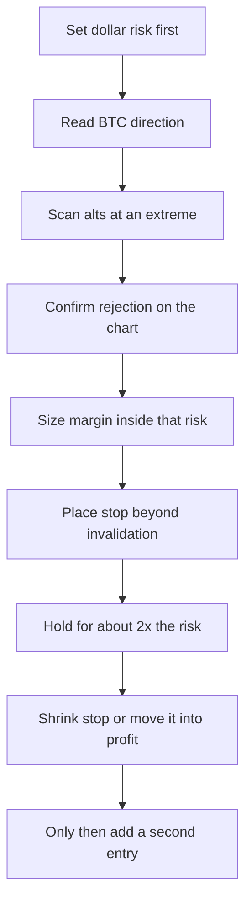

# Walkthrough: Belajar Trading Crypto Futures $10 to $50

**Research overlay — not trading doctrine.** Do not index this page into Qdrant `jarvise_doctrine`. Do not silent-merge it into SQLite or the paper ledger. Do not retune analyzer floors **0.55 / 0.70**, do not change `same_side_hold`, and do not set `JARVISE_LIVE_TRADING=true`. Do not treat this note as a futures execution path. Jarvise stays paper-first spot and forces flat on derivatives. How this series may inform the paper review, and what it must not change, is in [2026-10-14-youtube-notes-vs-jarvise.md](2026-10-14-youtube-notes-vs-jarvise.md).

Compiled **2026-10-14** from YouTube auto-captions (Indonesian) of Prayoga ID’s series. Numbers he states out loud are kept. A few alt tickers are garbled by the captions and are marked as such. Each video opens with an XM broker ad; that ad is not part of the method.

Series: [playlist](https://www.youtube.com/playlist?list=PLurWd9grkKfvPCT_eWUjsYbLsojTbwpgK). Seven episodes, about 13–20 minutes each. Speech dates in the captions run **Thursday 24 Nov 2022 through Monday 12 Dec 2022**. Bitcoin in episode 6 is stuck under about **17,500**, which matches that window.

Claimed futures-wallet path in the series (his on-screen results, not an independent audit):

- Ep 1: $10 funded, no trade
- Ep 2: $10 to $13
- Ep 3: $13 to $21
- Ep 4: $21 to $27
- Ep 5: $27 to $33
- Ep 6: $33 to about $43
- Ep 7: $43 to about $53

He says reaching $50 this way took **seven trades over several weeks**, and that a one-trade $10-to-$50 clip would teach a habit that breaks once the account is larger.

## Episode 1 — capital rules, no entry

[EPS 001](https://www.youtube.com/watch?v=KpcC-0Yocbc) (about 13 min). He treats this episode as foundation only. Entry starts in episode 2.

Prerequisite he points to: earlier videos on Binance signup, deposit and withdrawal, and a “step by step futures from zero” video. This playlist assumes the futures wallet already exists.

Steps he teaches:

1. A survey in his community: **83%** wanted to start from **$10**. He follows that, and refuses a “$10 becomes $100 in one shot” lesson. Reason: that habit survives into a $1,000–$2,000 account and becomes constant margin calls.
2. Preferred professional size, which he does **not** use in this series: **$1,000** wallet, **1%** margin (about **$10**) per order. On $10–$50 he accepts a higher risk, capped at **5–10%** of the wallet.
3. With $10, max margin per order is about **$1**. That leaves roughly **8–9** attempts before the wallet is gone, so each entry has to be mature.
4. **Isolated:** a margin call burns only the margin assigned to that position (his example: $1 isolated, the other $9 stays). **Cross:** a deep loss can consume the whole futures wallet.
5. Isolated weakness, in his words: a **−200%** swing can liquidate the position and then reverse. Cross can survive that swing and also wipe the account. Pick isolated when the whole wallet must not be at risk.
6. Minimum plan: stop and target at **1:2** in dollars. Risk $1, do not take profit before $2. He calls 1:3 too hard for this stage.
7. He shows a $10 futures balance and stops before placing the order.

## Episode 2 — first short, $10 to $13

[EPS 002](https://www.youtube.com/watch?v=ioQ5aD8N8yo) (about 16 min). Entry **Thursday 24 Nov, ~07:15**. Close **Friday ~16:15**. He reports about **+300%** on the position and a wallet of **$13**.

Steps:

1. Read **Bitcoin first**. BTC up: most alts rise, so look for longs on other coins. BTC down: most alts fall, so look for shorts. He will not trade BTC itself on a $10 wallet.
2. That morning BTC opened down, so his bias is further downside. He marks resistance on the left of the TradingView chart with a box, and notes selling already appeared the day before.
3. Scan Binance futures with the **down arrow** (biggest gainers) for a short candidate. If BTC were rising, he would scan the coins that are dumping.
4. Reject **GRT**: support and resistance exist, but price has already fallen a lot. On a small wallet a bounce can wipe the margin before the real drop. He wants the extreme: very high for a short, very low for a long. Mid-range is for larger accounts.
5. Pick **DASHUSDT perpetual**. Price is high, and a resistance on the left has not been met. Target is a modest dip, not a long campaign. On $10, **$1 in and $2 out** is enough; if there is no setup, do not trade.
6. Margin **$1**. He says a small wallet needs **large leverage** or the $1 does not “feel” like a profit, and that a large wallet should use smaller leverage. He never states the leverage multiple.
7. He chooses **Cross** because he is willing to risk the whole $10. Rule of thumb he gives: stop at **100%** of the position margin → use **isolated** (isolated dies around there). Stop **beyond 100%** → use **Cross**.
8. His stop is **150%** of the $1 margin = **$1.50** at risk. Percent is of the **position margin**, not of the $10 wallet.
9. Next day the short is about **+300%**. He maps 300% as **2 × 150%**, so the 1:2 dollar rule is met. Wallet **$13**. Price left the resistance and moved toward support. He says it could fall further; he still closes, because a small wallet can give the profit back. Missing tomorrow’s move is acceptable. The market keeps producing setups.

## Episode 3 — risk only the profit, $13 to $21

[EPS 003](https://www.youtube.com/watch?v=HDv0en4w6LE) (about 18 min). Open **Saturday 26 Nov, ~19:00**. Review **Monday 28 Nov, ~08:30**. Wallet **$13 → $21** (he had hoped for $17).

Steps:

1. Treat the first trades as one bullet. Wait for a clean moment. The **$3** just earned becomes the **only** risk. If it is lost, the original **$10** is still there.
2. BTC’s trend is fading and selling is showing up, while many alts are still green. Bias stays short.
3. **RENUSDT** has already rallied hard. He does not short a rising market on sight. On the small timeframe the same overhead resistance was **tested twice and failed**. Left side of the chart shows a prior sell zone. That double rejection is the entry.
4. First order is again about **10%** of the $13. Stop **200%** of that margin ≈ **$2.87–$3**, placed **above** the two rejection wicks. A break of that high invalidates the short.
5. He later adds two more shorts (he names **CEL** and **DOGE** as the intent). Total risk stays **$3**: REN’s stop is cut to about **100% / $1.36**, and the other two share the rest. Three positions, one risk budget. If all three stop out, the loss is still $3.
6. Monday: the REN short is about **+300%**, another about **+300%**, the third near **+190%**. Open profit about **$8**. He closes two because the book feels messy, and leaves one. He entered REN at the second high; by Monday price had fallen toward the lower area he had in mind.
7. Adding size is allowed only with a **fixed total stop in dollars**. He tells viewers not to copy the three-entry book without that cap.

## Episode 4 — repeat the pattern, $21 to $27

[EPS 004](https://www.youtube.com/watch?v=cKj8_VITqes) (about 13 min). The live entry recording was deleted by mistake, so this episode is a reconstruction. Start **$21**, risk budget **$4**, finish about **$27**. Two stops he cites: about **$1.39** and **$1.33** (about $3 of the $4). Combined profit about **$6**, so 1:2 again. He also says one REN result was about **+300%** and the other about **+200%** (a “$300 and $240” line in the caption is the percent, not dollars).

Steps:

1. Decide the dollar risk **before** the order. A small wallet with no stop is one spike away from a margin call. He shows a pair that ran far above an old resistance and would have wiped ~$20, then returned.
2. Once the loss is pre-accepted, a stop-out is a planned cost, not a crisis.
3. **REN again.** The same two-high pattern from episode 3 reprinted. He treats a repeated pattern as a signal, and calls this shape close to a **double top**. Short about **$1** margin, held **2–3 days**, closed when buyers appeared. If the two-high pattern prints again, the short can be taken again.
4. Second short: **BANDUSDT**, off a candle at the top of a tall rally with a **very long upper wick** (he compares it to a doji / shooting star). That wick is heavy selling. He shorts it and gets about **+200%**, then closes as buyers show up underneath.
5. Operating rule: after the stop distance is chosen, there are only two actions — stop, or take profit at **twice** that loss. Until one of those prices prints, leave the trade alone.
6. He closes both because the market looks ready to bounce. Risk teaching is done for him after episodes 1–4. Episode 5 is for entry technique.

## Episode 5 — pump top and stop-in-profit, $27 to $33

[EPS 005](https://www.youtube.com/watch?v=mQ7CklkdcAU) (about 20 min). Start **$27**. Risk **$3**. The other **$24** is the protected balance. Finish **$33**, then he closes both winners. He thinks the safe path can still need about **another month** to be comfortable at $50.

Two shorts. Captions do not agree on the symbols (heard as APV / ANT / AMT / IPT). Treat the tickers as unreliable. The second one has a spoken entry near **0.2737** and a result around **+500%** on about **$1** of margin. Stops he cites: about **$1.41** and **$1.30**.

Steps:

1. As the wallet grows, **shrink** the dollar risk. More equity is a reason to be calmer, not to press.
2. Any method without a pre-set risk still ends in a margin call. He says even a four-figure wallet can be liquidated with no stop, and that under $100–$1,000 it is easy.
3. First short: daily trend down, rally into an **old resistance**, sellers appear on the lower timeframe. Stop sits **above** that old resistance, because a break can continue higher.
4. Second short is a **pump-and-dump** that round-trips in a few hours. He happened to be watching. Rules for that pattern:
   - Stop is mandatory. These tops are dangerous.
   - Drop to a **lower timeframe** (he uses the 1h chart, then **15m**).
   - If the next candles are still green and still making highs, **close**. The trend is still dangerous.
   - He got a **bearish 15m** candle after 0.2737, so he held. Initial stop about **200%**, above the last high. After the next candles turned down, he **cut the stop to about 100%** of margin (~$1.36).
5. **SL+** (stop in profit), his answer to “can futures trail a stop the way forex does?”: after a short is well in profit, move the stop to a price **below the current price but still on the profit side of entry**. His demo: entry 0.2737, stop moved to **2.300** in the caption’s units (he means the 0.23 area). If that stop fills, the close is still about **+$4**. A stop above entry on a short would lock a loss; the whole point is to place it where a bounce still pays.
6. When every open stop is already a profit, the wallet has **no open loss**. He then allows a **new** risk budget (his example: another $3) for a fresh setup. Combined, the two existing stops in his demo would still leave about **$30** if both filled.
7. Same 1:2 check: risk was $3, open profit was about $6.
8. His five entry ingredients, in order: **candlestick**, **chart pattern**, **indicator**, **stop**, then optional news study. He immediately drops news for crypto. Headlines have often been right while price did the opposite, which he blames on easier price control than in forex. He still uses fundamentals in forex. For crypto in this series he uses **technicals only**.

## Episode 6 — failed reclaim, $33 to ~$43

[EPS 006](https://www.youtube.com/watch?v=d89W9rsRWCg) (about 17 min). Start **$33** on **Wednesday 7 Dec ~13:30**. Review **Thursday 8 Dec ~08:30**. Risk **$5**, so **$27** stays protected. Close about **$43.3** (he says to treat the cents as floating and call it $43). Profit on the book about **$9.8**, just under his $10 / 1:2 target.

Steps:

1. BTC is still heavy. Rallies fail under about **17,500–17,600**, which is the left-side resistance. He fades “BTC is about to pump” talk and looks for another correction.
2. He is late to one pumped coin that is already falling, so he **does not chase**. A small wallet can buy the bounce and stop out.
3. He finds **HOT (Holo)**. Two pushes up, many supports overhead, price at a high. Bollinger Band would also show “high,” but the stop matters more than the band. Crypto can be marked up without a headline.
4. One short, margin about **$2–$2.35**, stop **200%** of that margin = **$5**. Whole risk in one ticket.
5. Next morning HOT is about **+200%**. To keep hunting while the dollar risk stays $5, he **cuts HOT’s stop** (to about $2.3–$2.5) and spends the freed risk on a second short. He is explicit: **do not add a position before the first one is in profit.** Adding while the first trade is still a full-risk loser breaks the budget.
6. Second short (ticker unclear in the caption; he describes the chart, not a clean symbol): price spiked into a **strong left-side resistance** and he shot it with the stop above that high. It failed to hold above and fell. Result he cites around **+300%** and about **$5.4**.
7. HOT entry logic, which he calls the basic one: price **broke below** an old support, rallied back, and **could not reclaim** that old level. Failure to get back above = short under the level. A hold **above** the reclaimed level would have been a long. The red box on that old supply/resistance is the only line he says he needed.
8. He closes near $10 of profit so he can publish, and says HOT could still fall. Scaling plan he offers for later: while small, practice **$1 risk / $2 profit**; as the wallet grows, **$2 / $4**; around **$1,000**, a **1:3** such as **$10 risk / $30 profit** becomes reasonable.
9. He deletes takes when the session has no setup, and only keeps a recording once a moment exists. No moment, no trade.

## Episode 7 — $43 to about $53, series ends

[EPS 007](https://www.youtube.com/watch?v=RyHUi_PRe5M) (about 15 min). Entry **Thursday 8 Dec ~14:00–14:30**, from the **$43.3** left by episode 6. Close **Monday 12 Dec**. About **five days**. **BANDUSDT ~+244%** and **AXSUSDT ~+240%**. He closes the wallet around **$53** and ends the playlist.

Steps:

1. Risk today **$4**, so a full stop still leaves most of the wallet. He wants the decision to feel light: a loss means trade again tomorrow, not a damaged account.
2. BTC daily is **red and opened down**. He calls that “still pressured,” and does not expect a high pump on 8 Dec. The long trigger he describes: after a drop, a **long lower wick**, then the candle **turns green**. That is not present, so he looks for shorts again.
3. **BAND**: Bollinger is already at the **high**. He also reads a **downtrend** in the swing highs and lows (lower highs). Left side has supply. He does not need a perfect tick. He will not short something that is **already plunging**, and he will not short a pump with no rejection. More checks = a stronger entry. Nothing on the chart is certain; the stop is what makes the uncertainty survivable.
4. Margin about **$2.17**. Stop tuned to about **172%** so the dollar loss is **$4**.
5. A commenter who kept losing while “following Bitcoin” is told to collect several methods, test them, and keep the one that fits, then run **money management** on top. A method that is wrong on repeat is the wrong method for that person.
6. Over five days BAND and AXS pay. He had shifted BAND’s stop from $4 of risk down to about **$2**, then used about **$1.93** on **AXS**. Combined risk stays about **$4**.
7. **AXS** (he mixes this up on camera, then corrects it): price could not break a resistance, fell, tried once more, fell again. He shorts under that resistance. A lower support also fails to break, which adds confidence. Bollinger-at-the-high plus that resistance is “enough,” provided the stop exists.
8. After a few hundred percent, keep **walking the stop tighter**. Best case is the stop already sits in profit (the episode 5 SL+).
9. BAND’s downtrend continued toward the lower area he had marked. He closes everything, wallet about **$53**, and says a later series might run **$50 to $100**.

## Knowledge

- Futures wallet vs the margin of one order. Percent stops in this series are **percent of position margin**, not percent of the wallet.
- **Isolated** limits damage to the margin of that position. **Cross** can spend the whole futures balance, which is why he uses it only when the stop is wider than ~100% of margin.
- Bitcoin is the **market switch** for alts: up-bias, look for longs on weak alts; down-bias, look for shorts on extended alts. Do not use BTC itself as the small-account vehicle.
- A small wallet has few attempts (he counts about 8–9 at $1 on a $10 wallet). The first winning trades are there to **fund later risk** so the starting stake can sit untouched.
- Time is unknown. His own path was weeks and seven episodes, including multi-day holds. The title’s $50 is a direction, not a schedule.
- Setups repeat: the REN double-high paid twice. A missed day is not a missed career; he says the market keeps offering moments.
- Crypto headlines are not his trigger. Chart structure is.
- No price level is “sure to reverse.” The stop is the part that makes the idea tradable.

## Technical skills (chart)

- Mark **support and resistance from the left**, with boxes, not only the last candle.
- **Double test** of a high that fails, then short. A clean break of that high is the invalidation, so the stop belongs above it.
- **Double top** and “two peaks then sell” as a repeating pattern.
- **Shooting star / long upper wick / doji-like** candle at the top of a rally = aggressive supply.
- **Failed reclaim:** broke under support, rallied, could not get back above → short. Held above that level → long.
- Multi-timeframe: daily or 1h for the level, **15m** for the rejection candle. If the lower timeframe is still printing higher green candles, stand aside or exit.
- **Bollinger at the high** as a “this is extended” check on BAND and HOT, always with a stop.
- Swing structure: lower highs and lower lows as a downtrend, even if the current price is a bit off the ideal tick.
- Pump-and-dump: locate the top only after a bearish candle, with the stop above the spike.

## Trade skills (account handling)

- Write the **dollar risk before** the order. Examples he actually used: $1.50, $3, $4, $3, $5, $4.
- Protected balance = equity minus that risk ($24 of $27, $27 of $33, and so on).
- Early on, risk **only profits** once they exist. Episode 3 risks the $3 just made, not the original $10.
- **1:2** is the default: $1 risk needs $2 profit before he is willing to close for the plan. Leave the trade until stop or that target.
- **One risk budget across many tickets.** Adding a second or third position requires **cutting** the earlier stop so the sum stays the same.
- Add only **after** the open trade is in profit. Adding while the first position still carries the full loss is the mistake he calls fatal.
- **SL+:** after a large open gain, move the stop onto the profit side of entry so a reversal still pays.
- Close a small account when the planned dollars are in, even if the chart could run further.
- Larger wallet, smaller percent. His north star remains $1,000 with about **1%** per idea. He raises the **ratio** toward 1:3 only after the wallet is large.
- Flat is a position. He discards session recordings that never found a setup.

## Tactics (the repeatable sequence)

1. Note equity. Choose a dollar risk that still leaves the stake you refuse to lose.
2. Judge BTC: daily color, whether it opened down, and whether it is stuck under a left-side high or has put in a long lower wick and turned green.
3. Scan futures leaders. Short the coins that pumped, long the coins that dumped, and only in the BTC direction.
4. Skip anything already in the middle of the move.
5. On TradingView, require at least one of: untouched or twice-rejected resistance, double top, long upper wick, failed reclaim of old support, Bollinger at the high plus a downtrend.
6. Confirm on a lower timeframe that the next candles are no longer pushing the wrong way.
7. Margin stays inside the dollar budget (early episodes: about $1–$2). Isolated if the stop is ~100% of that margin; Cross only if you accept a wider stop and wallet exposure.
8. Place the stop beyond the invalidation (above the high for a short). Convert it to dollars and check it against the budget.
9. Aim to take profit at about twice the dollars at risk, or earlier if the small wallet is already nervous.
10. If you want another symbol, shrink the winner’s stop first so the **sum of stops** is unchanged.
11. Once the stop itself is a profit, you may open a fresh risk budget.
12. If none of the checks are there, do nothing and look again later.

## Boundary

This series is discretionary **Binance USD-M futures**, often short alts, with wide percent stops and high leverage on a tiny wallet. Jarvise, as shipped, is paper-first spot, closed candles, one position per symbol, and it forces flat on derivatives. Nothing in this report turns those videos into a live order path.
