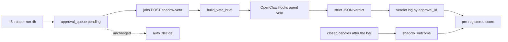

# OpenClaw shadow veto (audit and design, 2026-10-17)

**Research overlay — not trading doctrine.** Do not index this page into Qdrant `jarvise_doctrine`. Do not silent-merge it into SQLite or the paper ledger. Do not retune analyzer floors **0.55 / 0.70**, do not change `same_side_hold`, `flat_exit`, the 1.5× ATR stop, `profit_lock`, or the EV gate, and do not set `JARVISE_LIVE_TRADING=true`.

อ่านเมื่อ **2026-10-17**. Stage 1 เป็นการตรวจอ่านอย่างเดียวกับแบบ ไม่ได้ลงมือทำ ตัวเลขมาจาก `jq` และ `docker inspect` บน VPS, log ของ OpenClaw, การ scroll Qdrant จากคอนเทนเนอร์ jobs, และสำเนาสมุด `data/analytics/jarvise-vps-ledger-ro.db` สมุดบน VPS ไม่ถูกเขียน และ `/opt/jarvise/.env` ไม่ถูกอ่านค่า

เป้าหมาย: ตัดสินว่า OpenClaw ช่วยการตัดสินใจอัตโนมัติได้ทางไหน ถ้าเจ้าของเปิด auto ในภายหลัง และจะพิสูจน์ได้อย่างไรโดยไม่เสี่ยงเงินทุน ข้อมูลก่อน 2026-10-17 ถูกใช้ไปแล้วสำหรับคำถามเรื่องสัญญาณราคา การศึกษา shadow นี้ใช้เฉพาะข้อมูลไปข้างหน้า

## A. สิ่งที่ตรวจพบ

### ความปลอดภัยมาก่อน

- OpenClaw ไม่มีคีย์ตลาดและเข้าถึงสมุดไม่ได้ ชื่อตัวแปรในคอนเทนเนอร์มี `OPENROUTER_API_KEY`, `GEMINI_API_KEY`, `OPENCLAW_GATEWAY_TOKEN`, `QDRANT_URL`, `REDIS_URL` และธง paper-only ไม่มีตัวแปร `BINANCE*` หรือ exchange mount คือ `data/openclaw` แบบเขียนได้, `config/openclaw` อ่านอย่างเดียว, `plugins/jarvise-openclaw` อ่านอย่างเดียว ไม่มี `data/analytics` ดังนั้นข้อความในสกิล `jarvise-order-router` ที่บอกว่าเขียน fill ลง `paper_orders` เป็นข้อความที่ทำไม่ได้จริง
- Redis MCP เป็นทางเขียนเข้าธงเทรด `mcp.servers.jarvise-redis` รัน `@modelcontextprotocol/server-redis redis://redis:6379` Redis มี `jarvise:kill_switch` (=0), `jarvise:paper_auto_decide:enabled` (=1), `jarvise:risk:max_risk_per_trade_pct` (=1.0) เอเจนต์ที่ต่อ MCP นี้ได้สามารถปิด kill switch หรือเปิด auto-decide ได้ ข้อเสนอให้เจ้าของ: ถอดออก หรือเปลี่ยนเป็นเซิร์ฟเวอร์อ่านอย่างเดียว MCP `jarvise-qdrant` ยังล้ม (`-32000 Connection closed`) `auto_decide` ไม่ใช้ MCP นี้ เพราะเรียก Qdrant จาก Python ผ่าน `doctrine_snippets` เส้นทาง tactics จึงไม่พึ่ง MCP นี้
- Jobs API ไม่มีการยืนยันตัวตนบน `jarvise_net` `JARVISE_JOBS_TOKEN` ว่างในคอนเทนเนอร์ jobs และ `GET http://jobs:8090/healthz` จากในคอนเทนเนอร์ OpenClaw ได้ 200 ทุกอย่างบนเครือข่าย compose ส่ง `POST /jobs/paper-run` หรือ `/jobs/paper-auto-decide` ได้ ยังเป็น paper และ live ถูกปิด แต่แบบ shadow ต้องไม่ให้ OpenClaw มีเครื่องมือ HTTP ที่ถึง `jobs:8090` ข้อเสนอให้เจ้าของ: ตั้งโทเค็นและใส่หัวในเวิร์กโฟลว์ n8n
- เส้น hook: `hooks.enabled=true`, `path=/hooks`, `allowedAgentIds=["ingest"]`, `allowRequestSessionKey=false` การเข้าคิวทำงานหลังการตัดปลั๊กอินแล้ว: รันแบบฝังถึง `stream-ready` ใน 12.8 วินาทีเมื่อ 2026-10-17 15:17Z และมีไดเจสต์ `2026-10-17-15.md` คำเตือน `trade-bot` หยุดหลังรีสตาร์ต 15:14Z
- ค่าที่เหลื่อมและคอนฟิกที่ไม่มีคนเรียก: `skills.workshop.autonomous.mode=auto` เจ้าของควรยืนยันว่ามันสร้างสกิลเองโดยไม่มีคนดูไม่ได้ `config/guardrails.policy.json` ไม่มีผู้เรียกใน Python (`load_guardrails_policy` ไม่ถูกเรียกที่ไหน) และระบุ Hyperliquid, Coinbase, Binance TH พร้อมเกต 0.65 และรายชื่อ 4 สินทรัพย์ ซึ่งขัดกับ production (พื้น 0.55, สัญลักษณ์ที่ใช้งาน 7 ตัว) `jarvise-signal-analyzer`, `jarvise-risk-guard`, `jarvise-order-router`, `blackswan` เป็นไฟล์ `SKILL.md` ข้อความล้วน ไม่มีสคริปต์หรือเครื่องมือ env บน VPS มี `JARVISE_ANALYZE_MTF=true` ทั้งที่ `PROJECT_CONTEXT.md` บอกให้ MTF ปิดอยู่, `JARVISE_AUTO_DECIDE_MIN_EV=0`, `MIN_EV_N=8`, `MAX_PER_RUN=4`, โมเดล `anthropic/claude-sonnet-5.5`, live เป็น false บันทึกไว้เท่านั้น ไม่เปลี่ยนค่า

### รูปร่างของรันไทม์

เอเจนต์: `main` (heartbeat), `chief` (systemAgent), `researcher`, `writer`, `reviewer`, `ingest` (`openrouter/openrouter/auto`, workspace `workspace-ingest`) รายชื่อโมเดลที่อนุญาต: `openrouter/openrouter/auto`, `google/gemini-3.1-pro-preview` หน่วยความจำ: `memory-lancedb` ด้วย `text-embedding-3-small` แบบเข้ากันได้กับ OpenAI ผ่าน OpenRouter ไม่มี cron ของ OpenClaw การผูกสกิล: researcher [binance-intel, doctrine-rag], writer [paper-research], reviewer [doctrine-rag], chief [doctrine-rag, paper-research] รายการปลั๊กอิน 43 รายการ ที่เปิดตาม entry: openrouter, google, perplexity, firecrawl, memory-lancedb (อีก 3 ตัวที่ handoff บอกว่าเก็บไว้เป็นค่าเริ่มต้นของชุด)

### วงจร tactics ยังไม่เคยรันบน VPS

- `data/openclaw/exports/tactics/` มีแค่ `README.md` `exports/` มีบันทึกทดสอบ 2 ไฟล์ (2026-09-22, 2026-10-07) Qdrant `jarvise_doctrine` มี 83 จุด = 50 doctrine, 30 notebook, 3 openclaw (สองบันทึกนั้น) ไม่มีอะไรตั้งเวลา: `jarvise paper post-mortem` เป็น CLI อย่างเดียว ไม่มีใน `jobs.py` และไม่มีใน n8n
- `approval_llm_reviews`: 28 แถว (อนุมัติ 12, เลื่อน 16, **ปฏิเสธ 0**, `unparseable` 2) ระหว่าง 2026-10-03 ถึง 2026-10-13 เหตุผลอ้างกฎการเทรดแบบกว้าง ("ไม่ขัดกับกฎการเทรด") ไม่มีแถวไหนอ้างบทเรียนจากไม้ เพราะยังไม่มีบทเรียน
- `post_mortem.py` ค่าเริ่มต้น `losses_only=True` และออกกฎสำเร็จรูปจากเกณฑ์ตายตัว (ระยะจาก EMA20 เกิน 1.5 ATR, RSI เกิน 65, อัตราส่วนวอลุ่มต่ำกว่า 0.8) โดยไม่เทียบกับไม้ที่ชนะ จาก n=10 นี่เป็นสัญญาณรบกวนโดยโครงสร้าง และเอนไปทางไม้แพ้ `outcome_memory` (5 ไม้ล่าสุดต่อสัญลักษณ์) ป้อนสัญญาณตัวอย่างเล็กแบบเดียวกันให้ Claude อยู่ในวันนี้
- **เกตปลดตัวเอง:** `auto_ev_gate_status` บล็อกก็ต่อเมื่อไม้ auto ใน 30 วันมี n ≥ 8 และ EV ต่ำกว่า 0 ไม้ปิด `auto_claude` 10 ไม้ span 2026-10-06 ถึง 2026-10-15 ดังนั้นหลัง **2026-11-06** n ตกต่ำกว่า 8 และ Claude จะอนุมัติอัตโนมัติอีกครั้งโดยไม่มีหลักฐานใหม่ เจ้าของต้องตัดสินก่อนวันนั้น shadow mode สมมติว่าเกตยังปิด หรือเจ้าของยอมรับ fill จริงเป็นผลลัพธ์

### สิ่งที่ตัววิเคราะห์ยังไม่ใช้ (ความลึกของประวัติบนสำเนา ณ 2026-10-17 12:00Z)

- `derivatives_analytics` (funding และ OI รายชั่วโมง): BTC, ETH ตั้งแต่ 2026-09-24 (460 จุดเวลา); BNB, SOL ตั้งแต่ 2026-09-27 (365); ADA, DOGE, XRP ตั้งแต่ 2026-10-08 (78–84) `build_brief` ส่ง funding และ OI ล่าสุดให้ Claude แล้ว ไม่มีอะไรใช้ประวัติหรือเปอร์เซ็นไทล์
- `order_book_microstructure`: BTC, ETH ตั้งแต่ 2026-10-01 (ประมาณ 3.7 พันแถว); BNB, SOL ตั้งแต่ 2026-10-05; ADA, DOGE, XRP ตั้งแต่ 2026-10-16 (ไม่ถึง 2 วัน) `market_safety` ใช้แถวล่าสุดเท่านั้น
- `macro_onchain_sentiment`: ตั้งแต่ 2026-10-01, 3,740 แถว, Fear & Greed มีใน 3,176 แถว ไม่มีปฏิทินเหตุการณ์ที่ไหนใน `src/` (FOMC และ CPI ปรากฏเป็นสตริงธีมของ news-reaction เท่านั้น) ไดเจสต์ 2026-10-17 ระบุ FOMC วันที่ 27–28 ตุลาคม และตัวเลข CPI เดือนกันยายนแล้ว
- การไหลของตัวเลือก: ประมาณ 24 แถวคิวต่อวัน, 4–7 คู่สัญลักษณ์กับทิศทางที่ไม่ซ้ำต่อวัน; 122 จาก 333 แถวเป็นทิศทาง; 219 หมดเวลา, 79 เป็น `same_side_hold` ความมั่นใจของไม้ทิศทางมีแค่ 0.65 หรือ 0.75 ส่วนเบี่ยงเบนมาตรฐานของ PnL ไม้ปิดประมาณ $2.57 (n=18)

### ค่าใช้จ่าย

- วันนี้: Claude ถูกเรียก 28 ครั้งใน 11 วันตอนเกตยังเปิด (ประมาณ 2.5 ครั้งต่อวัน) ประมาณ 3 พันโทเค็นเข้าและ 150 โทเค็นออกต่อครั้ง จึงประมาณ $0.01 ต่อครั้ง หรือประมาณ $0.80 ต่อเดือนที่ราคาลิสต์ของ Sonnet ตอนนี้เป็น $0 เพราะเกตปิด
- ข้อเสนอ: ตัวเลือกทิศทางที่ไม่ซ้ำ 3–6 ตัวต่อวัน จึง 90–180 ครั้งต่อเดือนที่ประมาณ 4–5 พันโทเค็น ประมาณ **$2–4 ต่อเดือน** บน Sonnet 5.5 และประมาณ $0.30 บนโมเดลระดับ Flash เพดาน `MAX_PER_RUN=6` จำกัดกรณีเลวร้ายไว้ใกล้ $20 ต่อเดือน การเข้าคิวของ OpenClaw ไม่เพิ่มค่า API

## B. แบบ

OpenClaw เพิ่มความระวังได้อย่างเดียว มันแนะนำ `veto` หรือ `no_objection` พร้อมเหตุผล และอนุมัติ กำหนดขนาด ส่ง หรือแก้คำสั่งไม่ได้ ไม่มีคีย์ตลาดใน OpenClaw โหมด shadow มาก่อน การต่อเข้า `auto_decide` เกิดหลังผ่านเกณฑ์ที่ลงทะเบียนไว้และหลังเจ้าของตัดสินเท่านั้น

### 1. บทบาท

OpenClaw เพิ่มความระวังได้อย่างเดียว: `verdict` เป็น `veto`, `no_objection`, หรือ `abstain` `reason_category` เป็น `event_risk`, `news_contradiction`, `derivatives_crowding`, `book_health`, `data_stale`, `doctrine_conflict`, หรือ `none` พร้อม `inputs_cited` และ `reason` เป็นภาษาไทยตามสำเนาของเจ้าของ มันอนุมัติ กำหนดขนาด ส่ง หรือแก้คำสั่งไม่ได้ และไม่มีคีย์ตลาด เอเจนต์ veto ไม่มีเครื่องมือ เพราะ brief มีข้อมูลครบในตัว ไม่มี MCP และ `allowedAgentIds` ของ hook เพิ่ม `veto` เท่านั้น ทางเลือกที่เจ้าของเลือกแทนได้: ส่ง brief เดียวกันผ่านการเรียก OpenRouter ตรงจาก Python โดยไม่ผ่าน OpenClaw การให้คะแนนเหมือนกันทั้งสองทาง

### 2. โหมด shadow

`POST /jobs/shadow-veto` รัน 15 นาทีหลัง paper run แต่ละครั้ง ครั้งเดียวต่อ `analysis_id` ที่ไม่ซ้ำ เฉพาะตัวเลือกที่มีทิศทาง ข้ามกรณีกฎ (`same_side_hold`, `flat_exit`) มันไม่แตะ `auto_decide`, fill, หรือคิว

ที่เก็บให้เจ้าของเลือก:

- ตาราง `paper_shadow_verdicts` ใน `jarvise.db` ข้าง `approval_llm_reviews` แนวเดียวกับที่มีอยู่ และ join ได้ง่าย
- ฐาน `data/analytics/shadow-veto.db` แยกต่างหาก
- JSONL

นี่เป็นบันทึกการตัดสินใจ ไม่ใช่ความจริงของตลาด แถวถูกคีย์ด้วย `approval_id` เก็บคำตัดสิน หมวด และรหัสหรือแฮชของอินพุตที่อ้าง ไม่เก็บ OHLCV หรือข้อความไดเจสต์ ไม่มีอะไรใน ingest, ตัววิเคราะห์, หรือ RAG อ่านแถวเหล่านี้ และไม่ถูกทำดัชนีเข้า Qdrant ไดเจสต์ข่าวยังถูกห้ามซิงก์เข้า SQLite หรือ doctrine ตาม `AGENTS.md`

### 3. การให้คะแนนที่ลงทะเบียนก่อนรัน

ผลลัพธ์เป็นข้อมูลไปข้างหน้าเท่านั้น fill จริงบน paper จะบางขณะเกตปิด ดังนั้นตัวเลือกที่ให้คะแนนทุกตัวได้ผลสมมติที่กำหนดได้จากแท่งปิดที่เก็บไว้หลังแท่งของมัน: เข้าที่ราคาปิดของแท่งตัวเลือก, ตรวจ stop ที่ `invalidation_price` ด้วยความหมาย `bar_range_after` ของ PR #179, ออกเมื่อ `analysis_output` ถัดไปเป็น flat หรือฝั่งตรงข้าม, จำกัด 30 แท่ง, ค่าธรรมเนียม 10 bps ต่อขา, slip เป็น `max(5 bps, ครึ่งสเปรด)`, อ้างอิงอิควิตี้คงที่ $10,000 เพื่อไม่ให้การเดินสมุดทีละสัญลักษณ์ขยายตัวเลข ตัวชี้วัดคือค่าเฉลี่ย R สุทธิต่อตัวเลือก EV เป็นดอลลาร์, อัตราชนะ, และ EV ต่อหมวด เป็นรายงานเท่านั้น อัตราชนะไม่ตัดสิน

**ช่องตัดสิน:** หน้าต่างเริ่มที่คำตัดสินแรก จนมีตัวเลือกทิศทางที่ให้คะแนนและมีผลลัพธ์แล้วอย่างน้อย 40 ตัว หรือครบ 60 วัน ขยายได้ครั้งเดียว 30 วัน แล้วหยุด ผ่านก็ต่อเมื่อ `n_no_objection` อย่างน้อย 20, `n_veto` อย่างน้อย 10, ค่าเฉลี่ย R สุทธิของกลุ่ม no objection มากกว่าหรือเท่ากับ 0, ค่าเฉลี่ย R สุทธิของกลุ่ม veto ต่ำกว่ากลุ่ม no objection อย่างน้อย 0.25 R, และอัตรา veto ไม่เกิน 60% prompt, หมวด, และอินพุตถูกแช่แข็งที่ `prompt_version` การเปลี่ยนใดๆ เริ่มนับใหม่ ที่ขนาดนี้ตรวจจับได้เฉพาะช่องว่างใกล้หนึ่งส่วนเบี่ยงเบน ดังนั้นการผ่านหมายถึงไปหน้าต่างยืนยันขนาดเดียวกัน ไม่ได้หมายถึงต่อเข้า `auto_decide` ทันที เว้นแต่เจ้าของตัดสินเป็นอย่างอื่น

### 4. การต่อสาย หลังผ่านและหลังเจ้าของตัดสินเท่านั้น

เพิ่มทางเดียวใน `run_auto_decide` ก่อนเรียก Claude: คำตัดสินใหม่ ( `analysis_id` เดียวกัน อายุน้อยกว่า 1 แท่ง) ที่เป็น `veto` ทำให้ `reject_approval` ด้วย `auto:veto:<category>` คำตัดสินที่หายหรือเก่าให้พฤติกรรมวันนี้ พร้อมธง `veto_unavailable` ใน payload ของรัน พื้น 0.55/0.70, สูตรตัววิเคราะห์, stop 1.5× ATR, `flat_exit`, `same_side_hold`, `profit_lock`, เกต EV, และ universe ไม่เปลี่ยน

### 5. วงจร post-mortem

หยุดซิงก์บันทึกต่อไม้ `generate_post_mortems` ได้ `--min-sample` (ค่าเริ่มต้น 20 ไม้ปิดในถัง) และไม่เขียนอะไรเมื่อต่ำกว่านั้น บันทึกมี `sample_n`, `window`, `generated_at` และ `losses_only` เป็น false เป็นค่าเริ่มต้น `doctrine_snippets` ทิ้ง hit ที่ `kind=openclaw` เมื่อ payload มี `sample_n` ต่ำกว่า 20 บันทึกทดสอบสองไฟล์ไม่ใช่บทเรียนและถูกกันออก คำถามของเจ้าของ ไม่ใช่ของ Stage 1: `outcome_memory` (n=5) ควรอยู่ใน brief ของ Claude ต่อหรือไม่

### 6. โครงสำหรับขั้นถัดไป

ทำให้ Grok 4.7 High ทำ และให้ Claude Sonnet 5.5 ตรวจใน stage B

ไฟล์: `src/jarvise_paper/shadow_veto.py`, `src/jarvise_paper/shadow_outcome.py`, migration ใน `db.py` (คำตัดสินกับผลลัพธ์ หรือ JSONL), จุดใน `jobs.py` พร้อมล็อกเที่ยวเดียวและ 409 เมื่อ kill switch ทำงาน, `infra/n8n/workflows/jarvise-shadow-veto.json` (timeout ต้องไม่ต่ำกว่า timeout ของเอเจนต์ และถูกครอบโดย `tests/test_n8n_workflows.py`), CLI `jarvise paper shadow-veto run|score --json`, ชิป Shadow บนหน้า Decisions เป็นทางเลือก OpenClaw ที่เจ้าของใส่เอง ไม่ให้ deploy ทำอัตโนมัติ: เอเจนต์ `veto` ที่ `identity` เป็นอ็อบเจกต์, ปิดเครื่องมือ, `hooks.allowedAgentIds` เพิ่ม `veto`, สกิล `jarvise-shadow-veto/SKILL.md` พร้อมสัญญา JSON

การทดสอบ: brief ไม่มีความลับและไม่มีฟิลด์ขนาดหรือทิศทางที่จะส่งคำสั่ง, การแปลที่เข้มงวด (อย่างอื่นเป็น `abstain`), ตัวให้คะแนนตรงกับ fill ของ replay `rules` บนหน้าต่าง fixture, ตัวประเมินเกณฑ์ผ่านบนข้อมูลสังเคราะห์, กราฟการเรียกของ `run_auto_decide` ไม่เปลี่ยนในโหมด shadow การย้อนกลับ: ปิดเวิร์กโฟลว์ n8n และเอา `veto` ออกจาก `allowedAgentIds` ตารางคงอยู่
